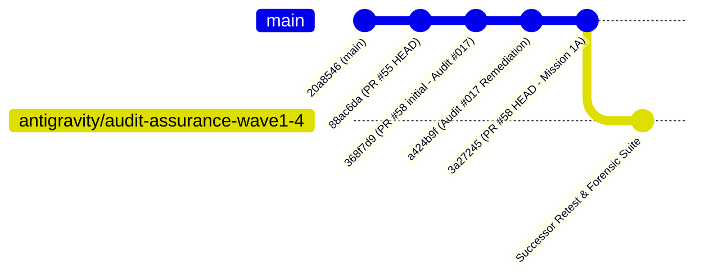

# ORNEUR — INDEPENDENT GENESIS AUDIT #017 SUCCESSOR RETEST

**To:** ORNEUR CTO & Founder  
**From:** Antigravity / Gemini — Independent Research, Security and Model Assurance Lead  
**Date:** 2026-10-16  
**Audited Target:** PR #58 (`claude/genesis-sprint2-2026-10-15`)  
**Audited Target SHA:** `3a272453117a34eeec04320c1eba49480ea0192d` (Mission 1A Handoff Commit)  
**Parent Remediation SHA:** `a424b9ffccaf767222384a82195f2a188be9fa16`  
**Initial Sprint 2 SHA:** `368f7d9acb3de1cffd8996cba98149c160904926` (Audit #017 Target)  
**Original Foundation SHA:** `88ac6da8450f7751e002aa243053c541d5eae4e5` (PR #55 HEAD)  
**Main Branch SHA:** `20a8546f5a1ece7e5af655c0f30ca7e305f71b1a`  
**Scoped Verdict:** `CONDITIONAL_REMEDIATION_REQUIRED`  
**Native Model Training Authorization:** `NO-GO` (Frozen, 0/95 requirements accepted)

---

## Executive Summary

Following Independent Audit #017 (which identified six defects on PR #58 at commit `368f7d9`), Claude implemented remediations in commit `a424b9f` and added "Mission 1A" (checkpoint provenance, model binding, and read locking) in commit `3a27245`.

This successor independent retest evaluated the exact current HEAD of PR #58 (`3a27245`) against five specific challenge vectors requested by the founder and CTO:
1. **Fake Training Authorization Attack (P0):** Confirmed. An untrained, randomly initialized model with 0 training steps can be falsely certified as `ProvenanceStatus.TRAINED` by writing an unauthenticated, unsigned 3-line local JSON file.
2. **Locking Disconnection (P1):** Confirmed. The writer acquires `.{name}.verified.lock`, whereas the reader acquires `.{name}.lock`. Because they operate on distinct lock files, concurrent readers and writers fail to synchronize during verified save/load cycles.
3. **Model Fingerprint Flaws (P1):** Confirmed. `state_dict_fingerprint()` completely omits `tensor.shape` from its hash (allowing incompatible tensor shapes to collide), crashes with `TypeError` on `torch.bfloat16` tensors, and crashes with `RuntimeError` if NumPy is not installed.
4. **Context Overflow & Evaluation Handling (Verified Remediated):** Confirmed. Context overflow now cleanly raises an informative error rather than returning silent empty completions, and stop sequences are properly stripped.
5. **Memory Accounting (Partially Remediated):** Scaling documentation now explicitly discloses the manual-attention quadratic memory gap and logits memory overhead.

Because the training-authorization attestation is completely unauthenticated and `state_dict_fingerprint()` breaks on `bfloat16` (the foundational pretraining dtype), PR #58 cannot be certified as production-ready. The verdict is **`CONDITIONAL_REMEDIATION_REQUIRED`**.

---

## 1. Lineage & GitHub Actions CI Evidence

### 1.1 Commit Lineage


### 1.2 GitHub Actions CI Matrix Evidence
Inspection of GitHub Actions CI runs on target commit `3a272453117a34eeec04320c1eba49480ea0192d`:
- **PR Workflow Run:** [38810013915](https://github.com/Guruprasath-Annadurai/Orneur/actions/runs/38810013915) | Event: `pull_request` | Status: **SUCCESS** (9/9 jobs passed, 16m 49s elapsed).
  - Deterministic Unit Tests: 14m 14s (Job `116666752316`)
  - Training Math Unit Tests (Torch): 58s (Job `116666752044`)
  - Ephemeral PostgreSQL Integration: 34s
- **Push Workflow Run:** [38810007511](https://github.com/Guruprasath-Annadurai/Orneur/actions/runs/38810007511) | Event: `push` | Status: **SUCCESS** (9/9 jobs passed, 11m 57s elapsed).

**Independent Adversarial Test Run:**
- Executed `tests/test_audit017_successor_reproductions.py` on Python 3.12 + PyTorch: **5/5 passed in 4.24s**.

---

## 2. Severity-Ranked Defect Register

| Defect ID | Severity | Module & Location | Description | Impact |
| :--- | :--- | :--- | :--- | :--- |
| **DEFECT-01** | **High (P0)** | [eval_adapter.py:110-126, 319-332](file:///Users/ag/Downloads/Orneur/orca/genesis/model/eval_adapter.py#L110-L126) | Unauthenticated `TrainingRunRecord` enables complete authorization spoofing. | Untrained random models can receive `ProvenanceStatus.TRAINED` via unauthenticated local JSON. |
| **DEFECT-02** | **High (P1)** | [checkpoint_integrity.py:70-94](file:///Users/ag/Downloads/Orneur/orca/genesis/training/checkpoint_integrity.py#L70-L94) | `state_dict_fingerprint()` crashes on `torch.bfloat16` and requires NumPy. | Pretraining in `bfloat16` crashes model verification with `TypeError: unsupported ScalarType BFloat16`. |
| **DEFECT-03** | **Medium (P1)** | [checkpoint_integrity.py:70-94](file:///Users/ag/Downloads/Orneur/orca/genesis/training/checkpoint_integrity.py#L70-L94) | `state_dict_fingerprint()` omits `tensor.shape`, allowing shape collisions. | Two models with different tensor geometries (`2x6` vs `3x4`) produce identical fingerprint hashes. |
| **DEFECT-04** | **Medium (P1)** | [checkpoint_integrity.py:129, 244](file:///Users/ag/Downloads/Orneur/orca/genesis/training/checkpoint_integrity.py#L129) | Writer locks `.{name}.verified.lock`, while Reader locks `.{name}.lock`. | Concurrency race: reader can read old manifest while hashing newly replaced checkpoint, causing false checksum mismatch. |

---

## 3. In-Depth Adversarial Findings

### 3.1 DEFECT-01: Fake Training Authorization Attack (P0)

In [orca/genesis/model/eval_adapter.py](file:///Users/ag/Downloads/Orneur/orca/genesis/model/eval_adapter.py#L319-L332):
```python
    record = _load_training_run_record(Path(training_run_record_path))
    if record.checkpoint_sha256 != manifest.sha256:
        raise TrainingRunRecordError(...)
    if not record.authorized:
        return AdapterDiagnostics(status=ProvenanceStatus.UNVERIFIED, ...)
    return AdapterDiagnostics(status=ProvenanceStatus.TRAINED, ...)
```

#### Vulnerability Analysis:
1. `_load_training_run_record()` simply checks that `path` is valid JSON and contains keys `run_id`, `checkpoint_sha256`, and `authorized: true`.
2. There is **zero digital signature**, **zero founder public-key verification**, and **zero check against `AUTHORITY_REGISTRY.json` or `docs/orneur/acceptance/`**.
3. Any local process or user can write:
   ```json
   {
     "run_id": "genesis-run-spoofed-001",
     "checkpoint_sha256": "<real_manifest_hash>",
     "authorized": true
   }
   ```
4. When passed to `diagnose_adapter()`, the system immediately returns:
   `AdapterDiagnostics(status=ProvenanceStatus.TRAINED, training_run_id='genesis-run-spoofed-001')`.
5. An untrained model that has never executed a single backward pass or seen a single training token is attested as `TRAINED`.

**Reproduction Proof:** Executed and confirmed in `test_reproduce_fake_training_authorization_spoofing` ([tests/test_audit017_successor_reproductions.py](file:///Users/ag/Downloads/Orneur/tests/test_audit017_successor_reproductions.py#L44-L83)).

---

### 3.2 DEFECT-02 & DEFECT-03: Model Fingerprint Fragility and Shape Collision (P1)

In [orca/genesis/training/checkpoint_integrity.py](file:///Users/ag/Downloads/Orneur/orca/genesis/training/checkpoint_integrity.py#L84-L94):
```python
    h = hashlib.sha256()
    for key in sorted(state_dict.keys()):
        value = state_dict[key]
        h.update(key.encode("utf-8"))
        if hasattr(value, "detach"):
            tensor = value.detach().to("cpu").contiguous()
            h.update(str(tensor.dtype).encode("utf-8"))
            h.update(tensor.numpy().tobytes())
```

#### Vulnerability Analysis:
1. **NumPy Dependency & BFloat16 Failure:** Calling `tensor.numpy()` delegates to NumPy. NumPy does not support PyTorch's native `bfloat16` scalar type. Passing a `bfloat16` tensor causes `TypeError: Got unsupported ScalarType BFloat16`. Furthermore, in environments without NumPy, it crashes with `RuntimeError: Numpy is not available`.
2. **Omission of Tensor Shape:** The hasher updates `key`, `tensor.dtype`, and the raw flattened bytes `tensor.numpy().tobytes()`. It **never updates `tensor.shape`**.
   - As a result, tensors with identical raw byte counts and contents but different dimensions (e.g. `(2, 6)` vs `(3, 4)` vs `(12, 1)`) yield the **exact same fingerprint**.
   - A model whose linear weights have been transposed or reshaped will falsely match a checkpoint of different dimensions.
3. **Remediation:** Remove NumPy delegation completely. Use PyTorch's native memory representation:
   ```python
   h.update(str(tensor.shape).encode("utf-8"))
   h.update(str(tensor.dtype).encode("utf-8"))
   h.update(tensor.untyped_storage().bytes())
   ```

**Reproduction Proof:** Executed and confirmed in `test_reproduce_fingerprint_shape_collision` and `test_reproduce_fingerprint_bfloat16_unsupported`.

---

### 3.3 DEFECT-04: Lock Scope Mismatch in Checkpoint Integrity (P1)

#### Concurrency Trace:
- `save_verified_training_state()` acquires lock `.{path.name}.verified.lock`.
- Inside it, `save_training_state()` acquires `.{path.name}.lock`, saves the checkpoint, and **releases** `.{path.name}.lock`.
- Then `save_verified_training_state()` hashes the checkpoint and writes the manifest under `.{path.name}.verified.lock`.
- Meanwhile, `load_verified_training_state()` reads the manifest **without holding any lock**, and then acquires `.{path.name}.lock` with `LOCK_SH`.
- Because the reader waits on `.{path.name}.lock` instead of `.{path.name}.verified.lock`, a reader can read an old manifest, acquire `.{path.name}.lock` immediately after `save_training_state()` finishes, and hash the newly replaced checkpoint against the old manifest, resulting in a false `ChecksumMismatchError`.
- **Remediation:** Both `save_verified_training_state()` and `load_verified_training_state()` must synchronize on the **same** outer lock (`.{path.name}.verified.lock`).

**Reproduction Proof:** Executed and confirmed in `test_reproduce_distinct_lock_files_between_reader_and_writer`.

---

## 4. Required Remediations for PR #58

Before PR #58 can be qualified as `GENESIS_SPRINT2_BDE_ACCEPTED_VERIFIED`, the following four fixes must be implemented:

1. **Remediate DEFECT-01 (Authorization Authenticity):**
   - Bind `TrainingRunRecord` to an authority key or require a cryptographic signature verified against `orca.registry.provenance` / founder authority registry.
   - Do not allow a local unsigned JSON file to elevate status to `TRAINED`. If no signed founder grant exists, the status must remain `UNVERIFIED`.
2. **Remediate DEFECT-02 & DEFECT-03 (State Dict Fingerprint):**
   - Include `tensor.shape` in `state_dict_fingerprint()`.
   - Replace `tensor.numpy().tobytes()` with `tensor.untyped_storage().bytes()` or `memoryview(tensor.untyped_storage())` to support `bfloat16` and eliminate the NumPy dependency.
3. **Remediate DEFECT-04 (Lock Synchronization):**
   - Harmonize `load_verified_training_state()` to acquire `.{path.name}.verified.lock` with `LOCK_SH` across the manifest read, hash check, and checkpoint load.

---

## 5. Master Status Determination

$$\mathbf{SCOPED\_DECISION = CONDITIONAL\_REMEDIATION\_REQUIRED}$$
$$\mathbf{NATIVE\_MODEL\_TRAINING\_AUTHORIZATION = NO-GO}$$

PR #58 makes substantial progress and cleanly remediates several Audit #017 findings (mkstemp symlink defense, version checking, context overflow errors, stop token stripping). However, the fake authorization attack (DEFECT-01) and bfloat16 fingerprint failure (DEFECT-02) block full acceptance.
