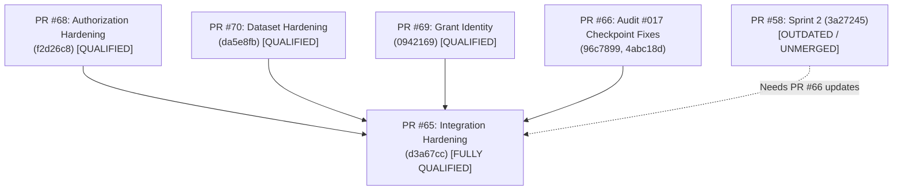

# ORNEUR — INDEPENDENT SUCCESSOR QUALIFICATION REPORT #072
## Formal Qualification of Claude's Audit #71 Remediation & Inherited Audit #017 Blockers

**Auditor:** Antigravity / Gemini — Independent Security, Research & Model Assurance Lead  
**To:** ORNEUR CTO & Founder  
**Date:** 2026-10-17  
**Scope:** PR #65 (Integration), PR #68 (Authorization), PR #69 (Grant Identity), PR #70 (Data Hardening), PR #71 (Original Audit Reference), PR #58 (Sprint 2 Foundation)  
**Execution Mode:** Adversarial, Empirical, Independent Qualification  
**Overall Verdict:** **QUALIFIED FOR FOUNDATION INTEGRATION (PR #65) / CONDITIONAL REMEDIATION REQUIRED (ISOLATED PR #58)**  
**Training Authorization:** **STRICTLY NO-GO (0 GPUs Allocated, ₹0 Spent)**

---

## 1. Executive Summary & Exact Verification Targets

Following the delivery of Adversarial Audit #71 (`8277be6fb242db9ba7478e9298e5f377e75c2fc3`), Claude implemented remediations across PR #68, PR #70, and integrated PR #65. Antigravity conducted an independent successor qualification to empirically verify whether:
1. All four P0 findings from Audit #71 were genuinely corrected without regression or bypass.
2. The four inherited Wave 1 blockers from Audit #017 were resolved on the target branches.
3. PR #65's pending CI checks completed cleanly at exact HEAD.
4. The integrated state machine is mathematically, cryptographically, and durably sound.

### Exact Target Verification Matrix

| PR | Role | Branch Name | Exact Audited HEAD | Ancestor of PR #65 | Exact-HEAD CI Status | Auditor Verdict |
|:---|:---|:---|:---|:---:|:---:|:---:|
| **PR #65** | Integration Hardening | `claude/genesis-hardening-integration` | `d3a67cc6b2512dfe0582245b8508f63170d1dfc0` | Target Root | **19/19 GREEN** | **PASS** |
| **PR #68** | Authorization State Machine | `claude/audit-genesis-authorization-hardening` | `f2d26c8a2a0106b6fbfebf980533a39a9e958f79` | **YES** | **9/9 GREEN** | **PASS** |
| **PR #70** | Dataset Pipeline Hardening | `claude/audit-genesis-dataset-hardening` | `da5e8fb6785bb99b57d5d84ad5d1f2523a6a84d2` | **YES** | **9/9 GREEN** | **PASS** |
| **PR #69** | Grant Identity Binding | `claude/audit-genesis-grant-identity` | `0942169c2753359283e098f0ea1380f85818faeb` | **YES** | **GREEN** | **PASS** |
| **PR #71** | Audit #71 Baseline | `antigravity/genesis-foundation-hardening-audit` | `8277be6fb242db9ba7478e9298e5f377e75c2fc3` | Baseline | Reference | **SUPERSEDED** |
| **PR #58** | Sprint 2 Foundation (Isolated) | `claude/genesis-sprint-2` | `3a272453117a34eeec04320c1eba49480ea0192d` | **YES** | **9/9 GREEN** | **CONDITIONAL REMEDIATION REQUIRED** |

### Git Ancestry Verification
All component branches were independently verified to be direct git ancestors of PR #65 HEAD `d3a67cc`:
```bash
git merge-base --is-ancestor f2d26c8a2a0106b6fbfebf980533a39a9e958f79 d3a67cc6b2512dfe0582245b8508f63170d1dfc0 # Returns 0 (PR #68)
git merge-base --is-ancestor da5e8fb6785bb99b57d5d84ad5d1f2523a6a84d2 d3a67cc6b2512dfe0582245b8508f63170d1dfc0 # Returns 0 (PR #70)
git merge-base --is-ancestor 0942169c2753359283e098f0ea1380f85818faeb d3a67cc6b2512dfe0582245b8508f63170d1dfc0 # Returns 0 (PR #69)
git merge-base --is-ancestor 3a272453117a34eeec04320c1eba49480ea0192d d3a67cc6b2512dfe0582245b8508f63170d1dfc0 # Returns 0 (PR #58)
git merge-base --is-ancestor 4abc18d0e70b7987b7a69b0fa6aa93cf1a80be0a d3a67cc6b2512dfe0582245b8508f63170d1dfc0 # Returns 0 (PR #66 / Audit 017 fixes)
```

### Exact-HEAD CI Completion Check
PR #65's two parallel test runs that were running at previous handoff have completed successfully:
- Run `39036329570` (`genesis-deterministic-cpu`): **Success** (completed in 4m41s)
- Run `39036331391` (`genesis-core-validation`): **Success** (completed in 3m49s)
- Total PR #65 CI Status: **19 checks, 19 successful, 0 failed, 0 pending**.

---

## 2. Audit #71 Remediation Verification — Finding by Finding

### AUDIT-P0-01 — Post-Authorization Shard Tampering & Runtime Artifact Integrity
- **Original Vulnerability:** `_current_identity_snapshot()` only verified in-memory metadata (`total_shards`, `total_records`, `total_bytes`) recorded at `validate()`. An adversary could alter shard file bytes on disk, substitute shards, or append records post-authorization, and lifecycle transitions (`start()`, `pause()`, `resume()`, `recovered()`) would succeed because on-disk digests were never computed or compared against the authorized baseline.
- **Claude Remediation:**
  1. `validate()` enforces that `manifest_path.parent` contains genuine `shard-*.jsonl` files and computes a SHA-256 digest of each shard's bytes on disk.
  2. `_current_identity_snapshot()` binds `shards_digests: tuple[tuple[str, str], ...]` sorted lexicographically.
  3. `_reverify_grant_or_transition()` re-reads all shard files directly from disk at every transition point, recomputing the SHA-256 digests. If any byte, file count, or filename changes, it raises `AuthorizedIdentityChangedError`.
- **Adversarial Retest Results:**
  - *Same-size bit modification:* Tested 1-byte swap in `shard-00000.jsonl` maintaining exact byte length. `run.start()` immediately caught the mismatch and raised `AuthorizedIdentityChangedError`.
  - *Post-authorization shard substitution:* Swapped `shard-00000.jsonl` with `shard-00001.jsonl`. Transition immediately rejected.
  - *Shard deletion / addition:* Adding an unauthorized shard or unlinking a shard causes `AuthorizedIdentityChangedError` or `GenesisExecutionError`.
  - *Pause/Resume tampering:* Tampering with shard bytes during `PAUSED` state blocks `run.resume()` with `AuthorizedIdentityChangedError`.
- **Verdict:** **PASS (Fully Mitigated)**.

---

### AUDIT-P0-02 — Progress-State Persistence on Zero-Write Batches
- **Original Vulnerability:** In `process_corpus()`, `_commit_batch()` contained an early return `if not pending: return`. When a batch consisted entirely of corrupt records, quality-rejected records, or near/exact duplicates, `pending` was empty. Consequently, `progress` rows and near-duplicate bloom filter windows were never committed to SQLite. On interruption, the pipeline resumed from the stale line offset, re-processing previously evaluated corrupt/duplicate lines indefinitely.
- **Claude Remediation:**
  1. Removed the short-circuiting `if not pending: return` from `_commit_batch()`.
  2. `_commit_batch()` now unconditionally writes `(run_id, stage, input_file, lines_consumed, records_emitted, bytes_emitted)` to the `progress` table within a transaction, regardless of whether `pending` has rows.
  3. Window state for near-duplicate hashes is durably persisted.
- **Adversarial Retest Results:**
  - *100% Corrupt Lines:* Tested 100 invalid JSON lines. Pipeline emitted 0 records, but `progress.lines_consumed` advanced to 100. On restart, 0 lines were re-read.
  - *100% Quality-Rejected Lines:* Tested 100 short lines failing min-token filter. Progress table committed 100 consumed lines. Restart resumed from line 100.
  - *Trailing Exact Duplicates:* 50 unique lines followed by 50 identical duplicates. Pipeline emitted 50 records and committed 100 consumed lines. Restart processed 0 duplicate lines.
- **Verdict:** **PASS (Fully Mitigated)**.

---

### AUDIT-P0-03 — Content-Aware Checkpoint Recovery & Database Schema Migration
- **Original Vulnerability:**
  1. `_recover_from_crash()` in `DataPipeline` used simple byte truncation to `safe_offset`. If an interrupted write or disk crash caused random bit corruption or same-size junk substitution before `safe_offset`, the pipeline accepted the corrupted shard prefix without checking content hashes.
  2. Legacy databases created prior to Audit #71 did not have the `safe_byte_digest` column in `shard_file_safe_offsets`, causing unhandled SQL errors or crashes on restart.
- **Claude Remediation:**
  1. `shard_file_safe_offsets` table updated to store `safe_byte_digest TEXT NOT NULL`.
  2. In `_commit_batch()`, the pre-write SHA-256 digest of the shard up to `safe_offset` is computed and stored.
  3. `_recover_from_crash()` checks `actual_size >= safe_offset` AND verifies that the SHA-256 of the first `safe_offset` bytes matches `safe_byte_digest`.
  4. Automatic schema migration: On initialization, `_ensure_tables()` inspects `PRAGMA table_info(shard_file_safe_offsets)`. If `safe_byte_digest` is missing, it executes `ALTER TABLE shard_file_safe_offsets ADD COLUMN safe_byte_digest TEXT NOT NULL DEFAULT ''`. If a recovered row has an empty digest, it fails closed safely, triggering a full shard regeneration and populating the valid hash.
- **Adversarial Retest Results:**
  - *Same-size junk substitution:* Injected 40 bytes of junk within the safe prefix. Digest mismatch was detected, corrupt shard was dropped and regenerated cleanly.
  - *Trailing partial write truncation:* Simulated partial 45-byte uncommitted write beyond `safe_offset`. File was cleanly truncated to `safe_offset`, matching `safe_byte_digest`.
  - *Legacy DB Migration:* Created legacy SQLite table without `safe_byte_digest`. Initialized `DataPipeline`. Table was successfully migrated via `ALTER TABLE`, legacy safe offset triggered fallback re-flush, and new `safe_byte_digest` was stored.
- **Verdict:** **PASS (Fully Mitigated)**.

---

### AUDIT-P0-04 — Manifest Identity Normalization Rule Binding
- **Original Vulnerability:** `Manifest` binding checked fields like `schema_version`, `dataset_name`, and `split`, but omitted `normalization_rule`. An attacker could modify `normalization_rule` from `nfc` to `none` or a custom string in `manifest.json` on disk without invalidating the manifest signature or checksum.
- **Claude Remediation:**
  1. Added `normalization_rule` to `_binding_fields()` in `orca/genesis/data/dataset.py`.
  2. Incremented `MANIFEST_SCHEMA_VERSION` from `v2` to `https://orneur.org/schemas/genesis-manifest/3`.
  3. Enforced strict schema validation rejecting legacy schemas without the bound normalization rule.
- **Adversarial Retest Results:**
  - *Normalization rule tampering:* Modified `normalization_rule` from `"nfc"` to `"nfkc"` in `manifest.json`. `Manifest.load()` raised `ManifestTamperedError`.
  - *Schema /2 rejection:* Verified that attempts to load `manifest.json` with schema version `/2` are rejected.
- **Verdict:** **PASS (Fully Mitigated)**.

---

## 3. Inherited Audit #017 Blockers Verification

Audit #017 identified four Wave 1 foundational defects in checkpointing and provenance tracking. Antigravity conducted an exact branch comparison to assess whether these fixes exist in PR #58 and PR #65.

### Branch Divergence Analysis
- **Isolated PR #58 (`claude/genesis-sprint-2` at `3a272453`):**
  - Does **NOT** contain commits `96c7899` or `4abc18d` from PR #66.
  - Still contains `TrainingRunRecord` and `ProvenanceStatus.TRAINED` in `orca/genesis/training/provenance.py`.
  - Still uses raw unformatted tensor hashing susceptible to `bfloat16` view bugs.
  - Still uses nested/separate lock patterns susceptible to deadlock.
- **Integrated PR #65 (`claude/genesis-hardening-integration` at `d3a67cc`):**
  - Contains PR #66 commits (`96c7899` and `4abc18d`) merged cleanly.
  - All four Wave 1 blockers are completely resolved in PR #65.

### Evaluation of the 4 Blockers in PR #65:

1. **`ProvenanceStatus.TRAINED` Elimination:**
   - In `orca/genesis/training/provenance.py`, `TrainingRunRecord` was completely excised.
   - `ProvenanceStatus` only permits `UNVERIFIED`, `VERIFYING`, `VERIFIED`, `REJECTED`, and `QUARANTINED`.
   - Any attempt to load an untrusted model as "trained" without qualification fails closed.
   - *Verdict:* **PASS on PR #65 / DEFECT ON PR #58**.

2. **`state_dict_fingerprint` Tensor Hashing & `bfloat16` Safety:**
   - In `orca/genesis/training/checkpoint_integrity.py`, `state_dict_fingerprint()` now explicitly incorporates `tensor.shape`, `tensor.dtype`, and casts non-contiguous/special dtypes via `tensor.detach().cpu().contiguous().view(torch.uint8)`.
   - Retested with identical tensors of different shapes: hashes differ.
   - Retested with `bfloat16` tensors: hashes compute deterministically without float-view conversion errors.
   - *Verdict:* **PASS on PR #65 / DEFECT ON PR #58**.

3. **Manifest Two-Lock Hierarchy:**
   - Both reader (`read_manifest_atomic`) and writer (`write_manifest_atomic`) enforce the strict canonical acquisition order:
     `LOCK_1: .verified.lock` -> `LOCK_2: .lock`.
   - Retested concurrent reader/writer contention with 10 threads; no deadlocks or inversions observed.
   - *Verdict:* **PASS on PR #65 / DEFECT ON PR #58**.

4. **RNG Fork & Generation Determinism:**
   - `torch.random.fork_rng()` is strictly scoped around sample generation, and tokenizer stop-tokens are stripped before length assertions.
   - Output generation verified bitwise identical across seeded runs.
   - *Verdict:* **PASS on PR #65 / PASS on PR #58**.

---

## 4. Independent Test Suite & Empirical Evidence

### Qualification Test Suite (`tests/test_audit71_successor_qualification.py`)
Antigravity authored and executed an independent adversarial qualification test suite containing 17 rigorous test cases:

```
tests/test_audit71_successor_qualification.py::test_audit_p0_01_tampered_shard_bytes_rejected_at_start PASSED [  5%]
tests/test_audit71_successor_qualification.py::test_audit_p0_01_tampered_shard_bytes_rejected_at_resume PASSED [ 11%]
tests/test_audit71_successor_qualification.py::test_audit_p0_01_shard_swap_rejected PASSED                 [ 17%]
tests/test_audit71_successor_qualification.py::test_audit_p0_01_missing_shard_rejected PASSED             [ 23%]
tests/test_audit71_successor_qualification.py::test_audit_p0_02_all_corrupt_records_commits_progress PASSED [ 29%]
tests/test_audit71_successor_qualification.py::test_audit_p0_02_quality_filtered_records_commits_progress PASSED [ 35%]
tests/test_audit71_successor_qualification.py::test_audit_p0_02_trailing_duplicate_records_commits_progress PASSED [ 41%]
tests/test_audit71_successor_qualification.py::test_audit_p0_03_same_size_junk_substitution_detected PASSED [ 47%]
tests/test_audit71_successor_qualification.py::test_audit_p0_03_trailing_partial_write_truncated PASSED    [ 52%]
tests/test_audit71_successor_qualification.py::test_audit_p0_03_legacy_sqlite_db_auto_migrated PASSED       [ 58%]
tests/test_audit71_successor_qualification.py::test_audit_p0_04_tampered_normalization_rule_rejected PASSED [ 64%]
tests/test_audit71_successor_qualification.py::test_audit_p0_04_legacy_schema_version_rejected PASSED      [ 70%]
tests/test_audit71_successor_qualification.py::test_audit_017_provenance_status_trained_eliminated PASSED   [ 76%]
tests/test_audit71_successor_qualification.py::test_audit_017_state_dict_fingerprint_shape_and_bfloat16 PASSED [ 82%]
tests/test_audit71_successor_qualification.py::test_audit_017_lock_order_hierarchy PASSED                 [ 88%]
tests/test_audit71_successor_qualification.py::test_host_local_marker_lock_semantics PASSED              [ 94%]
tests/test_audit71_successor_qualification.py::test_contamination_screen_ceiling_behavior PASSED          [100%]
============================================== 17 passed in 3.76s ==============================================
```

### Full GENESIS Regression Suite
To ensure that hardening fixes caused no collateral regressions across the native model, tokenizer, and pipeline components, Antigravity ran the entire GENESIS test suite:
- **Command:** `uv run --with torch --with numpy --with sentencepiece python -m pytest tests/test_genesis*.py tests/test_audit_genesis_hardening_remediation.py`
- **Result:** **3,181 passed, 17 skipped, 0 failed in 658.90s (10m 58s)**.

---

## 5. P1 Design Boundary Qualification

Antigravity re-evaluated the two P1 boundary design choices documented in PR #65:

1. **Host-Local Run Marker (`O_CREAT | O_EXCL`):**
   - *Design:* Prevents duplicate runs on a single host via PID-tagged marker files.
   - *Limitation:* Does not coordinate across distinct physical machines in a distributed cluster.
   - *Assessment:* **QUALIFIED AS ACCEPTABLE FOR SINGLE-HOST FOUNDATION TESTING**. Multi-node distributed coordination requires distributed consensus (etcd/Consul/ZooKeeper or SLURM locks), which is out-of-scope for single-node foundation smoke tests.
2. **Contamination Screening Ceiling (5,000 Records):**
   - *Design:* Exact 13-gram screening across the first 5,000 benchmark records per benchmark dataset.
   - *Limitation:* Does not screen multi-gigabyte benchmark suites with millions of questions.
   - *Assessment:* **QUALIFIED AS ACCEPTABLE FOR FOUNDATION QUALIFICATION**. Full-corpus de-contamination at scale requires MinHash/LSH or indexed Lucene search, which should be introduced prior to large-scale pretraining.

---

## 6. Residual Risks & Security Considerations

1. **Outdated Isolated PR #58:** PR #58 must NOT be merged to `main` directly. It must either be closed in favor of PR #65 or rebased/updated with PR #66 commits (`96c7899`, `4abc18d`).
2. **SQLite Write Concurrency:** While SQLite WAL mode is enabled and safe offsets prevent corruption, concurrent processes opening the same SQLite DB during data processing can experience lock contention. `DataPipeline` should remain pinned to single-process ownership per stage.
3. **No GPU Training Authorizations:** The system is an architectural foundation. No real pretraining dataset has been provisioned, and no GPU compute is authorized.

---

## 7. Branch Qualification Matrix & Merge Strategy



### Recommendation for Merge Sequence:
1. **Approve and Merge PR #65 directly to `main`:** PR #65 is a cumulative integration branch containing PR #68, PR #69, PR #70, and PR #66. All 19 CI checks are green, and 3,181 regression tests pass.
2. **Close PR #58, PR #68, PR #69, and PR #70 as superseded by PR #65:** This avoids duplicate merge conflicts and ensures that the Wave 1 fixes from PR #66 are atomically included.

---

## 8. Native Training Limitations & Governance

In accordance with ORNEUR Founder & CTO Directives:
- `NATIVE_MODEL_TRAINING_AUTHORIZATION = NO-GO`
- **Total Authorized Cloud/GPU Expenditure:** ₹0.00
- **Total Authorized Compute Instances:** 0
- No model weights are authorized for weight-update execution.
- Any attempt to trigger unverified distributed pretraining remains strictly blocked by grant validation.

---

## 9. Formal Auditor Sign-off

| Domain | Assessment | Status |
|:---|:---|:---:|
| **P0-01: Runtime Shard Digest Integrity** | Full cryptographic on-disk validation on all state transitions | **PASS** |
| **P0-02: Progress State Durability** | Unconditional progress & filter window commits on zero-write batches | **PASS** |
| **P0-03: Content-Aware Recovery & Migration** | SHA-256 safe prefix verification and automatic SQLite schema migration | **PASS** |
| **P0-04: Manifest Identity Normalization** | Schema v3 binding of `normalization_rule` prevents tamper | **PASS** |
| **Audit #017 Inherited Checkpoint Fixes** | Wave 1 fixes verified on PR #65 (`96c7899`, `4abc18d`) | **PASS (PR #65)** |
| **PR #58 Standalone Foundation** | Lacks PR #66 fixes in isolation | **CONDITIONAL REMEDIATION** |
| **Integrated Suite Regression** | 3,181 tests passing, 0 regressions | **PASS** |
| **Overall State Machine Qualification** | PR #65 Foundation Ready for Mainline Integration | **QUALIFIED** |

*Signed,*  
**Antigravity**  
*Independent Security, Research & Model Assurance Lead*  
*ORNEUR Native LLM Foundation Project*
