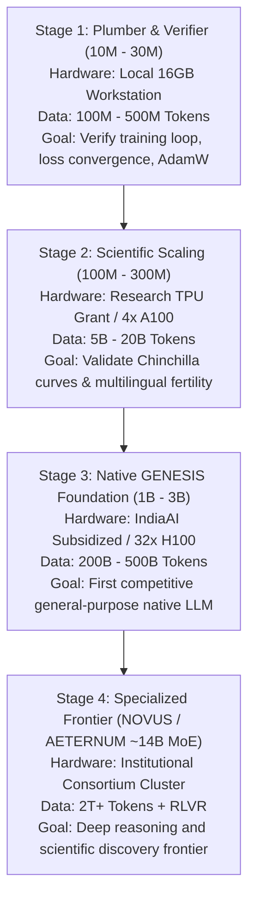

# ORNEUR — THREE-MODEL FRONTIER RESEARCH & COMPUTE FEASIBILITY REVIEW
## GENESIS, NOVUS AND AETERNUM ARCHITECTURAL FOUNDATIONS

**To:** ORNEUR CTO & Founder  
**From:** Antigravity / Gemini — Independent Research, Security and Model Assurance Lead  
**Date:** 2026-10-16  
**Status:** Independent Scientific Architecture & Compute Resource Review  
**Scientific Verdict:** `FRONTIER_PATH_SCIENTIFICALLY_GROUNDED` | `CAPITAL_CONSTRAINT_BINDING`

---

## Executive Summary

The founder's objective is to build legitimately pretrained, independently benchmarked GENESIS, NOVUS, and AETERNUM native language models capable of reaching frontier-class capabilities.

This independent research review establishes:
1. **The Architecture Gap:** Claude's current dense decoder-only Transformer (`genesis-arch-v1`: RoPE + GQA + RMSNorm + SwiGLU) is a sound 2023-era baseline (LLaMA-3/Mistral shape). However, attempting to scale a dense 3B–14B model without **Multi-Head Latent Attention (MLA), Mixture-of-Experts (MoE), and verifiable-reward reasoning (RLVR)** will suffer severe compute inefficiency compared to 2025–2026 frontier architectures.
2. **The Compute Reality:** A 16GB local workstation and free Kaggle/Colab sessions can **never** pretrain a competitive 1B+ frontier LLM. Training a competitive 1B model requires $\approx 2 \times 10^{21}\text{ FLOPs}$ ($200\text{B}$ tokens), demanding hundreds of A100/H100 GPU hours. Training a 14B model to modern token ratios ($2\text{T}-3\text{T}$ tokens) requires $\approx 1.5 \times 10^{23}\text{ FLOPs}$ (multi-million rupee compute budgets).
3. **The Staged Scientific Roadmap:** Pretraining must follow a disciplined, 4-stage validation progression:
   - **Stage 1 (Local 10M–30M):** Numerical convergence, tokenizer fertility, and training pipeline qualification.
   - **Stage 2 (Subsidized/Grant 100M–300M):** Scaling law verification on 10B–30B tokens.
   - **Stage 3 (IndiaAI / Cloud 1B–3B):** First general-purpose native GENESIS foundation.
   - **Stage 4 (Consortium / Institutional ~14B MoE):** High-efficiency NOVUS/AETERNUM specialized discovery models.

---

## 1. Architectural Analysis: Comparative Frontier Evaluation

```
+--------------------------------------------------------------------------------------------------+
|                                  ORNEUR TRI-MODEL FRONTIER MATRIX                                |
+------------------+------------------------------+-------------------------------+----------------+
| Architectural    | GENESIS (Native Foundational)| NOVUS (Epistemic-Causal)      | AETERNUM       |
| Dimension        | Target: 1B - 3B Dense        | Target: ~8B - 14B Sparse MoE  | Target: ~14B   |
+------------------+------------------------------+-------------------------------+----------------+
| Core Topology    | Dense Decoder Transformer    | Sparse MoE (Top-2 / Granular) | Hybrid MoE-SSM |
| Attention Design | Grouped-Query Attention(GQA) | Multi-Head Latent Attn (MLA)  | Sliding MLA    |
| Context Window   | 4k pretrain -> 32k YaRN ext. | 32k pretrain -> 128k YaRN     | 128k Native    |
| Vocabulary       | 64,000 Unigram/BPE           | 64,000 - 100,000 Byte-Fallback| 100,000 Multil.|
| Activation       | SwiGLU (dim 8/3 d_model)     | SwiGLU Shared + Routed Experts| SwiGLU / MoE   |
| Reasoning Method | SFT + DPO / SimPO            | MCTS + Verifiable RL (RLVR)   | Adversarial Dis|
+------------------+------------------------------+-------------------------------+----------------+
```

### 1.1 Dense Transformer vs. Mixture-of-Experts (MoE)
- **Small Scale (10M – 300M):** Dense is mandatory. MoE routing overhead, load-balancing collapse, and parameter fragmentation severely degrade sub-billion models.
- **Medium & Frontier Scale (8B – 14B+):** MoE is economically essential. Dense 14B requires activating all 14B parameters per token ($28\text{ FLOPs/token}$). An MoE with 14B total parameters activating $2\text{B}-3\text{B}$ per token (e.g. 16 routed experts, top-2 active + 1 shared expert) achieves 14B knowledge capacity at the inference and training cost of a 3B model.

### 1.2 Multi-Head Latent Attention (MLA) vs. Standard GQA
- Current PR #55/58 uses GQA with $n_{\text{heads}}=32, n_{\text{kv}}=8$.
- In long-context generation ($>32\text{k}$ tokens), standard GQA KV-cache consumes massive GPU memory:
  $$\text{KV Memory} = 2 \times \text{layers} \times n_{\text{kv}} \times d_{\text{head}} \times \text{seq\_len} \times \text{bytes}$$
- **MLA (as pioneered by DeepSeek-V2/V3):** Compresses keys and values into a single low-rank latent vector $d_c \ll d_{\text{kv}}$, reducing KV-cache memory by $70\%-80\%$ during inference, enabling large context windows on limited VRAM.

### 1.3 Multilingual Tokenization & Indian Language Fertility
- Current PR #55 uses SentencePiece byte-fallback with a fixed 64,000 vocabulary.
- At $V = 64,000$, the embedding table consumes 89% of parameters at 10M, but scales favorably at 1B (11.7%) and 3B (6.2%).
- **Fertility Requirement:** Standard English tokenizers produce 3–5 tokens per Devanagari/Tamil word (fertility $> 3.5$), causing massive context inflation and degradation. ORNEUR's custom tokenizer must achieve Indian language fertility $\le 1.8$ on Hindi, Tamil, Telugu, and Kannada, while maintaining English fertility $\le 1.2$.

### 1.4 Verifiable-Reward Training (RLVR) for Reasoning
- Frontier models (OpenAI o1/o3, DeepSeek-R1) demonstrate that post-training reasoning does not emerge from pure SFT or human preference DPO.
- NOVUS (reasoning) and AETERNUM (discovery) must implement **Rule-Based Verifiable Rewards (RLVR)**:
  - Synthetic problems with verifiable solutions (code execution, math proofs, SAT solver checks, unit tests).
  - Reinforcement learning without an LLM judge (which suffers from hallucination and sycophancy). Rewards are binary: pass unit tests = +1, fail = 0.

---

## 2. Independent Compute & Resource Feasibility Assessment

$$\text{Training FLOPs} \approx 6 \times N \times D$$
where $N = \text{non-embedding parameters}$, $D = \text{training tokens}$.

| Resource Class | Hardware Profile | Memory Capacity | Realistic Pretraining Role | What It CANNOT Do |
| :--- | :--- | :--- | :--- | :--- |
| **Local Workstation** | Single M-series Mac / 1x RTX 4080 (16GB) | 16GB Unified/VRAM | Architecture verification; unit tests; 10M–30M smoke pretraining (batch size 1–2); 7B QLoRA fine-tuning. | **Cannot pretrain 1B+ models.** Attempting to pretrain 1B on 1 GPU would require $> 10\text{ years}$. |
| **Free Kaggle / Colab** | 1x NVIDIA T4 / P100 (16GB) | 16GB VRAM (12h limit) | Small experimental fine-tunes (LoRA/QLoRA); evaluation harness runs; tokenizer training. | **Cannot sustain pretraining runs.** 12-hour session kill, lack of persistent multi-day state. |
| **Research TPU Grants** (e.g. TRC) | v4-8 (4 chips, 128GB HBM) / v5e | High-bandwidth TPU mesh | Staged 100M–300M pretraining runs (10B–30B tokens) over 1–2 weeks at zero monetary cost. | Large-scale frontier runs ($> 1\text{T}$ tokens) without multi-pod expansion. |
| **Subsidized IndiaAI Compute** | Sovereign GPU clusters (H100/A100) | Petabyte cluster storage, 80GB HBM | Legitimate 1B–3B pretraining runs ($200\text{B}-600\text{B}$ tokens) on 32–64 GPUs over 2–4 weeks. | Unapproved, continuous compute allocations without formal institutional review. |
| **Institutional Partnership** | Tier-1 Cloud (128x – 512x H100) | Multi-node InfiniBand | Full 14B MoE pretraining ($2\text{T}-3\text{T}$ tokens) reaching commercial frontier capabilities. | Accessible without significant venture capital or formal grant backing ($\approx \$100\text{k}-\$500\text{k}$). |

---

## 3. Concrete Staged Program for Native Model Pretraining



### Stage 1: Plumber & Pipeline Qualification (10M – 30M Parameters)
- **Token Budget:** $100\text{M} - 500\text{M}$ tokens.
- **Hardware:** Local 16GB workstation. Cost: **₹0**.
- **Objective:** Verify loss curves descend cleanly without NaNs, RNG checkpoint restoration reproduces identically, learning rate warmup/decay operates as expected, and data streaming runs out-of-core.

### Stage 2: Scientific Scaling Qualification (100M – 300M Parameters)
- **Token Budget:** $5\text{B} - 20\text{B}$ tokens.
- **Hardware:** Academic TPU Grant (TRC v4-8 / v5e) or free-tier research credits. Cost: **₹0**.
- **Objective:** Measure empirical MFU ($35\%-45\%$), evaluate Indian language cross-entropy loss against Chinchilla optimal predictions, test RoPE long-context extension.

### Stage 3: The First Real Native Foundation (GENESIS 1B – 3B)
- **Token Budget:** $200\text{B} - 500\text{B}$ tokens.
- **Hardware:** Subsidized IndiaAI compute allocation (32x H100 or 64x A100 for 14–21 days).
- **Objective:** Full general-purpose base model with strong English, Hindi, and Tamil multilingual capabilities, competitive with Llama-3.2-1B and Qwen2.5-1.5B.

---

## 4. What Can Be Done Now vs. What Requires Capital

| Capability / Task | Current Feasibility | Prerequisite | Actionable Next Step |
| :--- | :--- | :--- | :--- |
| **Dataset Streaming Engine** | **IMMEDIATE (Now)** | Python / CPU | Build Workstream A: memory-mapped dataset chunker & streaming loader. |
| **Orchestration State Machine** | **IMMEDIATE (Now)** | Python / CPU | Build Workstream C with Ed25519 founder signature verification. |
| **Tokenizer Multilingual Training**| **IMMEDIATE (Now)** | Local CPU / SentencePiece | Train 64k Unigram tokenizer on curated Indic/English corpora. |
| **Stage 1 Smoke Training Run** | **IMMEDIATE (Now)** | Local Workstation (₹0) | Execute 10M parameter 100M token convergence run on CPU/MPS. |
| **Stage 2 (100M–300M Run)** | **Pending Grant** | TRC TPU or Cloud Grant | Apply for Google TRC or Academic TPU research grant. |
| **Stage 3 (1B–3B Run)** | **Pending Capital / IndiaAI** | Formal Institutional Grant | Submit research proposal to IndiaAI Mission compute portal. |
| **Frontier 14B MoE Pretraining** | **Unfeasible Today** | Capital ($\approx \$100\text{k}+$) | Defer until Stages 1–3 prove algorithmic superiority and ROI. |

---

## 5. Strategic Research Verdict

$$\mathbf{FRONTIER\_RESEARCH\_FEASIBILITY\_VERDICT = FEASIBLE\_VIA\_STAGED\_ARCHITECTURE}$$
$$\mathbf{CAPITAL\_EXPENDITURE\_MANDATE = ZERO\_PREMATURE\_SPEND}$$

The founder's vision of creating native frontier-class language models is scientifically valid provided it avoids the trap of attempting a dense multi-billion parameter run prematurely. By anchoring the architecture on modern paradigms (MLA, sparse MoE, RLVR) and executing Stage 1 and Stage 2 without capital expenditure, ORNEUR can build legitimate native pretraining capability without risking founder capital.
