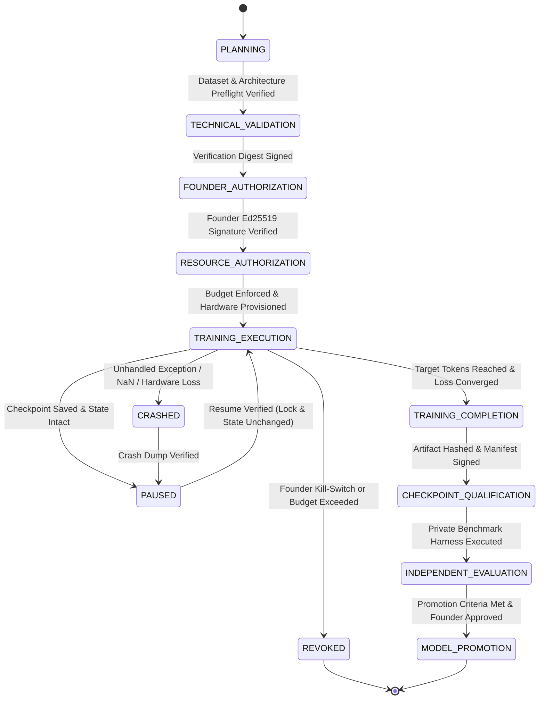

# ORNEUR — TRAINING ORCHESTRATION INDEPENDENT THREAT MODEL & ACCEPTANCE SPECIFICATION

**To:** ORNEUR CTO & Founder  
**From:** Antigravity / Gemini — Independent Research, Security and Model Assurance Lead  
**Date:** 2026-10-16  
**Target:** GENESIS Workstream C (Training Orchestration State Machine)  
**Status:** Independent Threat Model & Prioritized Acceptance Matrix  
**Architectural Verdict:** `FORMAL_THREAT_MODEL_DEFINED` | `GOVERNANCE_GATE_MANDATORY`

---

## Executive Summary

As Claude prepares to implement GENESIS Workstream C (the native training orchestration state machine), this independent threat model establishes the mandatory security boundaries, state transition rules, and verification criteria required before any state machine code can be authorized.

A naive training state machine that merely steps through strings (`"PLANNING"` $\rightarrow$ `"TRAINING"` $\rightarrow$ `"COMPLETED"`) based on boolean flags is vulnerable to **state spoofing, unauthorized GPU spend, checkpoint substitution, and forged founder approval**. This specification defines a fail-closed, cryptographically anchored state machine architecture and provides a 13-point prioritized acceptance test matrix.

---

## 1. Authoritative State Transition Graph



### Transition Invariants (Fail-Closed Gates):
1. **No Skip-Transitions:** No state may transition to `TRAINING_EXECUTION` without traversing `FOUNDER_AUTHORIZATION` and `RESOURCE_AUTHORIZATION`.
2. **Explicit Authority Binding:** `FOUNDER_AUTHORIZATION` requires an Ed25519 signature from a registered founder authority key (matching `AUTHORITY_REGISTRY.json`), binding the exact model architecture hash, tokenizer digest, and dataset manifest hash.
3. **Revocation Immediacy:** `REVOKED` is a terminal state. Once entered, the state machine must terminate all worker processes, flush logs, release locks, and forbid resumption.

---

## 2. Threat Catalog: 13 Adversarial Attack Vectors

| Threat ID | Threat Category | Attack Vector Description | Severity | Target State Boundary |
| :--- | :--- | :--- | :--- | :--- |
| **THREAT-01** | Authorization Spoofing | Attacker creates unsigned local JSON declaring `authorized: true` (reproduced in Audit #017). | **Critical (P0)** | `FOUNDER_AUTHORIZATION` |
| **THREAT-02** | Signature Replay | Attacker captures a legitimate historical founder signature for Run A and replays it for Run B. | **Critical (P0)** | `PLANNING` $\rightarrow$ `FOUNDER_AUTH` |
| **THREAT-03** | Expired Authorization | Run authorization has no time-to-live (TTL); executed weeks after founder approval when conditions changed. | **High (P1)** | `FOUNDER_AUTH` |
| **THREAT-04** | Target Model Confusion | Founder grants authorization for a 10M smoke run; orchestrator launches a 3B model under the same grant ID. | **Critical (P0)** | `FOUNDER_AUTH` $\rightarrow$ `RESOURCE_AUTH` |
| **THREAT-05** | Dataset Tampering / Substitution | Underlying training dataset files are modified or substituted after founder authorization. | **High (P1)** | `TECHNICAL_VALIDATION` $\rightarrow$ `EXECUTION` |
| **THREAT-06** | Post-Revocation Run Continuance | Founder issues a revocation signal (`REVOKED`); workers ignore SIGINT and continue burning compute. | **Critical (P0)** | `TRAINING_EXECUTION` $\rightarrow$ `REVOKED` |
| **THREAT-07** | Unbudgeted Compute Spend | Orchestrator provisions multi-node cloud GPU instances without a signed budget allocation token. | **Critical (P0)** | `RESOURCE_AUTHORIZATION` |
| **THREAT-08** | Forged Training Completion | A run aborts early due to loss divergence or NaN, but orchestrator logs `COMPLETED` and advances to eval. | **High (P1)** | `TRAINING_EXECUTION` $\rightarrow$ `COMPLETED` |
| **THREAT-09** | Post-Run Checkpoint Substitution | Attacker swaps the completed checkpoint with an external model before qualification. | **Critical (P0)** | `COMPLETION` $\rightarrow$ `QUALIFICATION` |
| **THREAT-10** | Confused Deputy Orchestration | Subordinate service or CI agent calls an internal API that triggers state progression without credentials. | **High (P1)** | State Transition API |
| **THREAT-11** | Stale Configuration on Resume | After a pause, learning rate, optimizer hyperparameters, or dataset order are altered before resume. | **Medium (P2)** | `PAUSED` $\rightarrow$ `TRAINING_EXECUTION` |
| **THREAT-12** | Atomic Lock Failure | Concurrent orchestrators run against the same run directory, causing split-brain training states. | **High (P1)** | File / Process Locking |
| **THREAT-13** | Self-Issued Audit Acceptance | The training agent itself generates an audit record marking its own code as "compliant". | **Critical (P0)** | `INDEPENDENT_EVALUATION` |

---

## 3. Prioritized Acceptance Test Matrix for Workstream C

Claude must implement executable unit and integration tests covering every row in this matrix prior to Workstream C acceptance:

| Test ID | Test Name | Injected Failure / Attack Payload | Expected Enforcement Behavior | Priority |
| :--- | :--- | :--- | :--- | :--- |
| **TEST-C01** | `test_unsigned_authorization_fails_closed` | Pass a run grant JSON with `"authorized": true` but missing cryptographic founder signature. | State machine raises `UntrustedAuthorizationError`; state remains `PLANNING`. | **P0** |
| **TEST-C02** | `test_tampered_model_config_fails_signature_check` | Alter `n_layers` or `d_model` in `GenesisModelConfig` after founder grant was signed. | Signature verification fails; state machine aborts transition. | **P0** |
| **TEST-C03** | `test_tampered_dataset_manifest_fails_check` | Mutate 1 byte in training dataset file after manifest hash was signed. | Dataset preflight check fails hash mismatch; execution forbidden. | **P0** |
| **TEST-C04** | `test_replay_of_prior_run_grant_fails` | Re-submit an authorization record with a previously used `run_id` or expired nonce. | State machine raises `DuplicateRunGrantError`; transition rejected. | **P0** |
| **TEST-C05** | `test_expired_authorization_rejected` | Set grant timestamp to $> 24\text{ hours}$ in the past where TTL is 12 hours. | State machine raises `AuthorizationExpiredError`. | **P1** |
| **TEST-C06** | `test_immediate_kill_switch_revocation` | Create revocation signal file or send `SIGTERM` during simulated training loop. | Worker terminates within 500ms; final state saved to `REVOKED`; no further steps. | **P0** |
| **TEST-C07** | `test_resume_validates_exact_checkpoint_lock` | Attempt to resume from a checkpoint whose manifest hash has changed while paused. | Resume rejected with `CheckpointTamperedError`; state stays `PAUSED`. | **P1** |
| **TEST-C08** | `test_early_divergence_fails_completion` | Loss returns `NaN` or steps terminate before reaching `target_tokens`. | State transitions to `CRASHED` or `FAILED`; never `COMPLETED`. | **P1** |
| **TEST-C09** | `test_concurrent_orchestrator_lock` | Spawn two state machine runners targeting the same `run_id`. | Second runner fails immediately with `OrchestratorLockCollisionError`. | **P1** |
| **TEST-C10** | `test_skip_state_rejected` | Invoke transition `PLANNING -> TRAINING_EXECUTION` directly. | State machine raises `InvalidStateTransitionError`. | **P0** |
| **TEST-C11** | `test_resource_budget_cap_enforced` | Request 8x H100 GPUs when grant permits max 1x local CPU/GPU. | Allocation raises `ResourceBudgetExceededError`; spend prevented. | **P0** |
| **TEST-C12** | `test_qualification_binds_checkpoint_fingerprint` | Substitute model state dict before `CHECKPOINT_QUALIFICATION`. | Qualification raises `ModelCheckpointBindingError`; rejected. | **P1** |
| **TEST-C13** | `test_self_certification_blocked` | Attempt to transition to `MODEL_PROMOTION` without an independent audit signature. | Promotion raises `IndependentAuditRequiredError`. | **P0** |

---

## 4. Minimum State Machine Data Contract

When Claude implements `TrainingStateMachine` in Workstream C, the following minimal dataclass structure must be enforced:

```python
@dataclass(frozen=True)
class TrainingAuthorizationGrant:
    run_id: str
    model_family: str
    architecture_version: str
    model_config_sha256: str
    tokenizer_sha256: str
    dataset_manifest_sha256: str
    max_tokens: int
    max_gpu_hours: float
    max_spend_inr: float
    issued_at_iso: str
    expires_at_iso: str
    nonce: str
    founder_key_id: str
    founder_signature_hex: str  # Ed25519 signature over canonical challenge bytes
```

Any grant lacking valid `founder_signature_hex` verified against `AUTHORITY_REGISTRY.json` must fail closed.
