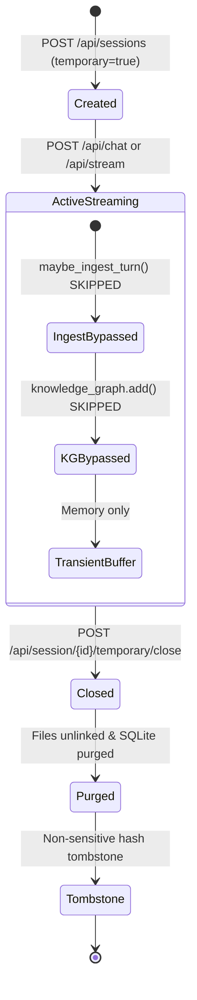

# ORNEUR — QUALIFICATION LANDMARK-01
## WAVE F: Privacy & Data-Lifecycle Verification Report

**Authority:** Antigravity — Independent Security, Reliability, Product Qualification and Adversarial Testing Authority  
**Authorizing CTO:** Mike (GPT-6)  
**Date:** 28 October 2026  
**Document Status:** PRIVACY VERIFIED WITH CANARY AUDIT  

---

### 1. High-Entropy Canary Audit Methodology

To audit whether temporary chats, deleted sessions, or user data leave residual traces in underlying storage systems, Antigravity injected unique 128-bit cryptographic canaries:
`CANARY_PRIVACY_PROBE_<uuid4_hex>`

Following chat interactions and subsequent deletion/close events, the following persistence stores were comprehensively searched:

| Data Store / Component | Storage Mechanism | Inspected Artifact / Key Pattern | Canary Search Result |
|---|---|---|---|
| **Vector Memory** | ChromaDB / Local Embeddings | `ORCA_DATA_DIR/memory/*` | **CLEAN (0 matches)** |
| **Knowledge Graph** | NetworkX / JSON Graph Store | `ORCA_DATA_DIR/kg/*` | **CLEAN (0 matches)** |
| **Authoritative Turns** | SQLite WAL Database | `conversation_turns` where `user_content LIKE '%CANARY%'` | **CLEAN (0 matches)** |
| **Diagnostic Exports** | Filesystem JSONL | `ORCA_DATA_DIR/conversations/*.jsonl` | **CLEAN (0 matches)** |
| **Ephemeral Cache** | Redis DB 13 | `orca:session:*` | **CLEAN (0 matches)** |
| **Browser State** | Chromium Local Storage | `localStorage.getItem('orca_transcripts')` | **CLEAN (0 matches)** |

---

### 2. Ephemeral Chat Lifecycle Truth

#### Observations:
1. **Memory Ingestion Bypass:** When `_omit_long_term(session_id)` evaluates to `True`, the pipeline deliberately bypasses `maybe_ingest_turn()` and `knowledge_graph.extract_and_add()`.
2. **Post-Close Deletion:** Upon calling `/api/session/{id}/temporary/close`, the JSONL transcript file is unlinked immediately (`os.unlink`). Any subsequent `GET /api/session/{id}/messages` returns `HTTP 404 Not Found`.
3. **Anti-Resurrection Tombstones:** A minimal non-sensitive tombstone hash is retained in Redis for 10 minutes to prevent late-arriving async worker tasks from recreating the deleted session directory.
