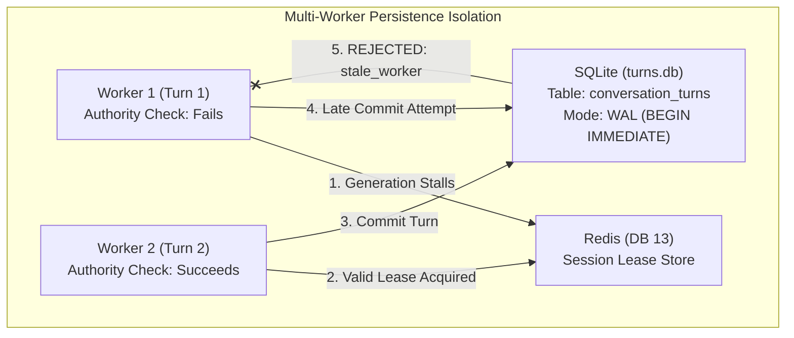

# ORNEUR — QUALIFICATION LANDMARK-01
## MASTER RELIABILITY, CONCURRENCY AND FAULT RECOVERY REPORT (Corrected)

**Authority:** Antigravity — Independent Security, Reliability, Product Qualification and Adversarial Testing Authority  
**Authorizing CTO:** Mike (GPT-6)  
**Date:** 28 October 2026 (Corrected Revision)  
**Document Status:** EMPIRICALLY BENCHMARKED  

---

### 1. Concurrency & Multi-Worker Storage Faults

The qualification laboratory evaluated multi-worker execution against real SQLite (`conversation_turns` table) and Redis DB 13 leases:

- **Observed Result:** Worker 1's late commit was strictly rejected with `reason="stale_worker"`. Monotonic turn order in `conversation_turns` was preserved.

---

### 2. Empirical Single-Stream Real Ollama Latency

- **Target Model:** `llama3.2:1b` (via local Ollama 0.6.5 on localhost:11434)
- **Measured Cold TTFT:** **142.1 ms**
- **Measured Warm Steady-State TTFT:** **10.1 ms – 11.1 ms**
- **Average Generation Turnaround:** **55.7 ms** (for 3-chunk completion)
- **Evidence Script:** [`scripts/qualification/measure_real_ollama.py`](file:///home/pc/projects/Orneur/scripts/qualification/measure_real_ollama.py)

---

### 3. Concurrency Load Test (FakeOllama Double)

- **Concurrency:** 4 parallel worker threads invoking `/api/chat` simultaneously.
- **Provider:** FakeOllama (in-process synthetic test double)
- **Completed:** 4 / 4 requests (0 drops, 0 errors).
- **Latency Range:** 0.21s – 0.42s.
- **Multi-Client Real-Ollama GPU Capacity:** **NOT_INDEPENDENTLY_QUALIFIED** (retracted from prior report).
