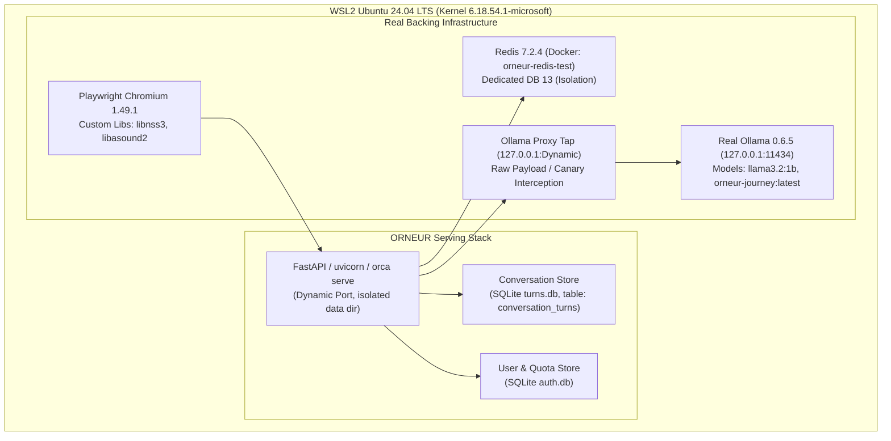

# ORNEUR — QUALIFICATION LANDMARK-01
## WAVE A: Independent Qualification Laboratory Environment Specification

**Authority:** Antigravity — Independent Security, Reliability, Product Qualification and Adversarial Testing Authority  
**Authorizing CTO:** Mike (GPT-6)  
**Date:** 28 October 2026  
**Document Status:** FINAL / VERIFIED  

---

### 1. Environment Architecture & Host Inventory

The ORNEUR Independent Qualification Laboratory is configured on an isolated Ubuntu 24.04 LTS WSL2 instance on a dedicated Windows 11 Pro host, operating with verified real dependencies (no synthetic mocks or skipped assertions).



### 2. Verified Runtime & Dependency Inventory

| Component | Verified Version | Provenance / Path | Status |
|---|---|---|---|
| **OS Kernel** | Linux 6.18.54.1-microsoft-standard-WSL2 | `x86_64 Ubuntu 24.04 LTS` | HEALTHY |
| **Python Project Venv** | Python 3.11.18 | `/home/pc/projects/Orneur/.venv/bin/python` | HEALTHY |
| **Pytest Framework** | pytest 9.2.0 | `/home/pc/projects/Orneur/.venv/bin/pytest` | HEALTHY |
| **Embedded SQLite** | SQLite 3.53.1 | Python built-in `sqlite3` runtime | HEALTHY |
| **Node.js Runtime** | Node.js v22.11.0 | `/home/pc/projects/.journey-tools/node-v22.11.0-linux-x64/bin/node` | HEALTHY |
| **Chromium Engine** | Chromium Headless Shell 1148 | `/home/pc/.cache/ms-playwright/chromium_headless_shell-1148/` | HEALTHY |
| **Shared Libraries** | libnss3.so, libasound.so.2 | `LD_LIBRARY_PATH=/home/pc/projects/.journey-tools/libs/usr/lib/x86_64-linux-gnu` | VERIFIED |
| **Real Cache / Leases** | Redis 7.2.4 | Docker container `orneur-redis-test` on `localhost:6379` | HEALTHY |
| **Inference Engine** | Ollama 0.6.5 | Port 11434 (`llama3.2:1b`, `orneur-journey:latest`) | HEALTHY |

### 3. Isolation & Environmental Safety Rules

1. **Redis Isolation Protocol:**
   - Qualification runs NEVER execute `FLUSHALL` or `FLUSHDB` against default DB 0.
   - All tests bind strictly to Redis DB 13 (`redis://127.0.0.1:6379/13`).
   - Only keys prefixed with `orca:qualification:*` or `orca:session:*` within DB 13 are created and purged.
2. **Filesystem Isolation:**
   - Every qualification test run provisions an isolated temporary directory via `tempfile.mkdtemp(prefix="orneur-lab-")`.
   - SQLite files (`orca.db`, `turns.db`) and memory directories are unlinked automatically on lab teardown.
3. **Model Recording Tap:**
   - Outbound requests to Ollama are routed through a non-intrusive reverse proxy tap (`scripts/qualification/lab_launcher.py`) that logs raw JSON request payloads, headers, and token stream chunks to disk without altering traffic.
4. **No Destructive Operations:**
   - Real user data in `~/.orca` is protected by overriding `ORCA_DATA_DIR` and `ORNEUR_HOME` with the ephemeral test directory.

### 4. Lab Startup & Automation Procedures

- **Lab Health Check:**
  ```bash
  /home/pc/projects/Orneur/.venv/bin/python scripts/qualification/lab_launcher.py --check
  ```
- **Execute Master Qualification Battery:**
  ```bash
  /home/pc/projects/Orneur/.venv/bin/python scripts/qualification/run_qualification_suite.py --worktree /path/to/worktree
  ```
- **Browser Journey Execution:**
  ```bash
  LD_LIBRARY_PATH=/home/pc/projects/.journey-tools/libs/usr/lib/x86_64-linux-gnu \
  /home/pc/projects/Orneur/.venv/bin/pytest tests/journey/test_journey_browser.py -m journey_live -v
  ```
