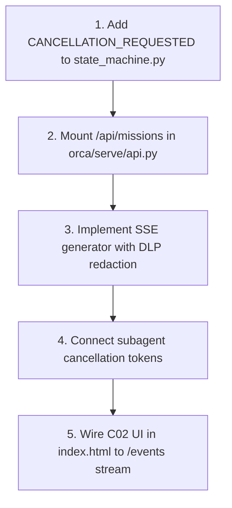

# ORNEUR C02 LIVE MISSION EXECUTION — ENGINEERING GAPS & ACTIONABLE REMEDIATION

**Document ID:** ORNEUR-C02-GAPS-002 (Corrected)  
**Priority:** P0 (Targeted Engineering Action)  
**Target Consumer:** Claude Code Engineering Agent  
**Author:** Antigravity / Gemini Engineering & Independent Audit Agent  

---

## 1. Executive Summary

This document enumerates the **5 discrete, verifiable engineering gaps** separating the existing ORNEUR backend from the founder-approved C02 Live Mission Execution interface.

All domain rules are verified locally, but the transport and persistence layers require targeted implementation by Claude upon credit reset (20 October 2026 at 5:30 PM IST).

---

## 2. Identified Engineering Gaps

### GAP-01: Zero Mission Routes Mounted in `orca/serve/api.py`
- **Severity:** P0 Blocker
- **Current Reality:** `orca/serve/api.py` has 44 routes for auth, chat, admin, and billing, but zero routes under `/api/missions`.
- **Remediation:** Mount an APIRouter `missions_router` implementing:
  - `POST /api/missions` (create mission)
  - `GET /api/missions/{id}` (snapshot fetch)
  - `GET /api/missions/{id}/events` (authenticated SSE stream)
  - `POST /api/missions/{id}/plan/decision` (approve/reject plan)
  - `POST /api/missions/{id}/permissions/{req_id}/decision` (HITL approval)
  - `POST /api/missions/{id}/pause`, `/resume`, `/cancel` (lifecycle controls)

### GAP-02: Missing `CANCELLATION_REQUESTED` State in `MissionState`
- **Severity:** P1 Invariant / UX Gap
- **Current Reality:** `MissionState` in `orca/mission/state_machine.py` currently transitions directly from `RUNNING` to terminal `CANCELLED`. It lacks the in-flight wind-down state (`C02-08 Cancellation Requested`).
- **Remediation:**
  1. Add `CANCELLATION_REQUESTED = "CANCELLATION_REQUESTED"` to `MissionState`.
  2. Allow transition from `RUNNING` or `WAITING_*` to `CANCELLATION_REQUESTED`.
  3. Allow transition from `CANCELLATION_REQUESTED` to `CANCELLED` once child tools halt.

### GAP-03: In-Process Ephemeral Store vs. PostgreSQL Persistence
- **Severity:** P1 Durability Gap
- **Current Reality:** `orca/mission/mission_store.py` defaults to in-memory dictionaries. Missions cannot survive process restarts or scale across multiple server instances.
- **Remediation:** Apply PostgreSQL schema migrations creating `missions`, `mission_events`, and `mission_approvals` tables with JSONB fields for plans and step telemetry.

### GAP-04: Subagent Process Cancellation Token & Heartbeat
- **Severity:** P1 Resource Leak Gap
- **Current Reality:** Tool execution in `orca/mission/executor.py` runs synchronously without an interruptible cancellation token passed to subprocesses.
- **Remediation:** Pass an `asyncio.Event` / `threading.Event` cancellation token to tool executors so cancelling a mission immediately sends SIGTERM to spawned subprocesses.

### GAP-05: Missing Frontend SSE Adapter in `index.html`
- **Severity:** P2 Frontend Gap
- **Current Reality:** In `orca/serve/web/index.html` lines 1937–1980, the Sub-Agent Pods invoke `sendStarter()`, sending plain text to the LLM chat instead of invoking mission execution.
- **Remediation:** Mount the C02 view component, wire it to `GET /api/missions/{id}/events` using a fetch-based SSE reader, and render C02-01 through C02-12 cards.

---

## 3. Targeted Roadmap for Claude (20 Oct 5:30 PM IST)

