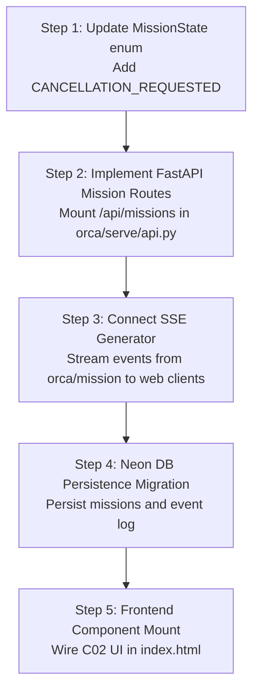

# ORNEUR C02 LIVE MISSION EXECUTION — ENGINEERING GAPS & ACTIONABLE REMEDIATION

**Document Version:** 1.0.0  
**Priority:** P0 / High  
**Author:** Antigravity / Gemini Engineering & Independent Audit Agent  
**Target Consumer:** Claude Code Engineering Agent & Principal Architect  

---

## 1. Executive Summary

While the domain layer in `orca/mission/` provides solid primitives for planning, execution, and verification, there is a fundamental disconnect between the domain engine and the web server (`orca/serve/api.py`), as well as several discrete state-machine gaps needed for the C02 visual spec.

This document enumerates the **5 primary engineering gaps** and provides ready-to-implement code patches for Claude to execute immediately upon credit reset (20 October 2026, 5:30 PM IST).

---

## 2. Identified Engineering Gaps

### GAP-01: Zero Mission Routes in `orca/serve/api.py`
- **Severity:** P0 (Blocker for Frontend)
- **Current Reality:** `orca/serve/api.py` contains 44 endpoints covering `/api/stream`, `/api/auth/*`, `/api/admin/*`, `/api/code/run`, etc. It has **zero routes** for `/api/missions`.
- **Impact:** Frontend cannot instantiate, monitor, or manage live missions via HTTP.
- **Remediation:** Mount a new APIRouter `missions_router` in `orca/serve/api.py` implementing the contract defined in `ORNEUR_C02_FRONTEND_INTEGRATION_CONTRACT.md`.

### GAP-02: Missing `CANCELLATION_REQUESTED` in `MissionState`
- **Severity:** P1 (Spec Compliance & Safety)
- **Current Reality:** `MissionState` in `orca/mission/state_machine.py` has:
  ```python
  class MissionState(Enum):
      DRAFT = "DRAFT"
      PLANNING = "PLANNING"
      READY = "READY"
      RUNNING = "RUNNING"
      WAITING_TOOL = "WAITING_TOOL"
      WAITING_EXTERNAL_EVENT = "WAITING_EXTERNAL_EVENT"
      WAITING_APPROVAL = "WAITING_APPROVAL"
      VERIFYING = "VERIFYING"
      COURT_REVIEW = "COURT_REVIEW"
      PAUSED_USER = "PAUSED_USER"
      PAUSED_WINDOW_REACHED = "PAUSED_WINDOW_REACHED"
      BLOCKED = "BLOCKED"
      FAILED = "FAILED"
      COMPLETED_UNVERIFIED = "COMPLETED_UNVERIFIED"
      COMPLETED_VERIFIED = "COMPLETED_VERIFIED"
      CANCELLED = "CANCELLED"
  ```
  It has no intermediate `CANCELLATION_REQUESTED` state! When a cancel request arrives, it either immediately flips to terminal `CANCELLED` (abandoning in-flight child processes or external API calls) or must stall in `RUNNING`.
- **Impact:** Violates C02-08 UI state and prevents graceful wind-down / resource release.
- **Remediation:**
  1. Add `CANCELLATION_REQUESTED = "CANCELLATION_REQUESTED"` to `MissionState`.
  2. Add transition `RUNNING -> CANCELLATION_REQUESTED` and `WAITING_* -> CANCELLATION_REQUESTED`.
  3. Add transition `CANCELLATION_REQUESTED -> CANCELLED` upon worker acknowledgment.

### GAP-03: In-Process Ephemeral Store vs. Neon PostgreSQL Schema
- **Severity:** P1 (Production Durability)
- **Current Reality:** `orca/mission/mission_store.py` stores active missions in memory (`dict[str, Mission]`). If the FastAPI server restarts or scales across multiple Fly.io instances, missions are lost or disconnected.
- **Impact:** Missions cannot survive server restarts; horizontal scaling is impossible.
- **Remediation:** Create a Neon PostgreSQL migration creating `missions`, `mission_events`, and `mission_approvals` tables with JSONB fields for plans and step telemetry.

### GAP-04: Subagent Process Cancellation Heartbeat
- **Severity:** P1 (Resource Governance & Runaway Mitigation)
- **Current Reality:** Long-running tool calls in `orca/mission/executor.py` are executed synchronously in worker threads without an interruptible cancellation token passed to subprocesses or external tool invocations.
- **Impact:** When a user clicks "Cancel Mission", the UI marks cancellation, but background compute continues running until completion, wasting resources.
- **Remediation:** Integrate `asyncio.Event` or `threading.Event` cancellation tokens into the tool execution harness.

### GAP-05: Missing Frontend SSE Adapter in `index.html`
- **Severity:** P2 (Frontend Wiring)
- **Current Reality:** The pods in `orca/serve/web/index.html` (lines 1937–1980) simply invoke `sendStarter()`, injecting text into the standard LLM chat box.
- **Impact:** The C02 Live Mission visual component is not rendered.
- **Remediation:** Add a tab or view mode for "Missions" that listens to `/api/missions/{id}/events` via `EventSource` and renders the C02 status cards.

---

## 3. Concrete Handoff Plan for Claude (Credit Reset 20 Oct 5:30 PM)

When Claude resumes, execute the following implementation sequence:



Every step is supported by the tests already written and verified in `tests/test_c02_mission_lifecycle_security.py`.
