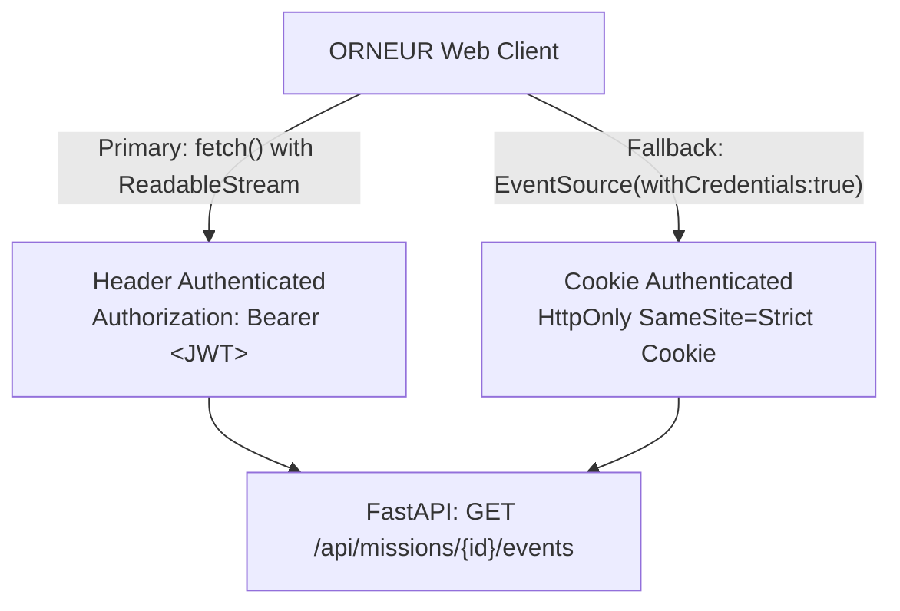

# ORNEUR C02 LIVE MISSION EXECUTION — FRONTEND INTEGRATION CONTRACT
## Authenticated Transport, Event Streaming & Security Boundary Specification

**Document ID:** ORNEUR-C02-CONTRACT-002 (Corrected)  
**Status:** SPECIFICATION COMPLETE / READY FOR CLAUDE IMPLEMENTATION  
**Primary Transport:** Fetch-Based SSE Stream (with Cookie-Authenticated EventSource Fallback)  
**Authority Posture:** Single Authority (Backend Authoritative; Frontend Pure Projection)  
**Author:** Antigravity / Gemini Engineering & Independent Audit Agent  

---

## 1. Architectural Authority & Tenancy Invariants

To guarantee security, confidentiality, and tamper-evident auditability, the integration contract enforces three strict invariants:

1. **Backend as Sole State Authority:** The frontend never decides whether a state transition is legal, whether an action is permitted, or whether a mission is completed. The frontend is strictly a reactive projection of the backend event stream.
2. **Server-Derived Tenant Identity (Anti-Spoofing):**
   - **RULE:** The server **NEVER** trusts a client-supplied `X-Tenant-ID` header as an independent authorization claim.
   - **MECHANISM:** The authenticated user's `tenant_id` is extracted strictly server-side from the verified cryptographic JWT claims or the validated database session row.
   - If an incoming request provides an `X-Tenant-ID` that does not match the server-derived `tenant_id`, the request is immediately rejected with HTTP 403 Forbidden.
3. **Resource-Level Access Gating:**
   - Every operation, mission, plan, and event stream lookup verifies that `(session.user_id, session.tenant_id)` matches `(mission.owner_user_id, mission.tenant_id)`.
   - Probing for another tenant's mission ID returns HTTP 404 Not Found (or 403) to prevent ID enumeration or existence oracle leaks.

---

## 2. Authentication & SSE Transport Model

### 2.1 The Browser `EventSource` Limitation & Solutions
Standard browser `EventSource` does **not** support setting custom HTTP request headers (such as `Authorization: Bearer <token>`). To support authenticated real-time streaming, ORNEUR supports two client integration models:



#### Option A: Fetch-Based Streaming Client (Primary / Recommended)
Modern web applications interact with SSE endpoints using `fetch()` and `response.body.getReader()` (e.g. `@microsoft/fetch-event-source` or native `ReadableStream` reader):
- Sends standard `Authorization: Bearer <access_token>` in request headers.
- Supports arbitrary headers, request bodies, and explicit control over reconnection backoff and `Last-Event-ID`.
- Token expiry is handled proactively: if the JWT expires during an active stream, the client fetches a refreshed token via `/api/auth/refresh` and reconnects with `Last-Event-ID`.

#### Option B: Cookie-Authenticated `EventSource` (Native Browser Fallback)
When standard `EventSource` is used:
- Client invokes `new EventSource('/api/missions/{id}/events', { withCredentials: true })`.
- Authentication is provided via an `HttpOnly`, `SameSite=Strict`, `Secure`, `__Host-` prefixed session cookie set during login.
- CSRF protection is enforced via `Origin` / `Sec-Fetch-Site` verification on the server.

---

## 3. Unified REST API Endpoints

All endpoints are standardized and internally consistent:

### 3.1 Create Mission
- **Endpoint:** `POST /api/missions`
- **Authentication:** Bearer Token or Session Cookie
- **Request Body:**
  ```json
  {
    "title": "Quarterly Financial Analysis & SEC Reconciliation",
    "goal": "Extract 10-K figures and reconcile balance sheet variances.",
    "pod_type": "ORNEUR_ANALYST",
    "parameters": {
      "ticker": "ORCA",
      "fiscal_year": 2026
    },
    "idempotency_key": "9b1deb4d-3b7d-4bad-9bdd-2b0d7b3dcb6d"
  }
  ```
- **Response (201 Created):**
  ```json
  {
    "mission_id": "msn_01jd9a87f6e8b42c90e7f1",
    "tenant_id": "ten_enterprise_01",
    "state": "READY",
    "created_at": "2026-10-19T13:20:00.000Z",
    "revision": 1,
    "events_url": "/api/missions/msn_01jd9a87f6e8b42c90e7f1/events"
  }
  ```

### 3.2 Plan Approval / Rejection (C02-02)
- **Endpoint:** `POST /api/missions/{mission_id}/plan/decision`
- **Request Body:**
  ```json
  {
    "decision": "APPROVED",
    "plan_revision": 1,
    "feedback": "Proceed with standard GAAP validation rules."
  }
  ```
- **Response (200 OK):**
  ```json
  {
    "mission_id": "msn_01jd9a87f6e8b42c90e7f1",
    "state": "RUNNING",
    "revision": 2
  }
  ```

### 3.3 Permission Escalation Decision (C02-01 / C02-02)
- **Endpoint:** `POST /api/missions/{mission_id}/permissions/{request_id}/decision`
- **Request Body:**
  ```json
  {
    "decision": "GRANTED",
    "scope_limitations": {
      "read_only": false
    }
  }
  ```
- **Response (200 OK):**
  ```json
  {
    "request_id": "req_esc_008",
    "status": "GRANTED",
    "mission_state": "RUNNING"
  }
  ```

### 3.4 Lifecycle Management (Pause / Resume / Cancel)
- **Pause:** `POST /api/missions/{mission_id}/pause`
- **Resume (C02-10):** `POST /api/missions/{mission_id}/resume` (requires `expected_revision`)
- **Cancel (C02-08):** `POST /api/missions/{mission_id}/cancel` (requires `reason`)

---

## 4. Server-Sent Events (SSE) Stream Specification

- **Unified Route:** `GET /api/missions/{mission_id}/events`
- **Format:** `text/event-stream; charset=utf-8`

### 4.1 Canonical Stream Envelope
Every event emitted conforms to the typed envelope:
```
id: 1042
event: mission_delta
data: {"seq":1042,"mission_id":"msn_01jd9a87f6","ui_state":"C02-03","domain_state":"RUNNING","type":"STEP_PROGRESS","payload":{...},"timestamp":"2026-10-19T13:21:10.050Z"}
```

### 4.2 Stream Event Types & UI Mappings

| Event Name | Approved UI State ID | Description |
|---|---|---|
| `state_changed` | C02-03 / C02-07 / C02-09 / C02-11 | Emitted on global state transitions (`READY` -> `RUNNING`, `FAILED`, etc.). |
| `permission_requested` | C02-01 (Permission Request) | Subagent requires privileged tool execution. |
| `approval_pending` | C02-02 (Approval Pending) | Escalation awaits human or supervisor authorization. |
| `step_progress` | C02-04 (Tool Action Details) | Real-time tool execution telemetry, duration, and output chunks. |
| `evidence_produced` | C02-05 (Evidence and Outputs) | Verified intermediate results and guardrail receipts. |
| `waiting_input` | C02-06 (Waiting for User Input) | Execution paused awaiting interactive user response. |
| `mission_interrupted` | C02-07 (Failed / Interrupted) | Unrecoverable error or unexpected interruption occurred. |
| `cancellation_requested` | C02-08 (Cancellation Requested) | Wind-down active; subagent processes halting. |
| `mission_cancelled` | C02-09 (Mission Cancelled) | Terminal cancelled state reached. |
| `resume_review` | C02-10 (Resume Review) | State revision comparison required prior to resuming. |
| `mission_completed` | C02-11 (Mission Completed) | Terminal success state verified with cryptographic proof. |
| `history_appended` | C02-12 (Mission History) | Audit log record sealed into durable ledger. |
| `heartbeat` | Any | Keepalive frame sent every 15 seconds: `: ping\n\n`. |

---

## 5. Reconnection, Replay Buffer & Horizon Expiry

1. **Reconnection Request:**
   - On disconnect, the client reconnects passing `Last-Event-ID: <seq>`.
   - The server validates session currency, verifies user ownership, and queries the event ring buffer.
2. **Replay Retention:**
   - The server maintains a durable in-memory/database ring buffer of the last 1,000 events (or 30 minutes).
   - If `Last-Event-ID` is within the buffer horizon, missing events are replayed sequentially before resuming live emission.
3. **Horizon Expiry (HTTP 410 Gone):**
   - If `Last-Event-ID` is older than the buffer horizon, the server closes the connection with:
     ```
     HTTP/1.1 410 Gone
     Content-Type: application/json
     
     {
       "error": "REPLAY_HORIZON_EXCEEDED",
       "message": "Event history has expired. Full snapshot resynchronization required.",
       "resync_url": "/api/missions/{mission_id}"
     }
     ```
   - Upon receiving HTTP 410, the client discards its cached stream buffer, performs a clean `GET /api/missions/{id}` snapshot fetch, and reconnects with the snapshot's latest revision.

---

## 6. Output Sanitization & XSS Safeguards

1. **DLP & Secret Redaction:** All tool outputs, stdout/stderr, and diagnostic traces pass through `orca.serve.dlp` / `redact_secrets()` on the server before emission into the event stream. API keys, bearer tokens, and private connection strings are scrubbed to `[REDACTED]`.
2. **Client-Side Rendering:** The frontend must never inject raw tool output into DOM `innerHTML`. All text must be set via `textContent` or processed through an HTML-escaped markdown renderer to neutralize DOM XSS vectors.
