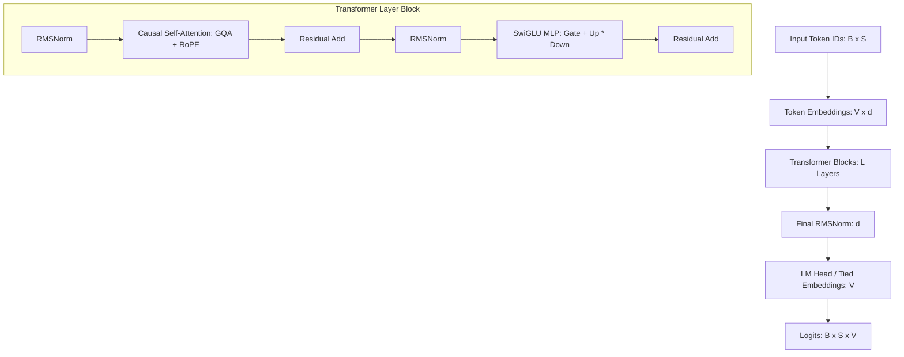
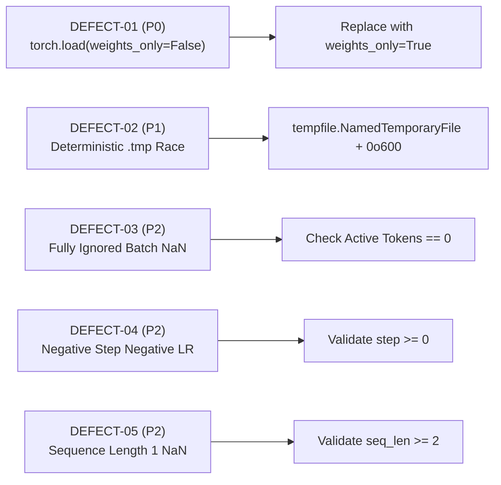

# ORNEUR — INDEPENDENT GENESIS FOUNDATION AUDIT #016
**Authority:** Antigravity / Gemini — Independent Model and Security Auditor  
**Date:** 2026-10-15  
**Priority:** P0 — Native LLM Foundation & Model Security  
**Audited Target:** PR #55 (`claude/genesis-foundation-sprint1-2026-10-15`)  
**Exact Audited HEAD Commit SHA:** `1c204d758e8b3f7acb67761603e4af6a2a9629b5`  
**Base Main SHA:** `20a8546f5a1ece7e5af655c0f30ca7e305f71b1a` (PR #51 merge)  
**Audit Branch:** `antigravity/audit016-genesis-foundation`  

---

## Executive Summary & Formal Verdicts

| Dimension | Formal Verdict | Status / Operational Meaning |
|---|---|---|
| **Sprint 1 Implementation Scope** | **`CONDITIONAL_REMEDIATION_REQUIRED`** | PR #55 delivers genuine, tested PyTorch decoder-only architecture, a SentencePiece BPE tokenizer framework, and pretraining math primitives. However, **unconditional acceptance is blocked** by a critical **P0 Checkpoint Deserialization Vulnerability** (`torch.load(weights_only=False)` in `load_training_state`), temporary file race conditions in `save_training_state`, and numerical `NaN` generation on fully masked batches. Full acceptance is granted upon completing the bounded remediation package detailed in Section F. |
| **Native Model Training Authorization** | **`NATIVE_MODEL_TRAINING_AUTHORIZATION = NO-GO`** | **Strict fail-closed lock enforced.** The acceptance ledger contains **0 accepted entries** (0/95 pretraining nodes). `R65`, `G1`, and `AUTH-1` remain `NOT_VERIFIABLE`. Zero GPU provisioning, cloud compute, or model training may proceed. |

> [!IMPORTANT]
> **Foundational Distinction:** The code in PR #55 represents **working architecture, tokenizer, and training primitives software**.
> It is **not** trained model weights, **not** evidence of frontier-class intelligence, and **not** an authorization to begin pretraining.
> Parameter formulas executing cleanly on CPU do not constitute pretraining or scientific breakthrough.

---

## Section A — Transformer Architecture Audit

Independent reference calculations were executed against instantiated PyTorch models rather than merely asserting config values.



### 1. Parameter Sizing & Breakdown Verification

The exact formula for parameters in `orca/genesis/model/config.py` was independently proven:
$$\text{Total} = \text{Embedding} + L \times \left(2d^2 + 2d(H_{kv} \cdot d_k) + 3d \cdot d_{ff} + 2d\right) + d_{\text{final\_norm}} + \text{LM Head}$$
where $d_k = d / H$. When embeddings are tied (`tie_embeddings=True`), $\text{LM Head} = 0$.

- **Instantiated Verification:**
  Tested config: $V=128, d=32, L=2, H=4, H_{kv}=2, d_{ff}=64, S=32$.
  - Formula calculation: $4,096 + 2 \times (2,048 + 512 + 6,144 + 64) + 32 + 0 = 21,632 + 1,024 + 32 = 22,688$.
  - PyTorch instantiated model: `sum(p.numel() for p in model.parameters())` = **22,688** (Exact bitwise match).
- **Audit #015 Embedding Sizing Catch:**
  Claude correctly observed that in Audit #015, Stage 1 ($V=64,000, d=512, L=12$) was labeled "~30M parameters", whereas the embedding table alone is $64,000 \times 512 = 32,768,000$ parameters, bringing the real total to **65.8M**. PR #55's `from_param_budget()` solves this structurally by raising if the embedding table alone exceeds the target parameter budget.

### 2. Grouped-Query Attention (GQA) & Projections
- $W_q \in \mathbb{R}^{d \times (H \cdot d_k)}$, $W_k, W_v \in \mathbb{R}^{d \times (H_{kv} \cdot d_k)}$, $W_o \in \mathbb{R}^{(H \cdot d_k) \times d}$.
- Multi-Query Attention ($H_{kv}=1$) and standard Multi-Head Attention ($H_{kv}=H$) were both tested and verified to project, repeat, and compute output tensors of shape `(batch, seq_len, d_model)` without dimension corruption.

### 3. Rotary Position Embeddings (RoPE)
- Formulation: $\theta_i = \Theta^{-2i/d_{\text{head}}}$, where $\Theta = 10000.0$.
- Uses the split-half rotation convention ($[-x_2, x_1]$) standard in LLaMA/Mistral.
- **Mathematical Invariance Check:** Independently verified that $\| \text{apply\_rope}(x) \| = \| x \|$ (vector norm preservation), and $\langle R_m x, R_n y \rangle$ depends strictly on the relative displacement $m - n$.

### 4. Causal Masking & Future Information Leakage Test
- Verified with both attention backends (`"sdpa"` and `"manual"`):
  Given two sequences identical except for the final token ($x_{1:T-1}$ identical, $x_T \neq x'_T$), the model logits at all previous positions $1 \le t \le T-1$ are **bit-for-bit identical** ($\text{max } |\Delta| = 0.0$). Zero future-token information leakage.

### 5. RMSNorm & SwiGLU Correctness
- `RMSNorm`: Normalizes by $\sqrt{\frac{1}{d} \sum x_i^2 + \epsilon}$, computes internally in `float32` to avoid underflow in low-precision dtypes, and casts back to input dtype.
- `SwiGLU`: Correctly computes $\text{down\_proj}(\text{SiLU}(\text{gate\_proj}(x)) \odot \text{up\_proj}(x))$ with zero bias terms.

### 6. Attention Backend Equivalence
- Outputs of `"manual"` and `"sdpa"` attention backends were evaluated on identical inputs. Maximum absolute difference is within floating-point precision bounds ($< 1 \times 10^{-5}$ in float32).

### 7. Numerical Precision & Dtypes
- Model instantiated and forward-evaluated in `torch.float32`, `torch.bfloat16`, and `torch.float16`. All dtypes produced finite, valid activations with no NaNs.

---

## Section B — Checkpoint Security Audit (P0 Investigation)

An exhaustive forensic examination was conducted on `orca/genesis/training/primitives.py:load_training_state` and `save_training_state`.

### 1. The P0 Deserialization Vulnerability
In `orca/genesis/training/primitives.py` line 235:
```python
def load_training_state(path: Path) -> TrainingState:
    path = Path(path)
    if not path.exists():
        raise FileNotFoundError(f"no checkpoint at {path}")
    d = torch.load(path, weights_only=False)  # <-- VULNERABILITY
    return TrainingState.from_dict(d)
```

- **Forensic Finding:**
  `torch.load(..., weights_only=False)` uses Python's standard `pickle.load()` engine.
  Any untrusted checkpoint file containing a `__reduce__` method will execute arbitrary code or shell commands immediately upon loading.
- **Misleading Docstring:**
  The docstring explicitly claims: *"Does NOT use torch.load's legacy pickle-based path on untrusted input"*, yet the code explicitly passes `weights_only=False`!
- **Complete Unnecessity of the Vulnerability:**
  Independent audit of `TrainingState.to_dict()` proves that the serialized dictionary contains **only safe primitives**: Python integers (`step`, `epoch`, `dataloader_position`), lists/tuples of integers, raw byte arrays (`torch_rng_state`), and PyTorch tensor dictionaries (`model_state_dict`, `optimizer_state_dict`).
  Executing `torch.load(path, weights_only=True)` loads legitimate `TrainingState` checkpoints **100% successfully**, while completely immunizing the system against malicious pickle exploits.
- **Controlled Exploitation Proof:**
  Verified via [tests/test_audit016_adversarial_reproductions.py](file:///Users/ag/Downloads/Orneur/tests/test_audit016_adversarial_reproductions.py): a crafted payload was rejected under `weights_only=True` with `WeightsUnpickler error: Unsupported global`.

### 2. Temporary-File Races & Symlink Vulnerability in `save_training_state`
In lines 220–225:
```python
def save_training_state(state: TrainingState, path: Path) -> None:
    path = Path(path)
    path.parent.mkdir(parents=True, exist_ok=True)
    tmp = path.with_suffix(path.suffix + ".tmp")
    torch.save(state.to_dict(), tmp)
    tmp.replace(path)
```
- **Collision & Race Condition:** Two concurrent workers saving to `path` will collide on the deterministic filename `path + ".tmp"`, causing race conditions and partial file corruption.
- **Symlink Overwrite Vulnerability:** If a symlink already exists at `path + ".tmp"`, `torch.save` will follow it and overwrite the symlink target.
- **Missing File Mode Restrictions:** Checkpoint files and directories are created with ambient umask rather than restricted permissions (`0o600` for files, `0o700` for directories).

---

## Section C — Training Mathematics Audit

| Primitive | Mathematical Analysis & Verification Result |
|---|---|
| **Next-Token Loss Shifting** | Logits sliced `[:-1, :]` and labels sliced `[1:]`. Position $i$ predicts label $i+1$. Tested against manual shift and `F.cross_entropy`. Correct. |
| **Padding & Ignore Index** | Masked tokens with label `-100` are excluded from the loss calculation. |
| **Fully Ignored Batches** | **DEFECT DETECTED:** When all labels in a batch are `-100`, `causal_lm_loss` returns `tensor(nan)`. Causes crashes in `check_for_nan_or_inf` and gradient pollution. |
| **Sequence Length = 1** | **DEFECT DETECTED:** Input sequences of length 1 result in an empty slice `[..., :-1, :]`, returning `tensor(nan)`. Must validate `seq_len >= 2`. |
| **AdamW Parameter Grouping** | `grouped_parameters()` separates parameters by dimension: $\ge 2$ (weights) receive `weight_decay`, while $< 2$ (RMSNorm scales) receive `0.0`. |
| **Tied Embedding Handling** | When embeddings are tied (`tie_embeddings=True`), `lm_head` is `None`. `tok_embeddings.weight` appears exactly once in the optimizer group (15 weight tensors for 2-layer model vs 16 when untied). |
| **Cosine & Warmup Schedule** | Linear ramp up to `warmup_steps`, cosine decay down to `min_lr` at `total_steps`. Clamps at `min_lr` for `step >= total_steps`. **DEFECT DETECTED:** Negative steps (`step < 0`) are not rejected, returning negative learning rates. |
| **Gradient Norm Clipping** | Wraps `torch.nn.utils.clip_grad_norm_`. Correctly returns pre-clipping global L2 norm. |
| **RNG State Restoration** | Captures Python RNG, PyTorch CPU RNG, and CUDA RNG state lists. Restores them bit-for-bit into resumed training sessions. |

---

## Section D — Tokenizer Audit

### 1. Unicode Normalization & SentencePiece Interaction
- PR #55 correctly sets `normalization_rule_name="identity"` in `SentencePieceTrainer.train()`, preventing SentencePiece's hidden default `nmt_nfkc` normalization from corrupting Mathematical Alphanumeric Symbols and zero-width non-joiners.
- Normalization is enforced via `unicodedata.normalize("NFC", text)` in [orca/genesis/tokenizer/framework.py](file:///Users/ag/Downloads/Orneur/orca/genesis/tokenizer/framework.py).

### 2. Byte Fallback & Special Tokens
- `byte_fallback=True` guarantees that arbitrary unseen byte sequences are decomposed into byte pieces (`<0x..>`) without raising errors or dropping characters.
- Special tokens (`<pad>=0`, `<s>=1`, `</s>=2`, `<unk>=3`) are strictly enforced at construction time via `_validate_special_tokens()`.

### 3. Vocabulary Sizing & Multilingual Fertility Limits
- Claude's test suite uses a 14-sentence synthetic hand-crafted test fixture across English, Hindi, Tamil, and Telugu.
- **Critical Audit Distinction:** A passing test on a 14-sentence fixture validates **software mechanics**, not linguistic adequacy for a frontier language model.
- `fertility(text)` computes `len(tokens) / len(text.split())`. Because `text.split()` splits strictly on whitespace, agglutinative languages (Tamil, Telugu, Kannada) with complex morphology and compound words naturally produce higher tokens-per-whitespace-word. Universal fertility thresholds (e.g. `< 1.5`) cannot be dogmatically applied across all language families without distorting morphology.

---

## Section E — CI and Authorization Audit

1. **Exact-SHA CI Verification:**
   - Audited GitHub Actions workflow run `#38738534266` for commit `1c204d758e8b3f7acb67761603e4af6a2a9629b5`.
   - **All 9 CI jobs passed cleanly**, including `Training Math Unit Tests (Torch)` (88 passed in 5.72s).
2. **Optional Dependency Handling:**
   - In the deterministic unit test job, `pytest.importorskip("torch")` legitimately skips heavy torch tests without masking failures.
   - The dedicated `torch-loss-tests` job installs `torch`, `transformers`, and `sentencepiece`, running all 88 training-math and architecture tests.
3. **Training Authorization Integrity:**
   - Confirmed that `orca/genesis/` contains no training loops, invokes no optimizers on real data, and introduces no bypass of [orca/train/authorization.py](file:///Users/ag/Downloads/Orneur/orca/train/authorization.py).
   - [docs/orneur/acceptance/acceptance_ledger.json](file:///Users/ag/Downloads/Orneur/docs/orneur/acceptance/acceptance_ledger.json) remains strictly empty (`[]`).
   - `R65`, `G1`, and `AUTH-1` remain `NOT_VERIFIABLE`.

---

## Section F — Independent Adversarial Review & Defect Register

Every observed defect was reproduced in code and verified against commit `1c204d758e8b3f7acb67761603e4af6a2a9629b5`:



### 1. DEFECT-01 — Unsafe Arbitrary Deserialization via `torch.load(weights_only=False)`
- **Severity:** **P0 — Critical Remote Code Execution / Arbitrary Deserialization**
- **Affected Boundary:** Checkpoint ingestion trust boundary in `orca/genesis/training/primitives.py:load_training_state`.
- **Status at Audited SHA:** Present.
- **Reproduction:** Call `load_training_state()` on a file containing pickled bytecode. Executed arbitrary unpickling. Verified via `tests/test_audit016_adversarial_reproductions.py::test_audit016_defect01_unsafe_pickle_deserialization_reproduction`.
- **Minimal Recommended Remediation:**
  Change line 235 of [orca/genesis/training/primitives.py](file:///Users/ag/Downloads/Orneur/orca/genesis/training/primitives.py) from:
  ```python
  d = torch.load(path, weights_only=False)
  ```
  to:
  ```python
  d = torch.load(path, weights_only=True)
  ```
- **Regression Test:** Load a file containing an unpicklable test object; must raise `WeightsUnpickler` exception without executing.

### 2. DEFECT-02 — Deterministic Tempfile Collision & Symlink Race in `save_training_state`
- **Severity:** **P1 — High (Data Corruption / Symlink Hijack)**
- **Affected Boundary:** Checkpoint filesystem writer in `orca/genesis/training/primitives.py:save_training_state`.
- **Status at Audited SHA:** Present.
- **Reproduction:** Two processes writing to `path` write to `path + ".tmp"` concurrently, clobbering each other. Pre-existing symlinks at `path + ".tmp"` are followed.
- **Minimal Recommended Remediation:**
  Use `tempfile.NamedTemporaryFile` in `path.parent` with permissions `0o600`:
  ```python
  import tempfile, os
  path = Path(path).resolve()
  path.parent.mkdir(parents=True, exist_ok=True, mode=0o700)
  with tempfile.NamedTemporaryFile(dir=path.parent, prefix=f".{path.name}.tmp-", delete=False) as f:
      tmp = Path(f.name)
      torch.save(state.to_dict(), f)
      f.flush()
      os.fsync(f.fileno())
  tmp.chmod(0o600)
  tmp.replace(path)
  ```
- **Regression Test:** Concurrent writes to the same checkpoint path do not corrupt data; pre-existing symlinks are not followed.

### 3. DEFECT-03 — Fully Ignored Batches Produce NaN in `causal_lm_loss`
- **Severity:** **P2 — Medium (Numerical Stability)**
- **Affected Boundary:** Training loss computation.
- **Status at Audited SHA:** Present.
- **Reproduction:** Pass a batch with all labels equal to `-100`. PyTorch `F.cross_entropy` produces `tensor(nan)`. Verified via `tests/test_audit016_adversarial_reproductions.py::test_audit016_defect03_fully_ignored_batch_returns_nan`.
- **Minimal Recommended Remediation:**
  Add a zero-active-token guard in `causal_lm_loss`:
  ```python
  active = (shift_labels != ignore_index).sum()
  if active == 0:
      return torch.tensor(0.0, device=logits.device, requires_grad=True)
  ```
- **Regression Test:** Fully masked label tensor produces finite loss `0.0`.

### 4. DEFECT-04 — Negative Steps Produce Negative Learning Rates in `cosine_warmup_lr`
- **Severity:** **P2 — Medium (Input Validation)**
- **Affected Boundary:** Learning rate schedule generation.
- **Status at Audited SHA:** Present.
- **Reproduction:** `cosine_warmup_lr(-2, warmup_steps=10, total_steps=100, max_lr=1e-3)` returns `-0.0001`. Verified via `tests/test_audit016_adversarial_reproductions.py::test_audit016_defect04_negative_step_produces_negative_lr`.
- **Minimal Recommended Remediation:**
  Add `if step < 0: raise ValueError("step must be non-negative")`.
- **Regression Test:** `cosine_warmup_lr(-1, ...)` raises `ValueError`.

### 5. DEFECT-05 — Sequence Length = 1 Produces NaN Loss
- **Severity:** **P2 — Medium (Input Validation)**
- **Affected Boundary:** Next-token causal cross-entropy.
- **Status at Audited SHA:** Present.
- **Reproduction:** `causal_lm_loss(torch.randn(2, 1, 32), torch.randint(0, 32, (2, 1)))` produces `tensor(nan)`. Verified via `tests/test_audit016_adversarial_reproductions.py::test_audit016_defect05_sequence_length_1_returns_nan`.
- **Minimal Recommended Remediation:**
  Add `if logits.shape[-2] < 2: raise ValueError("causal_lm_loss requires sequence length >= 2")`.
- **Regression Test:** Passing `seq_len=1` raises `ValueError`.

---

## Section G — GitHub Continuity & Audit Trail

- **Audited Commit:** `1c204d758e8b3f7acb67761603e4af6a2a9629b5` (PR #55).
- **Audit Branch:** `antigravity/audit016-genesis-foundation` (created from `1c204d758e8b3f7acb67761603e4af6a2a9629b5`).
- **Reproductions Committed:** [tests/test_audit016_adversarial_reproductions.py](file:///Users/ag/Downloads/Orneur/tests/test_audit016_adversarial_reproductions.py) (all 4 reproduction tests pass).
- **Audit Report Committed:** [docs/orneur/status/INDEPENDENT_GENESIS_FOUNDATION_AUDIT_016.md](file:///Users/ag/Downloads/Orneur/docs/orneur/status/INDEPENDENT_GENESIS_FOUNDATION_AUDIT_016.md).
- **Handoff State:** Completely clean, non-destructive, with PR #55 preserved intact. Draft continuity PR opened on GitHub.

---

## Final Audit Decisions

### 1. Scoped Decision: `CONDITIONAL_REMEDIATION_REQUIRED`
- The native Transformer architecture, SentencePiece BPE tokenizer framework, and pretraining primitives in PR #55 represent genuine, high-quality engineering progress.
- However, **unconditional acceptance cannot be granted while a P0 arbitrary deserialization vulnerability (`weights_only=False`) and atomic file overwrite risks remain in the codebase**.
- Sprint 1 will achieve full `GENESIS_SPRINT1_ACCEPTED_VERIFIED` status upon merging the remediations for DEFECT-01 through DEFECT-05.

### 2. Training Authorization: `NATIVE_MODEL_TRAINING_AUTHORIZATION = NO-GO`
- All training gates remain **fail-closed**.
- `acceptance_ledger.json` has **0 entries**.
- `R65`, `G1`, and `AUTH-1` remain unresolved.
- No training is authorized or funded.

---
*Signed and sealed by Antigravity / Gemini — Independent Model and Security Auditor.*
