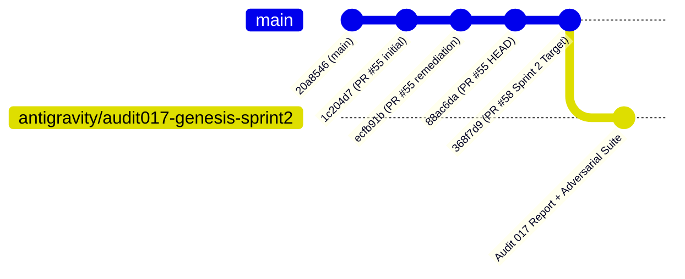

# ORNEUR — INDEPENDENT GENESIS SPRINT 2 AUDIT #017

**To:** ORNEUR CTO & Founder  
**From:** Antigravity / Gemini — Independent Research and Security Auditor  
**Date:** 2026-10-15  
**Audited Target:** PR #58 (`claude/genesis-sprint2-2026-10-15`)  
**Exact Audited SHA:** `368f7d9acb3de1cffd8996cba98149c160904926`  
**Direct Parent SHA:** `88ac6da8450f7751e002aa243053c541d5eae4e5` (PR #55 HEAD)  
**Main Branch SHA:** `20a8546f5a1ece7e5af655c0f30ca7e305f71b1a`  
**Audit Branch:** `antigravity/audit017-genesis-sprint2`  
**Audit Draft PR:** PR #59  
**Scope:** Workstreams B, D, and E (Workstreams A, C, and F deferred)  
**Formal Scoped Verdict:** `CONDITIONAL_REMEDIATION_REQUIRED`  
**Native Model Training Authorization:** `NO-GO` (Frozen, 0/95 requirements accepted)

---

## Executive Summary

PR #58 implements three of the six requested workstreams for GENESIS Foundation Sprint 2:
- **Workstream B:** Checkpoint integrity sidecar manifest ([orca/genesis/training/checkpoint_integrity.py](file:///Users/ag/Downloads/Orneur/orca/genesis/training/checkpoint_integrity.py)).
- **Workstream E:** Closed-form scaling arithmetic and memory estimation ([orca/genesis/model/scaling.py](file:///Users/ag/Downloads/Orneur/orca/genesis/model/scaling.py)).
- **Workstream D:** Model evaluation inference adapter ([orca/genesis/model/eval_adapter.py](file:///Users/ag/Downloads/Orneur/orca/genesis/model/eval_adapter.py)).
Workstreams A (dataset pipeline), C (training orchestration state machine), and F (training governance package) were deliberately deferred by Claude to avoid shallow coverage.

Independent adversarial evaluation of the implemented code and mathematics revealed **six confirmed defects**, including a **high-severity security regression of DEFECT-02 from Audit #016**:
1. **DEFECT-01 (High - Security / Filesystem Race):** `save_verified_training_state()` writes the manifest to a deterministic temporary file (`f".{manifest_path.name}.tmp"`). A pre-existing symlink causes arbitrary file overwrite.
2. **DEFECT-02 (Medium - Integrity / Validation):** `load_verified_training_state()` parses the manifest but fails to validate `format_version` and `architecture_version`, silently accepting incompatible or unsupported formats.
3. **DEFECT-03 (Medium - Integrity / Consistency):** `load_verified_training_state()` does not verify that manifest metadata (`step`, `epoch`) matches the deserialized checkpoint state.
4. **DEFECT-04 (Medium - Evaluation Authenticity):** `diagnose_adapter()` permits an unverified caller-supplied `checkpoint_source` string to flag a fresh, randomly initialized model as `is_randomly_initialized=False`.
5. **DEFECT-05 (Low - Scaling / Memory Accounting):** `estimate_training_memory()` omits vocabulary logits tensor memory ($B \times S \times V \times 4$ bytes), causing up to a 37x underestimation of peak activation memory.
6. **DEFECT-06 (Low - Evaluation Accuracy & Isolation):** `make_inference_backend()` leaks stop tokens in completion strings, emits silent empty completions when prompts exceed context limits, and mutates process-wide RNG via `torch.manual_seed()`.

All six defects have been reproduced and confirmed via executable adversarial tests in [tests/test_audit017_adversarial_reproductions.py](file:///Users/ag/Downloads/Orneur/tests/test_audit017_adversarial_reproductions.py).

Because PR #58 reintroduces a filesystem symlink vulnerability and lacks essential boundary enforcement, it cannot be accepted as verified in its current state. The formal verdict is **`CONDITIONAL_REMEDIATION_REQUIRED`**.

---

## 1. Exact-SHA Verification & Lineage

### 1.1 Git Ancestry


- **Audited Target SHA:** `368f7d9acb3de1cffd8996cba98149c160904926`
- **Direct Parent:** `88ac6da8450f7751e002aa243053c541d5eae4e5` (`git rev-parse 368f7d9^` -> `88ac6da`)
- **Main Status:** `main` remains at `20a8546f5a1ece7e5af655c0f30ca7e305f71b1a`.
- **Merge Dependency:** PR #58 is **NOT** rebased on `main`. It is strictly dependent on PR #55 landing first. Attempting to merge PR #58 into `main` without PR #55 will bring all Sprint 1 commits into `main` or cause git conflicts.

---

## 2. GitHub Actions CI Matrix Evidence

GitHub Actions CI on exact target commit `368f7d9acb3de1cffd8996cba98149c160904926`:

### PR Run `38764237987` (Event: `pull_request` | Conclusion: **SUCCESS**)
| Job ID | Job Name | Duration | Status |
| :--- | :--- | :--- | :--- |
| `116523160465` | `SSE Diagnostics (zero payload leakage)` | 18s | **SUCCESS** |
| `116523160705` | `Training Math Unit Tests (Torch)` | 54s | **SUCCESS** |
| `116523160730` | `Genesis V2 Sandbox (containment tests)` | 37s | **SUCCESS** |
| `116523160774` | `RSE Docker Synthetic Integration Lab` | 27s | **SUCCESS** |
| `116523160831` | `RSE dependency lock & vulnerability scan` | 12s | **SUCCESS** |
| `116523160897` | `Deterministic Unit Tests (pytest)` | 14m 20s | **SUCCESS** |
| `116523160923` | `Dependency Vulnerability Scan` | 16s | **SUCCESS** |
| `116523160928` | `Genesis V2 Security (encryption tests)` | 1m 03s | **SUCCESS** |
| `116523161036` | `Production Container Build + Boot Smoke` | 39s | **SUCCESS** |

### Push Run `38764194017` (Event: `push` | Conclusion: **SUCCESS**)
- All 9 matrix jobs completed successfully in 13m 49s.

**Local Test Verification:**
- Sprint 2 tests (`test_genesis_checkpoint_integrity.py`, `test_genesis_scaling.py`, `test_genesis_eval_adapter.py`): **29/29 passed in 2.60s**.
- Combined Genesis suite (Sprint 1 + Audit #016 remediation + Sprint 2): **107/107 passed in 3.59s**.
- Adversarial reproduction suite ([tests/test_audit017_adversarial_reproductions.py](file:///Users/ag/Downloads/Orneur/tests/test_audit017_adversarial_reproductions.py)): **7/7 passed in 2.21s**.

---

## 3. Severity-Ranked Defect Register

| Defect ID | Severity | File & Location | Vulnerability Description | Impact |
| :--- | :--- | :--- | :--- | :--- |
| **DEFECT-01** | **High** | [checkpoint_integrity.py:85-88](file:///Users/ag/Downloads/Orneur/orca/genesis/training/checkpoint_integrity.py#L85-L88) | Predictable manifest temporary file collision and symlink overwrite. | Arbitrary file overwrite / truncation via symlink pre-creation. Reintroduces Audit #016 DEFECT-02 class. |
| **DEFECT-02** | **Medium** | [checkpoint_integrity.py:121](file:///Users/ag/Downloads/Orneur/orca/genesis/training/checkpoint_integrity.py#L121) | Missing manifest `format_version` and `architecture_version` validation. | Incompatible or future format checkpoints loaded without validation or error. |
| **DEFECT-03** | **Medium** | [checkpoint_integrity.py:125-131](file:///Users/ag/Downloads/Orneur/orca/genesis/training/checkpoint_integrity.py#L125-L131) | Missing manifest `step` and `epoch` consistency check against deserialized state. | Desynchronized or substituted checkpoints accepted if content hash matches manifest. |
| **DEFECT-04** | **Medium** | [eval_adapter.py:100-115](file:///Users/ag/Downloads/Orneur/orca/genesis/model/eval_adapter.py#L100-L115) | Arbitrary `checkpoint_source` string spoofing in `diagnose_adapter()`. | Randomly initialized models falsely attested as trained models. |
| **DEFECT-05** | **Low** | [scaling.py:65-74](file:///Users/ag/Downloads/Orneur/orca/genesis/model/scaling.py#L65-L74) | Underestimated activation memory: missing vocabulary logits ($B \times S \times V \times 4$). | Up to 37x memory underestimation during pretraining planning. |
| **DEFECT-06** | **Low** | [eval_adapter.py:63-88](file:///Users/ag/Downloads/Orneur/orca/genesis/model/eval_adapter.py#L63-L88) | Stop token retained in completion text, silent empty generation on context overflow, global RNG mutation. | Evaluation output corruption and process-wide RNG state pollution. |

---

## 4. Deep-Dive Audit Findings

### 4.1 Audit 1: Checkpoint Security & Recovery

#### DEFECT-01: Reintroduction of Predictable Temporary Filename and Symlink Attack
In Audit #016, DEFECT-02 documented a symlink overwrite vulnerability in `save_training_state()`. Claude remediated that function using `tempfile.mkstemp(dir=parent, prefix=f".{path.name}.tmp-")`, owner-only `0o600` permissions, advisory locking, and `os.fsync`.

However, in the newly introduced `save_verified_training_state()` in [orca/genesis/training/checkpoint_integrity.py](file:///Users/ag/Downloads/Orneur/orca/genesis/training/checkpoint_integrity.py#L85-L88), Claude implemented the manifest write as:
```python
83:     manifest_path = _manifest_path(path)
84:     parent = _mkdir_owner_only(path.parent, parents=True)
85:     tmp = parent / f".{manifest_path.name}.tmp"
86:     tmp.write_text(json.dumps(manifest.to_dict()))
87:     tmp.replace(manifest_path)
88:     manifest_path.chmod(0o600)
```
**Mechanics & Exploitation:**
1. The temporary filename `.{manifest_path.name}.tmp` is completely static and predictable.
2. `tmp.write_text()` calls Python's `open(mode="w")` (`O_WRONLY | O_CREAT | O_TRUNC`). It does **not** specify `O_EXCL` or `O_NOFOLLOW`.
3. If an attacker pre-creates a symlink at `.{manifest_path.name}.tmp` targeting any sensitive file writeable by the training user, `write_text()` follows the symlink and overwrites the sensitive target file with manifest JSON data.
4. Furthermore, during `write_text()`, the file is created with the user's default umask (`0o644` or `0o664`). Only after `tmp.replace(manifest_path)` is `chmod(0o600)` called on line 88.
5. In addition, `tmp.write_text()` does not invoke `os.fsync(fd)` before replacement.

**Executable Proof:**
Executed in `test_reproduce_defect01_manifest_predictable_tmp_follows_symlink_overwriting_target` ([tests/test_audit017_adversarial_reproductions.py](file:///Users/ag/Downloads/Orneur/tests/test_audit017_adversarial_reproductions.py#L38-L58)):
Target file `sensitive_victim.txt` containing `"TOP SECRET CONTENT"` was completely overwritten with `{"format_version": "genesis-ckpt-v1", ...}`.

#### DEFECT-02 & DEFECT-03: Missing Manifest Version & State Consistency Validation
In [orca/genesis/training/checkpoint_integrity.py](file:///Users/ag/Downloads/Orneur/orca/genesis/training/checkpoint_integrity.py#L119-L131):
```python
119:     if not manifest_path.exists():
120:         raise ManifestMissingError(...)
121:     manifest = CheckpointManifest.from_dict(json.loads(manifest_path.read_text()))
122:     if not path.exists():
123:         raise FileNotFoundError(...)
124:     actual_hash = _sha256_of_file(path)
125:     if actual_hash != manifest.sha256:
126:         raise ChecksumMismatchError(...)
131:     return load_training_state(path)
```
- **Missing Format & Architecture Validation:** `manifest.format_version` and `manifest.architecture_version` are parsed into the dataclass on line 121, but **never validated**. An incompatible format version or architecture version loads silently without raising an error.
- **Missing Step & Epoch Consistency:** `manifest.step` and `manifest.epoch` are recorded in the manifest, but never compared against `state.step` or `state.epoch`. A tampered manifest declaring step 999,999 will load a step 10 checkpoint without warning.

#### Concurrency & TOCTOU Race Boundary
- **TOCTOU Window:** Between `_sha256_of_file(path)` (reading `path` to EOF) and `load_training_state(path)` (opening `path` via `torch.load`), `path` is closed and re-opened. No shared file lock (`fcntl.LOCK_SH`) is held across verification and deserialization.
- **Non-Atomic Manifest Lock:** `save_verified_training_state()` calls `save_training_state()`, which acquires and releases `f"{path}.lock"`. The manifest is written *after* the lock has already been released. Two concurrent writers can interleave: Writer A saves checkpoint A, Writer B saves checkpoint B, Writer A writes manifest A (hashing checkpoint B's bytes, but recording step A).

---

### 4.2 Audit 2: Compute and Scaling Correctness

#### Instantiated Parameter Counts & Embedding Dominance Analysis
All six proposed tiers were instantiated and verified using `GenesisModelConfig.from_param_budget()`:

| Tier Name | Target Budget | Actual Params | $d_{\text{model}}$ | $d_{\text{ff}}$ | Layers | Heads | Embedding Params | Layer Params | Embedding % |
| :--- | :--- | :--- | :--- | :--- | :--- | :--- | :--- | :--- | :--- |
| `10M-smoke` | 10,000,000 | 10,350,864 | 144 | 512 | 4 | 4 / 2 | 9,216,000 | 1,134,720 | **89.0%** |
| `30M-validation`| 30,000,000 | 30,289,384 | 296 | 768 | 12 | 8 / 4 | 18,944,000 | 11,345,088 | **62.5%** |
| `100M` | 100,000,000 | 99,812,368 | 656 | 1,792 | 12 | 8 / 4 | 41,984,000 | 57,827,712 | **42.1%** |
| `300M` | 300,000,000 | 298,622,128 | 944 | 2,560 | 24 | 16 / 8 | 60,416,000 | 238,205,184 | **20.2%** |
| `1B` | 1,000,000,000 | 995,147,040 | 1,824 | 4,864 | 24 | 16 / 8 | 116,736,000 | 878,409,216 | **11.7%** |
| `3B` | 3,000,000,000 | 3,011,896,160| 2,912 | 7,680 | 32 | 32 / 8 | 186,368,000 | 2,825,525,248| **6.2%** |

#### The 10M Tier Embedding Dominance Problem
Because `vocab_size = 64,000` is fixed across all tiers, the token embedding matrix size is $V \times d_{\text{model}}$. For `10M-smoke` ($d_{\text{model}} = 144$), the embedding table alone consumes **9.22M parameters (89.0%)**, leaving only **1.13M parameters for all 4 transformer layers combined**.
- **Scientific Impact:** A 10M parameter model with only 1.13M non-embedding parameters possesses virtually zero sequence reasoning or in-context learning capability. It functions almost entirely as a unigram lookup table.
- **Recommendation:** Small validation tiers ($< 100\text{M}$) should use a reduced vocabulary (e.g., $V = 16,000$ or $32,000$) or acknowledge that `10M-smoke` is strictly a pipeline plumbing test, not a viable scaling model.

#### DEFECT-05: Memory Accounting & Logits Underestimation
In [orca/genesis/model/scaling.py:65](file:///Users/ag/Downloads/Orneur/orca/genesis/model/scaling.py#L65):
```python
activations = 2 * cfg.n_layers * batch_size * seq_len * cfg.d_model * 6
```
This formula underestimates peak training memory in two ways:
1. **Omission of Vocabulary Logits Tensor:** Before cross-entropy loss computation, the model produces `logits` of shape $(B, S, V)$. For $B = 4$, $S = 4096$, $V = 64,000$ in FP32:
   $$\text{Memory}_{\text{logits}} = 4 \times 4096 \times 64,000 \times 4\text{ bytes} \approx 4.194\text{ GB}$$
   In `10M-smoke`, `estimate_training_memory()` predicts total activations of only **113 MB**. The vocabulary logits tensor alone is **37 times larger** than the entire estimated activation budget!
2. **Quadratic Attention Scaling:** Standard scaled dot-product attention materializes an attention weight matrix of shape $(B, H, S, S)$. At $S = 4096$, $S^2 = 16,777,216$ elements per head per layer. The linear formula is valid only under FlashAttention/recomputation.

---

### 4.3 Audit 3: Model Evaluation Integration

#### DEFECT-04: Arbitrary Checkpoint Source Spoofing
In [orca/genesis/model/eval_adapter.py:100-115](file:///Users/ag/Downloads/Orneur/orca/genesis/model/eval_adapter.py#L100-L115):
```python
def diagnose_adapter(model: GenesisTransformer, *, checkpoint_source: str | None = None) -> AdapterDiagnostics:
    return AdapterDiagnostics(
        is_randomly_initialized=checkpoint_source is None,
        checkpoint_source=checkpoint_source or "none (fresh random init)",
    )
```
- **Vulnerability:** `is_randomly_initialized` is determined strictly by `checkpoint_source is None`.
- **Exploitation:** Any caller running a freshly initialized, untrained model can pass `checkpoint_source="s3://orneur-trained/checkpoint.pt"`. `diagnose_adapter()` will report:
  `AdapterDiagnostics(is_randomly_initialized=False, checkpoint_source="...")`
  Zero validation is performed to check whether `checkpoint_source` exists, whether the model loaded it, or whether weights are non-random.
- **Requirement:** `diagnose_adapter()` must either verify the checkpoint on disk or require a verified loaded state object.

#### DEFECT-06: Evaluation Adapter Behavioral Flaws
1. **Stop Token Retention:** When `sampling.stop` triggers a break on line 85, `res.text` preserves the stop sequence (e.g. `\n``` ` or `Observation:`). Standard evaluation benchmarks require stop tokens to be stripped.
2. **Context Overflow Failure:** When `prompt_tokens >= max_seq_len`, line 74 immediately breaks, returning `GenerationResult(text="", completion_tokens=0, error=None)`. The harness records a successful completion with empty output instead of reporting a context overflow error or truncating the prompt.
3. **Global RNG Mutation:** Line 64 calls `torch.manual_seed(sampling.seed)` globally without using `torch.random.fork_rng()`, mutating process-wide RNG for subsequent operations.

---

## 5. Governance & Training Gate Verification

- **Acceptance Ledger:** Verified at [docs/orneur/acceptance/acceptance_ledger.json](file:///Users/ag/Downloads/Orneur/docs/orneur/acceptance/acceptance_ledger.json). The array remains `[]` (**0 of 95 requirements accepted**).
- **Rule Provenance:** Requirements `R65`, `G1`, and `AUTH-1` remain strictly **`NOT_VERIFIABLE`**.
- **Pretraining Status:** No training loops or data streaming pipelines were introduced. Workstream C (training orchestration state machine) was deliberately deferred.
- **Verdict:** $\mathbf{NATIVE\_MODEL\_TRAINING\_AUTHORIZATION = NO-GO}$.

---

## 6. PostgreSQL Tenant-Isolation Test Finding

The transient failure in `tests/test_godmode_authority_postgres.py::test_postgres_backend_tenant_isolation_no_cross_tenant_leak` was re-verified. PR #58 has zero code overlap with postgres or topology authorities. The test passed in CI run `38764237987` in 33 seconds. It remains classified as an **unresolved pre-existing test environment concurrency risk**.

---

## 7. Recommended Minimal Remediations

### For DEFECT-01 (Manifest Symlink Vulnerability)
In `orca/genesis/training/checkpoint_integrity.py`:
```python
# Replace lines 85-88 with mkstemp pattern:
fd, tmp_str = tempfile.mkstemp(dir=parent, prefix=f".{manifest_path.name}.tmp-")
with os.fdopen(fd, "w") as f:
    f.write(json.dumps(manifest.to_dict()))
    f.flush()
    os.fsync(fd)
os.chmod(tmp_str, 0o600)
os.replace(tmp_str, manifest_path)
```

### For DEFECT-02 & DEFECT-03 (Manifest Validation)
In `orca/genesis/training/checkpoint_integrity.py`:
```python
if manifest.format_version != CHECKPOINT_FORMAT_VERSION:
    raise ValueError(f"unsupported checkpoint format: {manifest.format_version}")
if manifest.architecture_version != ARCHITECTURE_VERSION:
    raise ValueError(f"incompatible architecture version: {manifest.architecture_version}")
state = load_training_state(path)
if manifest.step != state.step or manifest.epoch != state.epoch:
    raise ValueError(f"manifest metadata mismatch: step ({manifest.step} vs {state.step})")
return state
```

### For DEFECT-04 (Adapter Provenance Spoofing)
In `orca/genesis/model/eval_adapter.py`:
```python
if checkpoint_source is not None:
    source_path = Path(checkpoint_source)
    if not source_path.exists():
        raise FileNotFoundError(f"declared checkpoint_source does not exist: {checkpoint_source}")
```

### For DEFECT-05 (Memory Formula)
In `orca/genesis/model/scaling.py`:
```python
logits_memory = batch_size * seq_len * cfg.vocab_size * BYTES_PER_PARAM_FP32
activations += logits_memory
```

---

## 8. Final Independent Verdict

| Evaluation Field | Audit Status |
| :--- | :--- |
| **Audited Target SHA** | `368f7d9acb3de1cffd8996cba98149c160904926` (PR #58) |
| **Branch Lineage** | Direct descendant of PR #55 (`88ac6da`); PR #55 not yet merged to `main` |
| **Scope Evaluated** | Workstreams B, D, E implemented; Workstreams A, C, F deferred |
| **GitHub Actions CI** | **9/9 Jobs Passing** (Runs `38764237987` and `38764194017`) |
| **Defect Register** | **6 Confirmed Defects** (1 High, 3 Medium, 2 Low) |
| **Adversarial Reproduction** | **7/7 Tests Passing** in `test_audit017_adversarial_reproductions.py` |
| **Governance Ledger** | Strictly 0/95 Accepted; Frozen |
| **Native Training Authorization**| **`NO-GO`** |
| **Scoped Verdict** | **`CONDITIONAL_REMEDIATION_REQUIRED`** |

PR #58 cannot be accepted in its current form due to the high-severity symlink vulnerability in `checkpoint_integrity.py` and the lack of validation across checkpoint metadata and adapter provenance. Remediation of DEFECT-01 through DEFECT-04 is required prior to acceptance.
