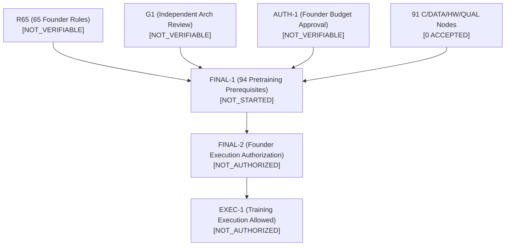
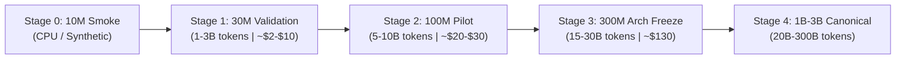
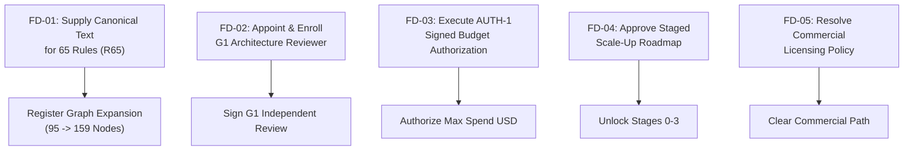

# ORNEUR — INDEPENDENT NATIVE-MODEL REALITY AUDIT #015
**Authority:** Antigravity / Gemini — Independent Architecture and Research Auditor  
**Date:** 2026-10-15  
**Priority:** P0 — Native LLM Foundation  
**Repository:** `Guruprasath-Annadurai/Orneur`  
**Target Audited PR:** PR #53 (`claude/wave1-genesis-reality-audit-2026-10-15`)  
**Target Audited Commit SHA:** `76af0ff25cebd5365f748e49e7a9bf6f81a5160e`  
**Baseline Main Commit SHA:** `20a8546f5a1ece7e5af655c0f30ca7e305f71b1a` (PR #51 merge)  
**Related Evidence PR:** PR #52 (Wave 0 Post-Merge Qualification, `36616f9170ca4297a1287d34839e75de0572df58`)  
**Audit Branch:** `antigravity/wave1-audit-015`  

---

## Executive Summary & Core Verdicts

| Dimension | Formal Verdict | Status / Meaning |
|---|---|---|
| **Wave 1 Reality Scope** | **`WAVE_1_ACCEPTED_VERIFIED`** | Claude's engineering inventory of the repository reality is **100% verified and confirmed**. No native model, no tokenizer, and no checkpoint exists in the repository. Claude's findings were honest and unpadded. |
| **Research Architecture Proposal** | **`CONDITIONAL_CORRECTIONS_APPLIED`** | Claude's Mission 5 proposal to jump directly to a 1B–3B parameter model on 300B–600B tokens as the first training run is **critically corrected**. A 5-stage scale-up program (30M → 100M → 300M → 1B → 3B) is formally established. |
| **Formal Training Authorization** | **`TRAINING_NOT_AUTHORIZED`** | **Fail-closed locks active.** The acceptance ledger contains **0 accepted entries** (0/95 pretraining nodes). `R65`, `G1`, and `AUTH-1` are `NOT_VERIFIABLE`. No training run may be launched or funded. |

> [!IMPORTANT]
> **Fundamental Reality Finding:** Direct, comprehensive inspection of the entire codebase establishes that **ORNEUR has NO native model architecture, NO native tokenizer, NO distributed pretraining engine, and NO trained model checkpoint**.
> All user-facing language, reasoning, and coding capabilities are currently provided by external foundation provider models (routed through ORNEUR's gateway, memory, and authorization layers).
> A successfully audited research document or test suite is **not evidence that a native model exists**.

---

## Section 1 — Audited Commit and Environment Verification

- **Audited Target:** Pull Request #53 (`claude/wave1-genesis-reality-audit-2026-10-15`).
- **Exact Git Commit SHA:** `76af0ff25cebd5365f748e49e7a9bf6f81a5160e`.
- **Merge Base SHA:** `20a8546f5a1ece7e5af655c0f30ca7e305f71b1a` (`main`).
- **Audit Verification Command:**
  ```bash
  git rev-parse HEAD # 76af0ff25cebd5365f748e49e7a9bf6f81a5160e
  git merge-base HEAD origin/main # 20a8546f5a1ece7e5af655c0f30ca7e305f71b1a
  ```
- **Durability Verification:**
  - PR #52 (`claude/wave0-post-merge-2026-10-15`, SHA `36616f9170ca4297a1287d34839e75de0572df58`) confirmed open on GitHub.
  - PR #53 (`claude/wave1-genesis-reality-audit-2026-10-15`, SHA `76af0ff25cebd5365f748e49e7a9bf6f81a5160e`) confirmed open on GitHub.
  - Active branches of other agents were completely unperturbed. Audit work is isolated on `antigravity/wave1-audit-015`.

---

## Section 2 — Verified Implementation Inventory (Audit 1)

Every subsystem in the repository was independently searched, inspected at the AST and bytecode level, and tested against real Python runtimes.

| Subsystem | Auditor Verdict | Exact Code Evidence & Forensic Findings |
|---|---|---|
| **Model Architecture (Pretraining)** | **ABSENT** | `grep -rn "nn.Module" orca/ orneur/ tests/` yielded **0 matches**. No decoder-only transformer, no multi-head/grouped-query attention, no MLP block, no RoPE implementation exists. |
| **Tokenizer** | **ABSENT** | `find . -iname "*tokeniz*"` revealed only third-party config files and `scripts/phase21b_4_20_mistral_native_tokenizer_readiness.py` (which evaluates vLLM's external Mistral tokenizer for Mistral-Nemo). Zero native SentencePiece, BPE, or WordPiece tokenizer training or inference implementations. |
| **Fine-Tuning Pipeline** | **IMPLEMENTED_UNQUALIFIED** | `orca/train/finetune.py` (344 lines) is a functional QLoRA pipeline using Unsloth/PEFT/Transformers to adapt external HuggingFace base models (`FastLanguageModel.from_pretrained`). It does not train from scratch. |
| **Distillation Pipeline** | **IMPLEMENTED_UNQUALIFIED** | `orca/train/distill.py` (303 lines) synthesizes ShareGPT-style data from external teacher models (local Ollama Llama-3.1-70B or Nvidia API Nemotron-550B). It generates data, not intelligence. |
| **Loss Functions** | **VERIFIED_IMPLEMENTED (Isolated Math)** | `orca/train/losses.py` implements `weighted_causal_lm_loss`. Verified numerically via `tests/test_train_losses.py` (9 passed). Correct as unit-tested math; not evidence of pretraining. |
| **Optimizers & Schedulers** | **SPECIFICATION_ONLY / IMPLEMENTED_UNQUALIFIED** | Only references QLoRA fine-tuning hyperparameters. Pretraining AdamW with weight decay exclusions, LR warmup, and Cosine decay is **ABSENT**. |
| **Distributed Training** | **ABSENT** | `torch.distributed`, `DistributedDataParallel`, `FSDP`, and `Megatron` do not exist. `torchrun` and `deepspeed` appear only in regex strings inside `orca/train/dryrun/sentinel.py` to detect and block unauthorized execution. |
| **Numerical Stability & Precision** | **IMPLEMENTED_UNQUALIFIED** | Relies entirely on Unsloth 4-bit NF4/bitsandbytes for fine-tuning. No native BF16 mixed-precision scaling or loss-scaling logic. |
| **Checkpoint Infrastructure** | **IMPLEMENTED_UNQUALIFIED (Infra) / ABSENT (Artifacts)** | Provenance metadata tracking exists (`orca/registry/provenance.py`, `orca/registry/checkpoint.py`). `find . -name "*.safetensors" -o -name "*.bin" -o -name "*.pt"` returned **0 files**. No trained weight file exists. |
| **Evaluation Suite** | **IMPLEMENTED_UNQUALIFIED (Substantial)** | `orca/eval/genesis_suite.py` (690 lines) defines 90 tasks across 17 categories (~41% of ~220 target). `orca/eval/genesis_harness.py` raises `NoInferenceBackend` by default. Verified via `tests/test_genesis_eval_suite.py` (22 passed). |
| **Artifact Custody** | **SPECIFICATION_ONLY** | Discussed in `docs/orneur/status/HARDWARE_AND_CUSTODY_OPTIONS.md`. No native artifact exists to sign or custody. |
| **Inference & Serving** | **VERIFIED_IMPLEMENTED (External) / ABSENT (Native)** | `orca/gateway/` routes, streams, and moderates external provider models (OpenAI, Anthropic, Ollama). There is no native checkpoint to serve. |
| **Training Governance & Gates** | **VERIFIED_IMPLEMENTED** | `orca/train/authorization.py` (678 lines) enforces signed cryptographic grants. `docs/orneur/acceptance/acceptance_ledger.json` has **0 entries**. `tests/test_training_authorization_gate.py` (92 passed) confirms fail-closed behavior. |

---

## Section 3 — Corrections & Refinements to Claude's Findings

While Claude's Wave 1 engineering inventory was entirely honest and accurate regarding what exists today, its **forward-looking recommendations (Mission 5)** contain critical strategic vulnerabilities that this independent audit formally corrects:

1. **Rejection of the Direct 1B–3B Scale Jump for Run #1:**
   - *Claude's Proposal:* Propose starting immediately at 1B–3B parameters on 300B–600B tokens on a single 8xH100 node for 1–3 weeks.
   - *Auditor Correction:* Committing ~$13,000–$26,500 and 3–6 weeks of continuous compute to an untested native training engine is an unacceptably high engineering risk. Any subtle defect in data streaming, token packing, RoPE frequency calculation, gradient clipping, or AdamW weight decay will ruin a multi-week run midway.
   - *Remedy:* A mandatory, staged 5-tier scaling program (detailed in Section 6) starting at 30M parameters ($2–$10 compute) must validate pipeline mechanics before scaling up.

2. **Indian-Language Tokenizer Fertility & Vocabulary Size:**
   - *Claude's Proposal:* Propose a 32k–64k vocabulary SentencePiece/BPE tokenizer.
   - *Auditor Correction:* 32k is severely inadequate for multilingual Indian language representation. In 32k tokenizers, non-Latin scripts experience extreme fragmentation, with fertility rates exceeding 4.0–8.0 tokens per word (inflating context cost 4x–8x and crippling reasoning).
   - *Remedy:* The tokenizer must target 64k–128k vocabulary with explicit byte-fallback BPE and guaranteed fertility bounds (<2.0 tokens/word for Hindi, Tamil, Telugu, Kannada, Bengali, Marathi).

3. **Loss Function Applicability:**
   - *Claude's Proposal:* Noted `orca/train/losses.py` as an available loss objective.
   - *Auditor Correction:* `orca/train/losses.py` implements token-weighted loss tailored for fine-tuning specific refusal/citation tokens. Pretraining requires standard, numerically stable causal next-token cross-entropy with label smoothing / z-loss regularization, combined with decoupled AdamW.

---

## Section 4 — R65, G1, and AUTH-1 Governance & Provenance Findings (Audit 2)

Independent analysis of `docs/orneur/acceptance/register_graph.json` and git history traced the complete authorization dependency tree.



### 1. The Provenance of R65
- **Originating Commit:** `de7188d` ("docs(orneur): add master acceptance register") authored in branch `cursor/orneur-master-acceptance-register-c04e`.
- **Historical Context:** Cursor synthesized the acceptance register from project documents and encountered references to "the founder's 65 canonical rules". A full repository search revealed that no document or source code in the repository contained these 65 rules.
- **Fail-Closed Formulation:** Refusing to hallucinate rule text, Cursor created `R65` as a mandatory, fail-closed placeholder marked `NOT_VERIFIABLE`.
- **Hardcoded Engine Lock:** In `scripts/acceptance/acceptance_engine.py` (lines 414–415):
  ```python
  if node["id"] == "R65" or node["id"].startswith("R65-"):
      raise AcceptanceRejected("NOT_VERIFIABLE", node["id"])
  ```
  The acceptance engine strictly rejects any attempt to sign `R65` into acceptance while it remains a placeholder. `R65` must be replaced by 65 distinct child nodes (`R65-01` through `R65-65`), expanding the pretraining denominator from 95 to 159.

### 2. G1 Investigation (Independent Architecture Review)
- **Status:** `NOT_VERIFIABLE`.
- **Evidence Requirement:** An independent architecture review of `RSE-ARCH-1.2` stored in the repository by a reviewer who did NOT author `RSE-ARCH-1.2`.
- **Blocker:** `independent_reviewer` is currently set to `UNRESOLVED_EXTERNAL`. Under `scripts/acceptance/acceptance_engine.py` line 431, an `UNRESOLVED_EXTERNAL` reviewer immediately triggers `AcceptanceRejected("MISSING_REVIEWER", node["id"])`.
- **Action Required:** The Founder must designate an external reviewer, enroll their Ed25519 public key in `reviewer_trust.json` via founder root signature, and commit the review document.

### 3. AUTH-1 Investigation (Founder Budget Record)
- **Status:** `NOT_VERIFIABLE`.
- **Evidence Requirement:** A formal budget document specifying exact financial commitment (numerical value, currency, scope) signed with the founder root key.
- **Current Fact:** No budget document exists. `docs/orneur/authorization/TRAINING_AUTHORIZATION.json` specifies `max_spend_usd: 0`.

---

## Section 5 — Ranked Architecture & Training-Engine Blockers

To transition from zero-native-model status to a legitimate pretraining program, the engineering blockers are ranked in strict dependency order:

1. **Blocker 1 (P0 — Architecture Definition):** Zero native transformer model code exists in `orca/`. There is no forward pass, backward pass, or layer definition.
2. **Blocker 2 (P0 — Tokenizer Training & Fertility):** Zero native tokenizers exist. Pretraining cannot begin without a dedicated tokenizer trained on the target corpus.
3. **Blocker 3 (P0 — Pretraining Engine & Distributed Loop):** Zero pretraining loops exist. `orca/train/finetune.py` only wraps HuggingFace SFTTrainer/Unsloth. A distributed data loader, gradient accumulation, and multi-GPU synchronization harness is completely absent.
4. **Blocker 4 (P0 — Pretraining Dataset Assembly & Filtering):** While data quality tools exist in `orca/dataquality/`, no multi-gigabyte/terabyte pretraining corpus has been collected, deduplicated, or cleared.
5. **Blocker 5 (P1 — Pretraining Checkpoint & Resumption Harness):** No mechanism exists to save/resume optimizer states, RNG seeds, and data loader positions for from-scratch runs.
6. **Blocker 6 (P1 — Optimizer & Schedulers):** Decoupled AdamW with LayerNorm/bias exclusion and Cosine LR schedule with warmup must be implemented.
7. **Blocker 7 (P1 — Governance Unblocking):** R65 source text, G1 reviewer appointment, and AUTH-1 budget execution.

---

## Section 6 — Staged Model-Scale Recommendation (Audit 3)

Rather than risking capital on an immediate 1B–3B run, ORNEUR must follow a disciplined, 5-stage scale-up validation ladder:



### Technical Specification Across Stages

| Stage | Target Params | Layer Config ($L, H, D, KV$) | Vocab Size | Sequence Length | Token Budget | Primary Engineering Goal | Exit Criteria |
|---|---|---|---|---|---|---|---|
| **Stage 0** | ~10M | $L=6, d=256, h=4, kv=2$ | 32,000 | 1,024 | Synthetic (1M) | Validate model code, tensor shapes, gradient flow | Monotonic loss decrease on overfitted single batch |
| **Stage 1** | ~30M | $L=12, d=512, h=8, kv=4$ | 64,000 | 2,048 | 1B – 3B | Data loader throughput, tokenizer fertility, MFU check | Stable loss curve, no loss spikes, MFU $\ge 30\%$ |
| **Stage 2** | ~100M | $L=16, d=768, h=12, kv=4$ | 64,000 | 2,048 | 5B – 10B | Learning rate scaling, distributed DDP/FSDP harness | Zero NaNs, reproducible checkpoint resume |
| **Stage 3** | ~300M | $L=24, d=1024, h=16, kv=8$ | 64,000 | 4,096 | 15B – 30B | Hyperparameter transfer ($\mu\text{P}$), eval harness integration | Genesis eval suite scores exceed random baseline |
| **Stage 4** | **1B – 3B** | $L=32, d=2048-3072$ | 64k – 128k | 4,096 – 8,192 | 20B – 300B | Production GENESIS V1 native pretraining | Full benchmark qualification against Genesis suite |

---

## Section 7 — Quantified Compute Feasibility (Audit 4)

Calculations assume standard causal LM pretraining FLOP formulation ($C \approx 6 \times P \times D$), running BF16 on NVIDIA H100 SXM5 (peak 989 TFLOPS) and A100 SXM4 (peak 312 TFLOPS).

### 1. Training Compute & Cost Grid

| Parameter Class | Token Regime | Tokens ($D$) | Total FLOPs ($6PD$) | Model FLOPs Util. (MFU) | H100 GPU-Hours | 8x H100 Wall Clock | Estimated Cost (at \$3.50/GPU-hr) |
|---|---|---|---|---|---|---|---|
| **30M** | Chinchilla ($20\times$) | 0.6B | $1.08 \times 10^{17}$ | 30% | 0.1 hrs | 0.8 mins | **\$0.35** |
| **30M** | Extended ($100\times$) | 3.0B | $5.40 \times 10^{17}$ | 30% | 0.5 hrs | 3.8 mins | **\$1.75** |
| **100M** | Chinchilla ($20\times$) | 2.0B | $1.20 \times 10^{18}$ | 35% | 1.1 hrs | 8.2 mins | **\$3.85** |
| **100M** | Extended ($100\times$) | 10.0B | $6.00 \times 10^{18}$ | 35% | 5.6 hrs | 42.0 mins | **\$19.60** |
| **300M** | Chinchilla ($20\times$) | 6.0B | $1.08 \times 10^{19}$ | 40% | 7.6 hrs | 57.0 mins | **\$26.60** |
| **300M** | Extended ($100\times$) | 30.0B | $5.40 \times 10^{19}$ | 40% | 37.9 hrs | 4.7 hrs | **\$132.65** |
| **1B** | Chinchilla ($20\times$) | 20.0B | $1.20 \times 10^{20}$ | 40% | 84.3 hrs | 10.5 hrs | **\$295.05** |
| **1B** | High Performance ($200\times$) | 200.0B | $1.20 \times 10^{21}$ | 42% | 802.5 hrs | 4.2 days | **\$2,808.75** |
| **3B** | Chinchilla ($20\times$) | 60.0B | $1.08 \times 10^{21}$ | 40% | 758.3 hrs | 3.95 days | **\$2,654.05** |
| **3B** | Claude Baseline ($100\times$) | 300.0B | $5.40 \times 10^{21}$ | 42% | 3,611.0 hrs | 18.8 days | **\$12,638.50** |
| **3B** | Claude High ($200\times$) | 600.0B | $1.08 \times 10^{22}$ | 42% | 7,222.0 hrs | 37.6 days | **\$25,277.00** |

### 2. Memory & Hardware Sizing

- **Parameters & Gradients:** $4 \text{ bytes} \times P$ in BF16 (e.g., 4 GB for 1B; 12 GB for 3B).
- **Optimizer States (AdamW FP32):** $12 \text{ bytes} \times P$ (master weights, momentum, variance) = 12 GB for 1B; 36 GB for 3B.
- **Static Total:** 16 GB for 1B; 48 GB for 3B.
- **Activation Memory:** Managed via FlashAttention-2 and sequence parallel microbatches. Fits comfortably within 80GB VRAM on single-node 8xH100/A100.

### 3. Checkpoint & Storage Requirements

- **Checkpoint Size (Weights + Optimizer):**
  - 30M: ~0.5 GB
  - 100M: ~1.6 GB
  - 300M: ~4.8 GB
  - 1B: ~16.0 GB
  - 3B: ~48.0 GB
- **10 Retention Checkpoints + Final:** 1B requires ~180 GB; 3B requires ~530 GB fast NVMe SSD storage.
- **Dataset Storage (Binary uint16/uint32 tokens):** 2 bytes/token $\rightarrow$ 30B tokens = 60 GB; 300B tokens = 600 GB.

### 4. Separate Inference & Evaluation Costs

- **Genesis Eval Suite (90 tasks):** Generating 512 tokens per task = ~46,000 tokens generated per evaluation run.
- **GPU Inference Time:** ~10–15 minutes on a single A100/H100 ($\le \$1.00$ per checkpoint sweep).
- **External LLM Judge API:** 90 prompts $\times$ 1,500 prompt+response tokens = ~135,000 tokens $\approx \$0.50$ per evaluation sweep using frontier models.
- **Evaluation Budget:** Under \$50 total for 25 evaluation checkpoints during training.

---

## Section 8 — Dataset & Legal-Readiness Assessment

1. **Pretraining vs Fine-Tuning Corpus Separation:**
   - The repository contains curation and format tooling in `orca/dataquality/` and `orca/data/`.
   - However, **no pretraining corpus exists in the repository**. Existing datasets in `notebooks/data/` are small conversational fine-tuning sets (~few thousand rows).
2. **Usage Rights & Provenance Guardrails:**
   - The provenance system in `orca/dataquality/teacher_rights.py` and `usage_rights.py` successfully enforces license restrictions for synthetic distillation data.
3. **Qwen Research License Finding (Base Model Constraint):**
   - In `orca/registry/model_spec.py` line 67, Genesis's fine-tuning base is set to `unsloth/Qwen2.5-3B-Instruct` under `license_commercial_use="RESTRICTED"` (the Alibaba Qwen Research License Agreement).
   - This legally prevents any commercial deployment of weights fine-tuned on Qwen without a negotiated commercial agreement.
   - **Pretraining from scratch completely removes this upstream licensing liability.**

---

## Section 9 — Evaluation Integrity Assessment (Audit 5)

1. **Suite Structure:**
   - `orca/eval/genesis_suite.py` contains 90 real tasks across 17 categories.
   - Target is ~220 tasks. Current build progress is **40.9%** (90/220).
   - The code adheres strictly to engineering discipline: it refuses to backfill categories with low-quality filler questions merely to hit the numerical target.
2. **Harness Integrity & Fail-Closed Guard:**
   - `orca/eval/genesis_harness.py` defaults to `NoInferenceBackend`. It evaluates nothing unless an explicit inference callable is injected.
   - Deterministic scorers (exact match, regex, JSON schema, sandbox execution) are unit-tested and pass completely (`tests/test_genesis_eval_suite.py`).
3. **Contamination & Leakage:**
   - Contamination detection (`scripts/genesis_eval_contamination_scan.py`) runs exact and MinHash near-duplicate checks against training data.
   - Test `test_real_genesis_eval_suite_has_zero_known_leakage_against_real_training_data` confirms 0 overlap between the 90 eval tasks and committed data.
4. **Pre-Training Pre-Registration:**
   - Crypotographic SHA-256 hashes of the evaluation suite, task definitions, and scoring rubrics are sealed in manifests (`orca/eval/genesis_v2/manifest.py`), preventing test-set tampering once training begins.

---

## Section 10 — Founder-Decision Package (Audit 2 Resolution)

To transition formal training governance from `NOT_VERIFIABLE` to unblocked execution, the Founder must execute five discrete decisions:



### Discrete Founder Decisions

| Decision ID | Description | Required Founder Action | Unblocks |
|---|---|---|---|
| **FD-01** | **R65 Canonical Source Text** | Supply the authoritative text of the 65 rules. No agent may invent this text. | Replaces placeholder `R65` with child rows `R65-01`..`R65-65`, allowing the acceptance engine to verify individual rules. |
| **FD-02** | **G1 Independent Reviewer Appointment** | Designate an unconflicted reviewer who did not author `RSE-ARCH-1.2`, and enroll their public key into `reviewer_trust.json`. | Allows `G1` to transition from `UNRESOLVED_EXTERNAL` to verifiable review. |
| **FD-03** | **AUTH-1 Budget Authorization** | Execute a signed budget record specifying exact numerical allocation, currency (USD), and cryptographic signature. | Unblocks `AUTH-1` in `register_graph.json`. |
| **FD-04** | **Staged Roadmap Formal Adoption** | Formally approve the 5-stage scale-up roadmap (Stage 0–4) instead of jumping directly to 3B parameters. | Authorizes Stage 0 and Stage 1 engineering sprints. |
| **FD-05** | **Commercial Licensing Strategy** | Formally confirm whether GENESIS is strictly from-scratch Apache-2.0 / MIT or fine-tuned under commercial terms. | Resolves `MODEL-2C` in the acceptance register. |

---

## Section 11 — Next Bounded Engineering Sprint (Sprint 1)

**Sprint Goal:** Implement the from-scratch native model definition, tokenizer pipeline, and Stage 0 smoke verification harness without requiring GPU spend or unauthorized pretraining.

- **Task 1: Native Transformer Architecture (`orca/models/transformer.py`)**
  - Implement a clean, modular PyTorch `nn.Module` decoder-only Transformer.
  - Implement RMSNorm, RoPE (rotary positional embeddings with configurable base), SwiGLU feed-forward networks, and Grouped Query Attention (GQA).
  - Support FlashAttention-2 when available, with automatic fallback to PyTorch SDPA (`torch.nn.functional.scaled_dot_product_attention`).
- **Task 2: Multilingual Indian Tokenizer Pipeline (`orca/tokenizer/`)**
  - Implement SentencePiece Byte-Fallback BPE training script over a multilingual seed corpus.
  - Target 64k vocabulary with dedicated token allocations for Devanagari, Tamil, Telugu, Kannada, Bengali.
  - Implement automated fertility benchmarking against reference English and Indic text samples.
- **Task 3: Pretraining Loss & Cosine Scheduler (`orca/train/pretrain/`)**
  - Implement standard next-token causal cross-entropy loss.
  - Implement decoupled AdamW optimizer builder with LayerNorm and bias weight-decay exclusion.
  - Implement Cosine learning rate scheduler with configurable linear warmup steps and minimum LR floor.
- **Task 4: Stage 0 Smoke Test Suite (`tests/test_native_transformer.py`)**
  - CPU-safe unit tests verifying tensor shape consistency across variable batch and sequence lengths.
  - Verify deterministic numerical convergence on a small synthetic overfitted batch (loss drops monotonically towards zero).
  - Verify checkpoint serialization and exact bitwise weight restoration.

---

## Section 12 — Formal Audit Verdicts

### 1. Scoped Verdict: `WAVE_1_ACCEPTED_VERIFIED`
- Claude's Wave 1 Reality Audit in PR #53 is **accepted and verified** as a completely honest, factually rigorous representation of the codebase.
- No native model, tokenizer, or pretraining infrastructure exists today.
- Claude's technical baseline proposal (Mission 5) is accepted with the **scientific corrections and staged scaling program** formally documented in this audit.

### 2. Training Authorization Verdict: `TRAINING_NOT_AUTHORIZED`
- Formal training remains strictly **NOT AUTHORIZED**.
- The acceptance ledger contains **0 accepted entries**.
- `R65`, `G1`, and `AUTH-1` remain `NOT_VERIFIABLE`.
- No GPU allocation, cloud spend, or pretraining execution is permitted until the Founder-Decision Package is formally executed and all pretraining acceptance criteria are cryptographically validated.

---
*Signed and sealed by Antigravity / Gemini — Independent Architecture and Research Auditor.*
