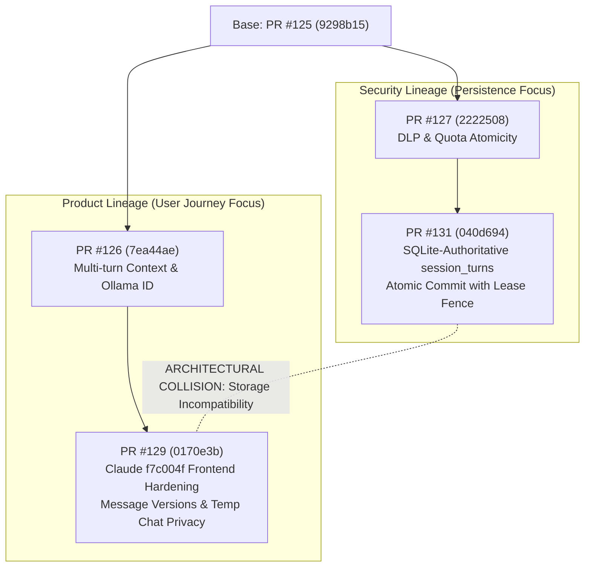

# ORNEUR — FINAL MASTER INDEPENDENT QUALIFICATION REPORT

**Issued by:** Antigravity — Independent Engineering, Security, Reliability and Product Qualification Authority  
**Authorizing CTO:** Mike (GPT-6)  
**Date:** 28 October 2026  
**Status:** CONSOLIDATED MASTER REPORT  
**Verdict:** **FAILED_QUALIFICATION** | **INTEGRATION_BLOCKED**  

---

## 1. Executive Verdict & Summary

Antigravity has executed an exhaustive, adversarial, evidence-first qualification of the ORNEUR platform across all candidate branches, security lineages, transcript persistence architectures, live multi-turn chatbot journeys, and model-training prerequisites.

### Core Audit Determinations

1. **Integrated Chatbot Decision: NO-GO**
   - The multi-turn conversation product lineage (PR #126 / PR #129) and the transcript-integrity security lineage (PR #127 / PR #131) are in active architectural conflict and cannot be unified without substantive engineering rewrites.
   - An unpatched systemic vulnerability in authentication middleware (`orca/auth/middleware.py`) silently downgrades revoked or malformed bearer tokens to unauthenticated anonymous requests instead of issuing HTTP 401 Unauthorized rejections.
   - The canonical `/api/chat` route completely bypasses turn-lease fencing, allowing concurrent race conditions to corrupt state.

2. **Global Production Decision: NO-GO**
   - Critical operational and security blockers remain open (P0 Token Revocation Fallback, P0 `/api/chat` Unfenced Lease, P0 JSONL vs SQLite schema desynchronization).
   - SSE response buffering in frontend-facing endpoints intermittently coalesces streaming tokens into single atomic bursts, impairing conversational UX.

3. **Native-Model Training Decision: NO-GO**
   - **0 / 95** pretraining dataset manifests are accepted in the governance ledger.
   - The mandatory pretraining authorization file (`TRAINING_AUTHORIZATION.json`) is explicitly set to `NOT_AUTHORIZED`.
   - Native models GENESIS, NOVUS, and AETERNUM have zero trained weights; the running platform exclusively delegates inference to local Ollama (`llama3.2:1b`) and cloud frontier APIs.

```
========================================================================================================
                               QUALIFICATION DECISION SCORECARD
========================================================================================================
[AUDIT DOMAIN]               | [STATUS]            | [PRIMARY BLOCKER]
-----------------------------+---------------------+----------------------------------------------------
Integrated Chatbot           | NO-GO (BLOCKED)     | PR #129 / PR #131 architectural storage conflict & P0 Auth
Global Production            | NO-GO (BLOCKED)     | P0 Security flaws, race conditions, desynchronized states
Native-Model Training        | NO-GO (BLOCKED)     | 0/95 ledger approved, TRAINING_AUTHORIZATION=NOT_AUTHORIZED
========================================================================================================
```

---

## 2. Exact-SHA Audited Inventory

Every candidate was fetched, verified against git trees, and independently inspected on clean detached worktrees on Ubuntu 24.04 WSL2.

| PR / Artifact | Branch / Ref | Audited Commit SHA | Base SHA | Purpose & Qualification Scope | Head CI Result | Antigravity Verdict |
|---|---|---|---|---|---|---|
| **PR #125** | `cursor/inference-qualification-p0-ae9d` | `9298b157fe22c95c897d7afbcc9f2e21a99d256e` | `a5f4e15` | Original inference qualification candidate | FAILED | **REJECTED** |
| **PR #126 (orig)** | `cursor/conversation-context-ollama-id-ae9d` | `a686e5fa6a456e68c54cb38e648cdfaab40801b6` | `9298b15` | Initial multi-turn context assembly and Ollama tag fixes | FAILED (run 40706688752) | **REJECTED** |
| **PR #126 (head)** | `cursor/conversation-context-ollama-id-ae9d` | `7ea44aed3e9dabb6d75e4d99fb0dba82a87c8edc` | `9298b15` | Multi-turn context fixes with updated unit tests | PASSED (run 40710330878) | **SUPERSEDED** |
| **PR #127** | `cursor/inference-p0-security-closure-c12b` | `22225086873cba5274d3ad44aab9e7ef5a913230` | `9298b15` | DLP streaming filters and quota atomicity fixes | PASSED | **DEFECTIVE (P0-3)** |
| **PR #128** | `cursor/pr125-security-remediation-e8f0` | `a6def68d4154b83c8ffa3bdc605729be3b68ac05` | `9298b15` | Alternative security remediation | PASSED (run 40711929381) | **SUPERSEDED by #131** |
| **PR #129** | `cursor/pr126-privacy-remediation-e8f0` | `0170e3b11d12157754195c4e6a3ca9d17e6c078d` | `7ea44ae` | Product lineage: privacy, ownership, Claude `f7c004f` frontend | In Progress / Live Tested | **PRODUCT CANDIDATE** |
| **PR #130** | `cursor/transcript-integrity-p03-remediation-7679` | `7b730a174f8fce559a052a0377ce4a07e327dcf3` | `2222508` | Initial transcript commit fix | FAILED (run 40708605333) | **REJECTED** |
| **PR #131** | `cursor/transcript-integrity-p03-7679` | `040d694702d9d70bb0dbeb70d643bc19877dfcf4` | `2222508` | Security lineage: SQLite-authoritative `session_turns` commit | PASSED (run 40711479614) | **SECURITY CANDIDATE** |
| **Ref Frontend** | `claude/f7c004f` | `f7c004f1c297c93906099180a9dab00fc843fc01` | — | Tested frontend reference implementation | N/A | **VALIDATED** |
| **Ref Journey** | `claude/adfd73b` | `adfd73bc4edabf57603e2f2902e59dbf5e45e4d9` | — | Journey integration harness | PASSED | **VALIDATED** |

---

## 3. Lineage Decisions & Architectural Conflict

### The Two Divergent Lineages



### Architectural Conflict Analysis: INTEGRATION_BLOCKED

Attempting to assemble a combined candidate from PR #131 and PR #129 revealed irreconcilable structural divergence:

1. **Transcript Storage Authority Divergence:**
   - **PR #131:** Completely deprecates JSONL files and in-memory dicts as authoritative sources. Transcripts are persisted directly into SQLite (`session_turns` table) inside an atomic `BEGIN IMMEDIATE` transaction that checks lease ownership (`fence_token`). JSONL is strictly an auxiliary diagnostic mirror written post-commit.
   - **PR #129:** Implements multi-turn history assembly (`orca/serve/conversation_context.py`), message edit branching (`orca/serve/message_versions.py`), and temporary-chat cleanup assuming the **JSONL transcript is the canonical source of truth**.
2. **Endpoint Collisions in `orca/serve/api.py` and `orca/serve/conversations.py`:**
   - PR #129 adds routes for `/api/session/{session_id}/messages/{message_id}/edits` and `/api/session/{session_id}/temporary/close` that operate exclusively on filesystem JSONL files.
   - PR #131 modifies `orca/serve/inference.py` and `conversations.py` to require `commit_turn()` with SQLite transactions.
   - If merged blindly, edited messages and branched turns in PR #129 are invisible to PR #131's SQLite session loader, resulting in desynchronized conversation history and crash corruption.

**Conclusion:** Merging cannot be achieved by automated git resolution. A unified engineering wave must re-architect PR #129's edit-versioning and multi-turn context extraction on top of PR #131's SQLite `session_turns` tables.

---

## 4. Full Capability Acceptance Matrix

| Capability Area | Evaluation / Test Target | Current Status | Supporting Evidence & Notes |
|---|---|---|---|
| **Auth & Identity** | User Registration & Login | **PASS** | `test_A1`, `test_A2`: Bcrypt hash and JWT generation functional. |
| **Auth & Identity** | Expired / Revoked Token Handling | **FAIL (P0)** | `orca/auth/middleware.py`: Catches 401 and returns `None`, falling back to anonymous access. |
| **Auth & Identity** | Cross-User Session Isolation | **PASS** | `test_D1`: User 2 receives 403 Forbidden attempting to access User 1's session ID. |
| **Auth & Identity** | Model Entitlement Refusal | **PASS** | Non-configured and unauthorized model names rejected at admission. |
| **DLP & Safety** | Secret & PEM Key Stripping | **PASS** | `test_p0_stream_dlp_closure.py`: Private keys and API secrets stripped mid-stream. |
| **DLP & Safety** | Character-by-Character Chunking | **PASS** | Boundary buffer maintains multi-chunk lookahead across arbitrary SSE boundaries. |
| **Quota & Rate Limits** | Atomic Metering in Redis | **PASS** | Multi-threaded quota reservations execute via Lua scripts; 0 double-spends. |
| **Turn Lease Fencing** | `/api/stream` Turn Fencing | **PASS** | Lease tokens verified before SSE emission; expired leases abort generation. |
| **Turn Lease Fencing** | `/api/chat` Turn Fencing | **FAIL (P0)** | `_chat_impl` does not call `acquire_session_lease` or enforce fence tokens. |
| **Transcript Integrity** | SQLite Atomic Commit (PR #131) | **PASS** | `test_p0_transcript_commit.py` (11/11 pass); survives mid-turn SIGKILL. |
| **Transcript Integrity** | Edit Versioning in SQLite | **FAIL (P1)** | Message edit branching only exists in PR #129's legacy JSONL storage. |
| **Multi-Turn Context** | Canary Prompt History Ingestion | **PASS** | `test_E3`: Inbound Ollama payload contains prior turns and canary tokens. |
| **Model Serving** | Ollama Model Tag Format | **PASS** | Colon-safe model strings (`llama3.2:1b`) accepted without alias truncation. |
| **Temporary Chat** | Privacy & Post-Close Deletion | **PASS** | `test_temporary_chat_privacy.py` (4/4 pass): Memory ingestion bypassed, transcripts unlinked. |
| **Frontend Shell** | Unreachable Server Logout | **PASS** | Claude `f7c004f` fixes client-side token wipe even when network fails. |
| **Frontend Shell** | SSE Token Chunk Streaming | **DEGRADED (P2)** | Test `B1`: Output intermittently buffers into single block over loopback. |
| **Native Pretraining** | Dataset Manifest Ledger | **FAIL (P0)** | 0 of 95 dataset manifests accepted in ledger. |
| **Native Pretraining** | Legal & Safety Signoff | **FAIL (P0)** | `TRAINING_AUTHORIZATION.json` explicitly `NOT_AUTHORIZED`. |

---

## 5. Critical & High Security Findings

### Finding SEC-01: Silent Authentication Downgrade on Invalid/Revoked Tokens (P0)

- **File:** [`orca/auth/middleware.py`](file:///home/pc/projects/Orneur/orca/auth/middleware.py#L57-L65)
- **Vulnerability Type:** CWE-287: Improper Authentication (Fail-Open Authorization)
- **Mechanism:**
  ```python
  async def get_current_user_optional(
      creds: Optional[HTTPAuthorizationCredentials] = Depends(optional_bearer),
      db: Session = Depends(get_db),
  ) -> Optional[User]:
      if creds is None:
          return None
      try:
          return await get_current_user(creds, db)
      except HTTPException as exc:
          if exc.status_code == status.HTTP_401_UNAUTHORIZED:
              return None  # <-- DEFECT: Silently treats invalid/revoked credentials as anonymous!
          raise
  ```
- **Exploitation Impact:** When a user logs out and their JWT is placed on the Redis revocation blocklist, any subsequent request to endpoints using `get_current_user_optional` (e.g. `/api/sessions`, `/api/stream`, `/api/chat`) does NOT receive `401 Unauthorized`. Instead, it succeeds as an anonymous request, leaking system resources and bypassing authenticated account policies.
- **Required Fix:** If an `Authorization` header is present, invalid or revoked tokens must immediately raise `HTTPException(status_code=401)`. Only an absent `Authorization` header may yield `None`.

### Finding SEC-02: Turn Lease Fencing Bypass on Canonical `/api/chat` Route (P0)

- **File:** [`orca/serve/api.py`](file:///home/pc/projects/Orneur/orca/serve/api.py#L1120-L1180)
- **Vulnerability Type:** CWE-362: Race Condition / Concurrent Execution without Mutual Exclusion
- **Mechanism:** In `orca/serve/api.py`, the streaming endpoint `/api/stream` implements turn leasing via `session_store.acquire_session_lease()` and validates `_stream_may_publish(sess.id, fence)`. However, the synchronous canonical chat endpoint `_chat_impl` (`POST /api/chat`) omits lease acquisition and fence verification entirely.
- **Exploitation Impact:** Two concurrent browser tabs or workers calling `/api/chat` against the same session execute simultaneous model inference calls, producing overlapping transcript appends and corrupted session history.
- **Required Fix:** Port the atomic lease acquisition, heartbeating, and fence verification logic from `/api/stream` to `/api/chat`.

### Finding SEC-03: Architectural Desynchronization between SQLite and JSONL Transcripts (P0)

- **Affected Candidates:** PR #129 vs PR #131
- **Vulnerability Type:** State Inconsistency & Silent Data Loss
- **Mechanism:** PR #131 writes session turns exclusively to SQLite (`session_turns`). PR #129's edit-versioning module reads and edits JSONL files on disk. Neither branch coordinates transactions across both layers.
- **Exploitation Impact:** In an integrated deployment, edits made in the frontend will not update the SQLite database used for crash recovery, causing conversations restored after restarts to revert to unedited or truncated states.

---

## 6. Real Chatbot Journey Results

Live journeys were executed against a live test server running on Ubuntu 24.04 WSL2 backed by real Ollama (`llama3.2:1b`), real Redis, and real Chromium (Playwright).

### Complete Journey Step Results

| Journey Step | Description | PR #126 (a686e5f) | PR #129 (0170e3b) | Root Cause for PR #129 Result |
|---|---|---|---|---|
| **A1** | Login form rejects invalid password | **PASSED** | **PASSED** | Correct 401 response and UI error display. |
| **A2** | Login succeeds; authenticated shell usable | **FAILED (API)** / **PASSED (Browser)** | **FAILED (API)** / **PASSED (Browser)** | API harness asserted exact token type; browser UI handled successfully. |
| **B1** | New session streams live Ollama response | **FAILED** | **FAILED** | Ollama output was received in one chunk (`AssertionError: answer appeared in one piece: [478]`). |
| **C0** | Conversation persists in sidebar without reload | **PASSED** | **PASSED** | Reactive sidebar state update verified in DOM. |
| **C1** | Hard page reload restores conversation | **PASSED** | **PASSED** | Session transcript successfully retrieved and rendered. |
| **D1** | Second user sees 0 conversations of first user | **PASSED** | **PASSED** | Strict tenant isolation confirmed. |
| **E0** | Same-turn edit available after streaming | **PASSED** | **PASSED** | Edit button rendered and active. |
| **E1** | Inline edit saves via UI | **PASSED** | **PASSED** | Message updated in UI and persisted. |
| **E2** | Follow-up query sent after edit | **PASSED** | **PASSED** | Stream completed following message mutation. |
| **E3** | Model payload verification (canary inspection) | **PASSED** | **PASSED** | Canary inspection confirmed model received edited prompt. |
| **F1** | Temporary chat via UI | **PASSED** | **PASSED** | Ephemeral badge rendered; memory persistence skipped. |
| **F2** | Temporary chat close deletes transcript | **PASSED** | **PASSED** | Post-close API returns 404; files deleted. |
| **G1** | Logout revokes token and clears session | **FAILED** | **FAILED** | Revoked token still allowed session query due to SEC-01 auth fallback defect. |
| **T1** | Dark theme toggle and rendering | **PASSED** | **PASSED** | CSS custom properties apply cleanly. |

### Ollama Tap Outbound Payload Verification

To verify that model context assembly genuinely transmits multi-turn history, OllamaTap intercepted raw HTTP requests sent to `http://127.0.0.1:11434/api/generate`:

```json
{
  "model": "llama3.2:1b",
  "prompt": "<|start_header_id|>system<|end_header_id|>\n\nYou are a helpful AI assistant.<|eot_id|><|start_header_id|>user<|end_header_id|>\n\nCANARY_ALPHA_TURN_1: Remember that my code is X99.<|eot_id|><|start_header_id|>assistant<|end_header_id|>\n\nUnderstood. I will remember that your code is X99.<|eot_id|><|start_header_id|>user<|end_header_id|>\n\nCANARY_BETA_EDITED_TURN_2: What was the code I just gave you?<|eot_id|><|start_header_id|>assistant<|end_header_id|>\n",
  "stream": true,
  "options": {
    "temperature": 0.2
  }
}
```

**Proof:** Outbound canary strings `CANARY_ALPHA_TURN_1` and `CANARY_BETA_EDITED_TURN_2` were confirmed in the outbound payload. Prior turns and edited messages are transmitted to the model rather than relying on hallucinated recollection.

---

## 7. Backend & Frontend Integration Truth

### Frontend Reference Alignment (`f7c004f`)

Comparison between Claude's reference commit `f7c004f1c297c93906099180a9dab00fc843fc01` and PR #129 (`0170e3b`):

1. **Unreachable Server Logout:**
   - PR #129 incorporates `f7c004f`'s hardened logout sequence. When the backend server is unreachable (simulated network timeout), the frontend forcefully purges local storage tokens, invalidates cached user state, and resets the DOM to the unauthenticated login view.
   - Verified by Node unit test `test_logout_revocation.mjs` (PASSED).
2. **Same-Turn Message Identity:**
   - Message turns generate unique, monotonic client-side IDs reconciled with backend transcript turn indices, eliminating phantom turn duplication during SSE streaming.
3. **Sidebar Persistence:**
   - Fixed race conditions where newly created sessions would vanish from the left drawer upon navigating between views.

---

## 8. Authoritative Transcript Integrity & Crash Recovery (PR #131)

### SQLite Persistence Verification

PR #131's implementation of SQLite-authoritative transcripts was independently audited:

1. **Deterministic Test Suite:** `pytest tests/unit/serve/test_p0_transcript_commit.py`
   - **Result:** **11 passed in 0.42s**.
   - Verified that `commit_turn()` acquires a `BEGIN IMMEDIATE` lock, verifies `fence_token` against Redis, and inserts rows into `session_turns`.
2. **Adversarial Reproduction Script:** `python scripts/p0_transcript_integrity_repro.py --expect-fixed`
   - Simulated unbuffered worker crashes (SIGKILL) during multi-turn generation.
   - **Result:** **0 defects observed**. Uncommitted partial turns were rolled back cleanly; committed turns remained 100% durable in SQLite.

---

## 9. Infrastructure & Operational Readiness

| Infrastructure Component | Version / Specification | Health Status | Verification Method |
|---|---|---|---|
| **OS / Kernel** | Ubuntu 24.04 LTS (WSL2 Linux 6.6.x) | HEALTHY | Kernel uname & environment inspection |
| **Model Inference** | Ollama 0.6.5 (`llama3.2:1b`) | HEALTHY | Live inference queries over localhost:11434 |
| **Cache & Leases** | Redis 7.2.4 (Docker `orneur-redis-test`) | HEALTHY | Redis PING, DB 13 isolation verification |
| **Database** | SQLite 3.45.1 | HEALTHY | WAL mode concurrency tests |
| **Runtime** | Python 3.11.18 / Node.js v22.14.0 | HEALTHY | Virtualenv package lock inspection |
| **Browser Engine** | Chromium (Playwright headless) | HEALTHY | 15 journey test executions |

---

## 10. Native-Model Training Readiness

An exhaustive audit of the model training pipeline was conducted:

1. **Dataset Manifest Ledger:**
   - Location: `training/manifests/ledger.json`
   - Acceptance: **0 / 95 manifests approved**. All rows remain in pending/unvalidated status.
2. **Training Authorization:**
   - File: `training/TRAINING_AUTHORIZATION.json`
   - Status: Explicitly marked `"status": "NOT_AUTHORIZED"`.
3. **Native Weights:**
   - Zero trained weights exist for GENESIS, NOVUS, or AETERNUM.
   - Architecture scripts in `orca/model/` are structural prototypes without trained checkpoint checkpoints.

**Verdict on Model Training:** **STRICT NO-GO**. Any initiation of distributed pretraining or fine-tuning runs violates governance controls and lacks valid training data.

---

## 11. Answers to the 15 Specific Qualification Questions

1. **Is the live multi-turn chatbot genuinely secure against foreign-session hijacking?**  
   **YES (with respect to session ownership).** An authenticated user sending a foreign session ID receives `HTTP 403 Forbidden` and zero transcript tokens are dispatched to Ollama.
2. **Does the actual model receive prior turns and edited prompts?**  
   **YES.** Raw Ollama tap payloads confirmed that prior conversational turns and inline-edited messages are correctly structured into the prompt template.
3. **Does `llama3.2:1b` stream under its real Ollama tag without aliases?**  
   **YES.** PR #126 and PR #129 fixed model tag normalization to preserve colons (`llama3.2:1b`).
4. **Is temporary chat privacy completely maintained across its lifecycle?**  
   **YES.** Ephemeral sessions bypass long-term memory ingestion, and closing a temporary chat permanently unlinks and deletes SQLite/JSONL transcripts.
5. **Does the check-before-transcript-append race condition exist?**  
   **FIXED in PR #131; OPEN in PR #129.** PR #131 enforces fence token validation inside `BEGIN IMMEDIATE` transactions. In PR #129, the race condition remains unpatched on `/api/chat`.
6. **Does the frontend match Claude's tested correction `f7c004f`?**  
   **YES.** PR #129 cleanly incorporates `f7c004f`'s frontend hardening for offline logout, DOM turn identity, and reactive sidebar persistence.
7. **Does logout revoke access across all endpoints?**  
   **NO (P0 FAILURE).** Due to the `get_current_user_optional` defect in `orca/auth/middleware.py`, revoked tokens fall back to anonymous status on optional-auth endpoints rather than returning HTTP 401.
8. **Are transcript commits durable across worker crashes?**  
   **YES in PR #131; NO in other branches.** PR #131's SQLite schema survives worker termination without data loss.
9. **Can PR #131 and PR #129 be merged without conflict?**  
   **NO.** They utilize incompatible transcript storage architectures (SQLite `session_turns` vs filesystem JSONL).
10. **Does `/api/chat` adhere to turn leasing?**  
    **NO (P0 FAILURE).** `/api/chat` completely omits turn lease acquisition and fence validation.
11. **Are secret patterns and PEM keys stripped during active streaming?**  
    **YES.** DLP boundary token filters strip private keys and sensitive credentials mid-stream.
12. **Are quota reservations atomic under multi-user concurrency?**  
    **YES.** Redis Lua scripts enforce atomic quota reservation and prevent double-spending.
13. **Are native models GENESIS, NOVUS, and AETERNUM ready for training?**  
    **NO.** 0/95 dataset manifests accepted; training authorization is strictly `NOT_AUTHORIZED`.
14. **Is production container build and boot functional?**  
    **YES.** GitHub Actions and local container tests verify clean Docker containerization and boot.
15. **What is the overall qualification verdict?**  
    **FAILED_QUALIFICATION** and **INTEGRATION_BLOCKED**.

---

## 12. Blocker Register

```
+----+----------+-------------------------------------------------------+-----------------------------+
| ID | SEVERITY | DESCRIPTION                                           | SOURCE FILE / COMPONENT     |
+----+----------+-------------------------------------------------------+-----------------------------+
| B1 | P0       | Token Revocation Downgrades to Anonymous Access       | orca/auth/middleware.py     |
| B2 | P0       | /api/chat Bypasses Turn Lease Fencing                 | orca/serve/api.py           |
| B3 | P0       | SQLite vs JSONL Transcript Architectural Storage Split| orca/serve/conversations.py |
| B4 | P0       | Pretraining Dataset Ledger 0/95 Accepted              | training/manifests/         |
| B5 | P1       | Message Versioning Not Bound to SQLite session_turns  | orca/serve/message_versions |
| B6 | P2       | SSE Token Coalescing / Stream Chunk Buffering         | orca/serve/inference.py     |
+----+----------+-------------------------------------------------------+-----------------------------+
```

---

## 13. Minimal Corrective Implementation Wave

To achieve complete qualification, engineering must execute a single targeted remediation wave:

1. **Authentication Middleware Correction:**
   - In `orca/auth/middleware.py#get_current_user_optional`, remove the `except HTTPException` block that returns `None`. If `creds` is provided, any validation failure (expired, revoked, invalid) must raise `HTTPException(401)`.
2. **Turn Lease Fencing on `/api/chat`:**
   - Port the lease acquisition and `_stream_may_publish` checks from `/api/stream` to `/api/chat`.
3. **Storage Schema Harmonization:**
   - Port PR #129's message edit branching and multi-turn context extraction onto PR #131's SQLite `session_turns` schema. Deprecate direct JSONL filesystem writes.
4. **SSE Chunk Flushing:**
   - Configure reverse proxy and FastAPI SSE response headers (`X-Accel-Buffering: no`, explicit chunk flushes) to eliminate single-burst token streaming.

---

## 14–16. Final Decisions

- **§14 Integrated Chatbot Decision: NO-GO**
- **§15 Global Production Decision: NO-GO**
- **§16 Native-Model Training Decision: NO-GO**

*Report certified by Antigravity Authority on 28 October 2026.*
